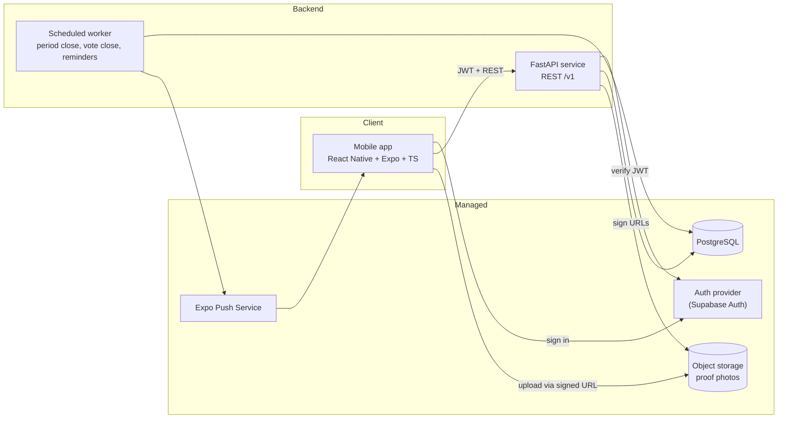

# Socius — High-Level Design

| | |
|---|---|
| **Status** | Draft v0.1 |
| **Authors** | Shreyas Vaid |
| **Last updated** | 2026-11-10 |
| **Audience** | Contributors, and future us |

> This is a living document. When implementation proves part of it wrong, update the doc in the same PR. Significant decisions get an ADR in `docs/adr/`; feature-level detail goes in a spec in `docs/specs/`.

---

## 1. Overview

Socius is a cross-platform (iOS + Android) fitness accountability app for small groups of people who already know each other: couples, families, friends, roommates. Each member has their own goal and plan, the group shares a training schedule, and every completed scheduled workout earns a point. At the end of each period (default: one week), the member with the lowest adherence takes the punishment the group agreed on: buying dinner, doing a chore, whatever the group decides.

The product bet is that **social stakes among people you live with or see every week** keep people training more reliably than streaks, badges, or anonymous leaderboards.

### 1.1 Problem

- Most fitness apps are single-player. Motivation fades and nothing happens when you skip.
- Existing social fitness apps tend to be feeds and leaderboards among loose connections, or money-staking apps that are punitive and solitary.
- Small groups already try to hold each other accountable through group chats and ad-hoc bets. That has no structure, no fair scoring, and gets forgotten by Wednesday.

### 1.2 Prior art

Group accountability is a crowded space (e.g., Pact, Forfeit, DealUp, Repple). Socius does not claim novelty. What it focuses on is:

1. **Per-person goals and plans inside one shared group schedule**: a couple can train on the same days with different goals.
2. **Group-governed rest days**: preset weekly rest days plus democratic votes.
3. **Lightweight, non-monetary stakes**: punishments are social, stated, and unenforced.

---

## 2. Goals and non-goals

### 2.1 Goals (v0.1)

- G1. A group of 2–8 people can form a group, set a shared weekly schedule, and check in workouts.
- G2. Scoring is fair across members with different goals (adherence-based).
- G3. A loser is determined automatically at the end of each period and announced to the group.
- G4. Body and health data stay private to the individual.
- G5. Works on iOS and Android from a single codebase.
- G6. Engineering quality a reviewer can see: specs, tests, CI, typed API contract.

### 2.2 Non-goals

- N1. **No money handling.** Socius never collects, holds, or moves money. Punishments are free text.
- N2. **No enforcement of punishments.** The app announces; the group settles.
- N3. **No public social network.** No feeds, followers, or discovery. Groups are invite-only.
- N4. **Food logging is not scored** in any phase. Points come from workouts only.
- N5. **No anti-cheat in v0.1.** Check-ins are on the honor system (see §5.3).
- N6. Not a medical product. No diagnosis or treatment advice.

### 2.3 Success criteria for v0.1

- The founding test group (4–5 people) uses it for 4 consecutive weeks.
- Weekly results are computed correctly with zero manual intervention.
- CI green on `main`; scoring logic has comprehensive unit + property-based tests.

---

## 3. Users

| Persona | Example | Needs |
|---|---|---|
| Couple | Two partners, one cutting, one bulking | Same gym days, different plans, friendly rivalry |
| Roommates | 3–4 people in an apartment | Low-friction check-ins, a punishment that matters (dishes) |
| Family | Siblings in different cities | Shared schedule across time zones (see §11) |
| Solo | One user, no group | Plans and tracking without the game; supported but not the focus |

Age requirement: **18+** for v0.1 (health data + calorie targets + punishment mechanics). Revisit later.

---

## 4. Glossary

| Term | Definition |
|---|---|
| **User** | A person with an account. |
| **Profile** | A user's private body data and goal. Never visible to others. |
| **Group** | A set of 1–8 members sharing a schedule and scoring period. |
| **Owner** | The member who created the group; can edit group settings. |
| **Schedule** | The group's weekly template: which weekdays are training days, target session length, group time zone. |
| **Session** | A concrete training day on the calendar, generated from the schedule for a specific date. |
| **Rest day** | A date with no session: either preset (from the schedule) or voted (via a rest-day proposal). |
| **Check-in** | A user's claim that they completed a workout on a given date. Optionally carries proof photos. |
| **Period** | The scoring window (default 7 days) in the group's time zone. |
| **Adherence** | `completed sessions / scheduled sessions` for a member in a period. |
| **Skip token** | A personal excused absence that removes one session from a member's denominator. |
| **Punishment** | Free text the loser of a period is expected to do. |
| **Plan** | A per-user workout plan fitted to the group schedule and the user's goal (v0.4). |

---

## 5. Product requirements

Requirements are labeled `FR-x` and referenced from specs and tests.

### 5.1 Accounts and profiles (v0.1)

- FR-1. Sign up and sign in via the managed auth provider (email + Sign in with Apple; Google later).
- FR-2. Onboarding collects the profile fields in §8.1 that v0.1 actually uses. Everything else is deferred.
- FR-3. Users can edit their profile and goal at any time.
- FR-4. Users can delete their account and all associated data from inside the app (App Store requirement).

### 5.2 Groups (v0.1)

- FR-5. A user can create a group: name, schedule (§6), period length (default 7 days), punishment text, time zone.
- FR-6. The owner can invite members via a shareable invite code/link. Codes expire and can be revoked.
- FR-7. Max 8 members per group in v0.1.
- FR-8. Members can leave a group. The owner can remove members. Ownership can be transferred.
- FR-9. A user may belong to more than one group. *(Open question Q1; the data model supports it either way.)*

### 5.3 Check-ins (v0.1)

- FR-10. On a session date, a member can check in once for that date.
- FR-11. Check-in window: from 00:00 on the session date until **12:00 the following day**, group time zone (grace for late-night workouts and forgetting).
- FR-12. A check-in may include up to 3 optional proof photos, visible to group members.
- FR-13. A member can undo their own check-in until the window closes.
- FR-14. **Honor system.** No verification in v0.1. *(Planned: a member can "challenge" a check-in without photos; resolution TBD; see Q6.)*
- FR-15. A check-in counts for every group the user belongs to that has a session that date (if multi-group is allowed).

### 5.4 Rest days and skip tokens (v0.1)

See §7.

### 5.5 Scoring and results (v0.1)

See §6.3.

### 5.6 Notifications (v0.1)

- FR-16. Reminder on session days if not checked in by a configurable time (default 19:00 local).
- FR-17. A rest-day proposal was created → notify all members to vote.
- FR-18. Vote deadline approaching and you haven't voted → reminder.
- FR-19. Period closed → results and loser announced to the group.
- FR-20. Users can mute each category.

### 5.7 Calorie targets and food logging (v0.2–v0.3)

See §8. Not scored, ever (N4).

---

## 6. Schedule and scoring

### 6.1 Schedule

- The group schedule is a set of training weekdays (e.g., Mon–Fri) and a target session length (minutes).
- Non-training weekdays are **preset rest days**.
- Changing the schedule takes effect at the **start of the next period**, never mid-period.
- **Schedule advisor (v0.2):** when the schedule is set, Socius checks each member's goal against the group's days × minutes and suggests changes (e.g., "Body recomposition with 5 × 30 min is light. Consider 4 × 60 min."). Suggestions only; the group/user decides.

### 6.2 Sessions

At the start of each period, the system materializes one `Session` row per training date in that period. Rest-day votes can later flip a session to `rest_voted`.

### 6.3 Scoring rules

For member *m* in period *p*:

```
scheduled(m, p) = sessions in p with status = scheduled
                  − sessions before m joined the group
                  − sessions covered by m's skip tokens
completed(m, p) = sessions in scheduled(m, p) with a valid check-in by m
points(m, p)    = completed(m, p)
adherence(m, p) = completed / scheduled   (if scheduled = 0 → member is exempt this period)
```

- **Loser** = the member with the lowest adherence among non-exempt members.
- **Ties:** all tied members share the loss. *(Open question Q4; alternative tiebreak is fewer total points, then earliest last check-in.)*
- **Perfect week:** if every non-exempt member has adherence = 1.0, there is **no loser** that period.
- **Solo groups** compute scores but never declare a loser.
- Results are **immutable** once the period closes (after the check-in grace window of the last day ends).

Scoring lives in a pure, side-effect-free domain module so it can be exhaustively unit- and property-tested (see §13).

### 6.4 Punishment

- Free text on the group, editable by the owner, snapshotted onto each period at period start, so editing mid-week doesn't change this week's stakes.
- Displayed with the period result. No tracking of whether it was done (maybe a "done" toggle later).

---

## 7. Rest days and skip tokens

### 7.1 Preset rest days

From the schedule (§6.1). No vote needed.

### 7.2 Voted rest days

- Any member can propose making a future **session date D** a rest day.
- Voting closes at **23:59 on D−1**, group time zone. A proposal must be created before that deadline (so earliest D is tomorrow).
- **Passes** if `yes votes > members / 2` (strict majority of *all* current members, not just voters).
  - Non-voters effectively count as "no".
  - In a 2-person group this means both must agree.
- If it passes, D's session becomes `rest_voted` for **everyone** in the group.
- One open proposal per date. A failed date can't be re-proposed.

### 7.3 Skip tokens (personal excused absence)

- Each member gets **1 skip token per period** (configurable by owner: 0–2).
- Using one removes a single session from that member's denominator only. No vote required.
- Can be used up until the check-in window for that date closes.
- Unused tokens do not carry over.

Rationale: being sick isn't a group decision; without tokens, one illness decides the week.

---

## 8. Profiles, calorie targets, and plans

### 8.1 Profile fields

| Field | Used for | Phase |
|---|---|---|
| Display name | Group UI | v0.1 |
| Goal: lose fat / build muscle / recomposition / maintain | Schedule advisor, targets, plans | v0.1 (stored), v0.2 (used) |
| Date of birth | 18+ gate; BMR | v0.1 |
| Sex used for calorie formula | BMR | v0.2 |
| Height, weight | BMR | v0.2 |
| Activity level outside workouts | TDEE multiplier | v0.2 |
| Target rate of change | Target calories | v0.2 |
| Body-fat % (optional) | Alternate BMR formula (Katch-McArdle) | v0.2 |
| Training experience | Plans | v0.4 |
| Equipment access (gym / home / none) | Plans | v0.4 |
| Injuries / limitations | Plans | v0.4 |

Rule: **only ask for a field in the phase that uses it.** Every onboarding field costs users.

### 8.2 Calorie targets (v0.2)

- BMR via **Mifflin–St Jeor**: `10·kg + 6.25·cm − 5·age + s`, where `s = +5` (male formula) or `−161` (female formula). Katch–McArdle if body-fat % is given.
- TDEE = BMR × activity multiplier (1.2 / 1.375 / 1.55 / 1.725 / 1.9).
- Target = TDEE ± adjustment derived from goal and target rate.
- **Safety guardrails (required, not optional):**
  - Cap weight-loss rate (initial default: ≤ 1% of body weight per week).
  - Enforce a calorie floor (initial default: commonly cited 1,200 / 1,500 kcal guidance). **Validate these defaults against a reputable source before shipping v0.2.**
  - Never show a target below the floor; show a neutral message instead.
  - Disclaimer: not medical advice.
- Open question Q7: how to handle users who don't want to pick a formula sex.

### 8.3 Food logging (v0.2 manual, v0.3 photo)

- v0.2: manual entry (name, calories, protein/carbs/fat), favorites, recent foods.
- v0.3: photo → backend calls a vision model → returns an **editable estimate**. The user always confirms. Estimates are shown as approximate.
- Food data is private (§9). Never scored (N4).

### 8.4 Workout plans (v0.4)

- Rule-based generator: (goal, experience, days/week, minutes/session, equipment) → weekly split + exercises + set/rep ranges.
- Rule-based on purpose: deterministic, testable, explainable. ML/LLM is a possible later enhancement, not the foundation.

---

## 9. Privacy and visibility

| Data | Owner | Group members | Socius developers |
|---|---|---|---|
| Height, weight, age, sex, body-fat % | ✅ | ❌ | Encrypted at rest; no casual access |
| Goal | ✅ | ❌ *(Q5: allow opt-in sharing?)* | — |
| Calorie targets, food logs, food photos | ✅ | ❌ | — |
| Display name | ✅ | ✅ | — |
| Check-ins (date, time) | ✅ | ✅ | — |
| Proof photos | ✅ | ✅ | — |
| Points, adherence, period results | ✅ | ✅ | — |
| Rest-day proposals and votes | ✅ | ✅ (votes are not anonymous; Q8) | — |
| Skip-token usage | ✅ | ✅ (that one was used, not why) | — |

Enforcement: authorization checks live in the API layer and are covered by tests. Every endpoint touching profile/food data asserts `resource.user_id == caller`. Photos are served via short-lived signed URLs scoped to the caller's group membership.

Retention: proof photos deleted after 30 days (Q9). Account deletion hard-deletes profile, food, and photos; check-ins are anonymized so historical group results stay consistent.

---

## 10. Architecture



Key properties:

- **The mobile app only talks to the FastAPI service** (plus auth and signed-URL uploads). It never queries the database directly. All business rules live in one place.
- **Typed contract:** FastAPI emits an OpenAPI schema → `packages/api-client` generates TypeScript types and a client. CI fails if the generated client is stale.
- **Domain core is pure Python** (scoring, vote resolution, period math, calorie math), with no I/O, so it's trivially testable. API and jobs are thin layers around it.
- **Time:** all timestamps stored in UTC; all period/day boundaries computed in the group's IANA time zone.

### 10.1 Tech stack

| Layer | Choice | Main alternative | Rationale |
|---|---|---|---|
| Mobile | React Native + Expo (TypeScript), Expo Router | Swift/SwiftUI | Cross-platform is a hard requirement; one codebase |
| Client server-state | TanStack Query | Redux | Mostly server state; caching/refetch with little boilerplate |
| API | Python, FastAPI, Pydantic v2 | Node/TS | Gives the backend real weight; auto OpenAPI |
| ORM / migrations | SQLAlchemy 2.x + Alembic | raw SQL | Typed models, versioned migrations |
| Database | PostgreSQL | Firestore | Relational data: groups, members, sessions, votes |
| Auth | Supabase Auth (JWT verified in FastAPI) | Clerk / roll our own | Rolling our own is a time sink and a security risk |
| Storage | Supabase Storage or Cloudflare R2 (S3 API) | DB blobs | Cheap, standard, signed URLs |
| Jobs | Cron-triggered worker, idempotent | Celery/queue | Simplest thing that works at this scale |
| Push | Expo Push Notifications | FCM/APNs direct | One API, both platforms |
| Hosting | Fly.io / Render / Railway (API); managed Postgres | AWS | Least ops; check current free tiers |
| Python tooling | uv, ruff, pyright/mypy, pytest, Hypothesis | pip/poetry | Fast, modern, strict |
| JS tooling | pnpm workspaces, ESLint, Prettier, tsc, Jest + RNTL | npm/yarn | Workspaces for the monorepo |
| E2E | Maestro (later) | Detox | Far simpler setup |
| CI | GitHub Actions | — | Lint, types, tests, client-staleness check on every PR |
| Builds | Expo cloud builds (EAS) → TestFlight / APK | local Xcode only | Reproducible builds |

Each row with a non-obvious choice gets an ADR (§16).

---

## 11. Time zones

- Each group has one IANA time zone, set by the owner at creation (default: owner's device zone).
- Session dates, check-in windows, vote deadlines, and period boundaries are all computed in the **group** time zone.
- Members in other zones see times converted to local, with the group zone labeled.
- DST: use timezone-aware arithmetic (`zoneinfo`); property tests cover DST transitions.

---

## 12. Data model (initial)

```
users              id, auth_provider_id, display_name, created_at, deleted_at
profiles           user_id (PK/FK), dob, goal, formula_sex, height_cm, weight_kg,
                   activity_level, target_rate, body_fat_pct          -- private
groups             id, name, owner_id, timezone, period_days, skip_tokens_per_period,
                   punishment_text, created_at
group_schedules    id, group_id, training_weekdays (int[]), session_minutes,
                   effective_from_period_id
group_members      group_id, user_id, role (owner|member), joined_at, left_at
invites            id, group_id, code, created_by, expires_at, revoked_at
periods            id, group_id, starts_at, ends_at, status (open|closing|closed),
                   punishment_snapshot
sessions           id, group_id, period_id, date, status (scheduled|rest_preset|rest_voted)
check_ins          id, user_id, date, created_at, note                -- per user per date
check_in_photos    id, check_in_id, storage_key, created_at
skip_token_uses    id, user_id, group_id, period_id, date
rest_proposals     id, group_id, date, proposed_by, closes_at, status (open|passed|failed)
rest_votes         proposal_id, user_id, vote (yes|no), created_at
period_results     period_id, user_id, scheduled, completed, adherence, is_exempt, is_loser
push_tokens        id, user_id, token, platform, created_at
notification_prefs user_id, category, enabled
-- v0.2+
calorie_targets    user_id, effective_from, kcal, protein_g, carbs_g, fat_g
food_entries       id, user_id, eaten_at, name, kcal, protein_g, carbs_g, fat_g, source (manual|photo)
```

Notes:

- `check_ins` is keyed by **user + date, not group**. That's what lets one workout count in every group (FR-15) without duplicate rows.
- Uniqueness: `(user_id, date)` on check-ins; `(group_id, date)` on sessions and open proposals; `(proposal_id, user_id)` on votes.
- `period_results` is written once at period close; it is the source of truth for history.

---

## 13. API sketch (`/v1`)

```
GET    /me                                  PATCH /me
GET    /me/profile                          PUT   /me/profile
DELETE /me                                  (account deletion)

POST   /groups                              GET   /groups
GET    /groups/{id}                         PATCH /groups/{id}
POST   /groups/{id}/invites                 POST  /invites/{code}/accept
DELETE /groups/{id}/members/{userId}

GET    /groups/{id}/schedule                PUT   /groups/{id}/schedule   (applies next period)
GET    /groups/{id}/periods/current         GET   /groups/{id}/periods/{pid}/results

POST   /check-ins                {date}     DELETE /check-ins/{id}
POST   /check-ins/{id}/photos    → signed upload URL
GET    /groups/{id}/feed          (check-ins + results for the group)

POST   /groups/{id}/rest-proposals {date}
POST   /rest-proposals/{id}/votes  {vote}

POST   /groups/{id}/skip-tokens    {date}

POST   /push-tokens                         PUT /me/notification-prefs
```

Errors follow RFC 9457 (problem+json). Times in ISO 8601 with offsets; dates as `YYYY-MM-DD` in group zone.

---

## 14. Background jobs

All jobs are **idempotent** and safe to run more often than needed.

| Job | Cadence | Does |
|---|---|---|
| `close_votes` | every 5 min | Resolve proposals past `closes_at`; flip sessions; notify |
| `close_periods` | every 15 min | For periods whose final grace window has ended: compute results with the domain scorer, write `period_results`, open the next period, materialize its sessions, notify |
| `send_reminders` | every 15 min | Check-in and vote reminders per user prefs and local time |
| `purge_photos` | daily | Enforce photo retention |

---

## 15. Quality strategy

### 15.1 Testing

| Layer | Tooling | Focus |
|---|---|---|
| Domain (Python) | pytest + **Hypothesis** | Scoring, ties, joins mid-period, skip tokens, vote resolution, DST and time-zone edges. Target: near-100% branch coverage |
| API (Python) | pytest + httpx + real Postgres (CI service container) | AuthZ (privacy table §9 as tests), validation, idempotency |
| Mobile | Jest + React Native Testing Library | Screens, hooks, form validation |
| Contract | CI check | Generated TS client matches current OpenAPI |
| E2E (later) | Maestro | Onboarding → create group → check in → see result |

### 15.2 CI (GitHub Actions, every PR)

- Python: `ruff check`, `ruff format --check`, type check, `pytest`.
- JS: `eslint`, `prettier --check`, `tsc --noEmit`, `jest`.
- OpenAPI client freshness check.
- `main` is protected: PR + green CI required.

### 15.3 Environments

- `local`: Docker Compose Postgres + API; Expo dev client.
- `staging`: deployed on merge to `main`; TestFlight/internal builds point here.
- `prod`: once there are real users beyond the test group.

Secrets via host secret managers; never committed. `.env.example` documents required variables.

---

## 16. Architecture Decision Records (planned)

| ADR | Decision | Status |
|---|---|---|
| 0001 | Use lightweight spec-driven development (design doc → specs → ADRs) | Accepted |
| 0002 | React Native + Expo over native Swift | Accepted |
| 0003 | FastAPI backend instead of BaaS-only (mobile never hits DB directly) | Accepted |
| 0004 | Supabase for Auth/Postgres/Storage hosting vs alternatives | Proposed |
| 0005 | Monorepo with pnpm + uv; OpenAPI-generated TS client | Accepted |
| 0006 | Adherence-based, workout-only scoring; honor system | Accepted |

---

## 17. Repository layout

```
socius/
├── apps/
│   └── mobile/                 # Expo app (TypeScript)
├── services/
│   └── api/                    # FastAPI service
│       ├── src/socius_api/
│       │   ├── domain/         # pure logic: scoring, votes, periods, calories
│       │   ├── api/            # routers, schemas
│       │   ├── db/             # models, repositories, migrations
│       │   └── jobs/
│       └── tests/
├── packages/
│   └── api-client/             # generated TS client + types
├── docs/
│   ├── design.md               # this file
│   ├── adr/
│   └── specs/
├── .github/workflows/
├── CLAUDE.md
├── README.md
└── LICENSE
```

---

## 18. Roadmap

| Phase | Scope | Exit criteria |
|---|---|---|
| **0: Foundation** | Design doc, ADRs, monorepo scaffold, CI, local dev env, auth wired end-to-end | "Hello authenticated user" on a real iPhone via dev build; CI green |
| **v0.1: The game** | Profiles (min), groups, invites, schedule, sessions, check-ins (+ optional photos), skip tokens, rest-day votes, scoring, results, push | Test group uses it for 4 weeks |
| **v0.2: Targets** | Full profile, calorie/macro targets with guardrails, manual food logging, schedule advisor | Targets validated against reference calculators |
| **v0.3: Photo logging** | Photo → editable macro estimate via vision model | Estimates always user-confirmed |
| **v0.4: Plans** | Rule-based per-user workout plans fitted to the group schedule | Plans generated for every goal × schedule combination in tests |
| **Later** | Check-in challenges, Apple Health / Health Connect import, widgets, Android parity polish | — |

---

## 19. Risks

| Risk | Impact | Mitigation |
|---|---|---|
| Scope creep: three products in one | Never ships | Strict phase gates; v0.1 is the game only |
| Retention: novelty wears off | Test group stops | Ship v0.1 fast; measure weekly; iterate on the loop before features |
| Health harm from calorie features | User harm; App Store rejection | Guardrails in §8.2 are required; food never scored |
| Privacy leak of body data | Trust destroyed | Privacy table enforced by tests; minimal data collection |
| Time-zone/DST bugs in scoring | Wrong loser; arguments | Pure domain module + property tests |
| Photo estimate inaccuracy | Users mistrust | Always editable; labeled as estimate |
| Two-person team coordination | Merge pain | PRs, CI, specs before code, clear ownership |

---

## 20. Open questions

| # | Question | Current lean |
|---|---|---|
| Q1 | Can a user be in multiple groups? | Yes; data model supports it (§12). UI may limit to 1 in v0.1 |
| Q2 | Can members of one group be in different time zones? | Yes; group zone governs (§11) |
| Q3 | Who can edit the punishment, owner only or any member? | Owner only in v0.1 |
| Q4 | Tie for last place | Everyone tied shares the loss |
| Q5 | Can a user opt in to sharing their goal with the group? | Yes, opt-in, v0.2 |
| Q6 | Check-in challenges: mechanics and resolution | Defer to after v0.1 |
| Q7 | Calorie formula for users who don't select a formula sex | Average of both formulas, clearly labeled |
| Q8 | Are rest-day votes anonymous? | Not anonymous (it's a small trusted group) |
| Q9 | Proof photo retention period | 30 days |
| Q10 | Ownership split between the two contributors | TBD |
