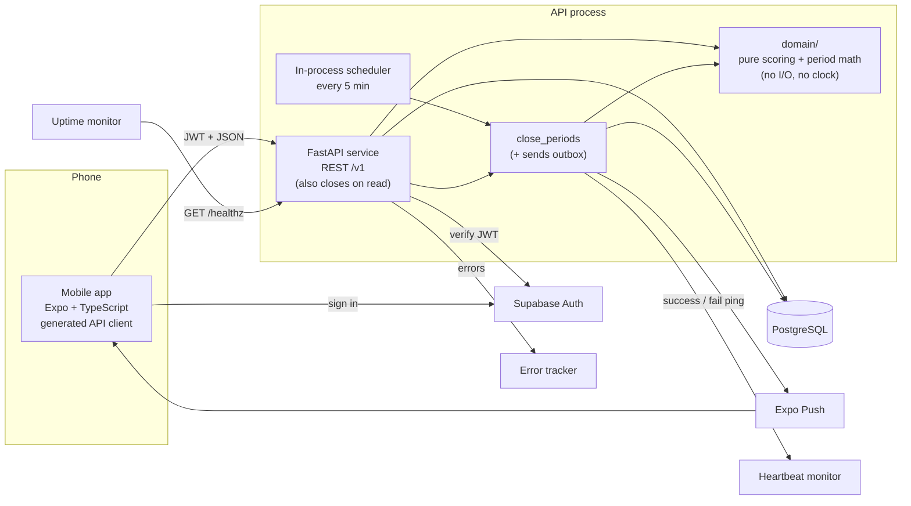

# Socius Game Engine and Engineering Foundation

*   **Author:** Shreyas Vaid
*   **Status:** Accepted (revised 2026-11-11 by [ADR-0011](../adr/0011-group-periods.md))
*   **Date:** 2026-11-11
*   **Review:** the first version (fixed weeks, a global Monday cutoff) was reviewed by fresh-context reviewers for scope, comprehension, design, cross-document consistency and technical viability. This revision replaces its time model with group periods and drops skip tokens; the close, testing and tooling designs carry over. The revision was then reviewed again by a fresh-context reviewer for errors, consistency and logic holes, and its findings resolved (2026-11-11). A dedicated implementation-readiness review of the plan has not been run.

--------------------------------------------------------------------------------

## Overview

Socius is an iOS and Android app for small groups who already know each other: couples, roommates, friends, families. The group's admin sets a period (a whole number of days, such as a week or a month) and a target N. Each member checks in whenever they work out. When the period ends, the member with the fewest check-ins does the punishment the group agreed on. No money is involved, and everything is on the honor system.

This document designs two things:

1.  **The game engine:**
    *   how check-ins are recorded
    *   how each group's periods are defined and scored
    *   how the loser is chosen
    *   how periods are closed on time without manual work
    *   how admin excusals fit into scoring
2.  **The engineering foundation that protects it:** build tooling, the API contract between app and server, and a testing approach aimed at the code most likely to produce a wrong result: scoring, period boundaries and the close.

This design is the single source of the game rules. The [product requirements](../product-requirements.md) and the [high-level design](../high-level-design.md) summarize the game and link here instead of restating the rules.

--------------------------------------------------------------------------------

## The Problem

**For users:** groups already hold each other to account with group chats and informal bets. That fails in predictable ways:

*   Nobody keeps an accurate count.
*   The rules get argued over at the end of the week.
*   The bet is forgotten by Wednesday.

Socius only helps if the result is something the group trusts without checking it. The rules must be simple enough to explain in one sentence: *check in N times before the deadline, or risk being the one who does the punishment*. The result must arrive without anyone having to do anything.

**For the system:** the arithmetic is trivial. The hard parts are around it:

*   **One deadline per group.** Members can live in different time zones, but a group has one deadline, in the group's time zone. Period lengths vary by group and can change between periods.
*   **One check-in, many groups.** A member in several groups checks in once, and that check-in must count in each group's open period.
*   **Closing on time.** Every group's period must close at its deadline. If closing runs twice, or crashes halfway, it must produce the same result. A check-in arriving at the last second must never change a result that has already been announced.
*   **Random tie-breaks.** When several members tie for last, the server picks one at random. A retry must never pick a different person.

A mistake in any of these produces a wrong loser. In a small group of friends, one wrong loser is enough for people to stop trusting the app.

### Proposed solution (summary)

*   **Check-ins.** A check-in is a single record of the moment the server received it. It is stored once, never copied per group, and counts in every group whose period is open at that moment.
*   **Periods.** Each group has a stored time zone. Each period is a stored row with a start, an end (midnight in the group's zone), N and the punishment, so lengths and settings can change between periods without touching history.
*   **Scoring.** A pure function (`score_period`) computes each period's scores from the check-ins, the members and the excusals, with no database or clock access.
*   **Closing.** Two triggers run the same close: a scheduled job, and the first read of a period's results after its end. Closing can safely be rerun, and it saves the result, including the tie-break pick, in one transaction, then opens the next period.
*   **Foundation.** pnpm + uv + a root `justfile` for tooling. An OpenAPI-generated TypeScript client for the app. Tests built on written invariants, checked by property-based tests where the rule is a pure function and by API and concurrency tests against a real Postgres database where it isn't.

--------------------------------------------------------------------------------

## Goals

*   **G1. Correct results with no manual work.**
    *   Every group's period ends in exactly one stored result, whether or not there is a loser.
    *   The scheduled job writes the result within 15 minutes of the period's end. If the job didn't run, the first read of that period after its end writes it.
    *   Over a trial with the test group (the first group of 4–5 people to use the app) of at least four closed 7-day periods, no result is changed or computed by hand. A non-zero late-write mismatch count (see "Close protection") during the trial counts as a failure of this goal.
    *   The trial also needs groups and invites, which spec 0001 (groups and invites) covers, not this design.
*   **G2. Rerunning gives the same answer.** Running the close any number of times, including two copies at once, produces the same stored result and the same loser. Tests check this against a real Postgres database.
*   **G3. The rules are written down and tested.** Every scoring rule is stated as an invariant in this document, and each invariant has a named test. Rules that are pure functions get property-based tests; rules that depend on the database get API or concurrency tests. The Testing approach section says which is which.
*   **G4. One check-in counts everywhere.** A member in several groups checks in once. That check-in adds a point in every group whose period is open, with no duplicate records.
*   **G5. One command for each task.** `just dev`, `just test`, `just lint` and `just gen-client` work from a fresh clone after following the README. CI runs the same commands.
*   **G6. CI detects drift between the app and the API.** The TypeScript client is generated from the API's OpenAPI schema. CI fails if the committed client is out of date, or if sampled API responses don't match the schema.
*   **G7. A missed close is noticed.** If any period has no result 60 minutes after its end, an alert fires. Every close run leaves a record of what it did.

--------------------------------------------------------------------------------

## Non-Goals

*   **Per-day rules.** There is no "one check-in per day" limit and no idea of which day a check-in belongs to. Two check-ins on one day are two points.
*   **Detecting cheating.** The server does not verify that a workout happened. Everything is on the honor system.
*   **Members' own time zones.** Members can live anywhere, but only the group's deadline matters. The app shows the deadline in each member's local time so nobody has to convert.
*   **Skip tokens, rest-day votes and member opt-outs.** Only check-ins count. An admin excusal covers absences.
*   **Members leaving on their own.** Only the admin can remove a member.
*   **The suspense animation, and draws members can verify.** Deferred. The server saves the tie-break candidates and the pick, so retries and history are consistent, but members can't check the draw themselves.
*   **Closing a period early** once its result can't change. See Future Improvements.
*   **Calendar-month periods.** Periods are a whole number of days; a "month" is 28, 30 or 31 days as the admin chooses.
*   **Money and enforcement.** The app never handles money. It does not check whether punishments were done.
*   **Bazel, Nx or Turborepo.** Not adopted at the current repo size. The tooling ADR records when to revisit this.
*   **Product areas outside the game engine.** Profiles, proof photos, notifications beyond the results, calorie targets, food logging and workout plans stay in the PRD. Each gets its own spec.

--------------------------------------------------------------------------------

## Decided Rules

These are the game rules in force. Every other section refers here instead of restating them. Items marked **[default]** were chosen by the assistant and are listed in CLAUDE.md as unconfirmed until the author confirms them.

| Topic | Rule |
|---|---|
| **Group time zone** | <ul><li>Each group stores one IANA time zone, set from the creator's phone when the group is created.</li><li>All of the group's deadlines are midnight in this zone. Members' own zones don't matter.</li><li>Changing it is an admin setting that takes effect from the next period, so an admin who travels doesn't move the current deadline.</li></ul> |
| **Period** | <ul><li>A whole number of days, from 1 to 365, set by the admin.</li><li>A period starts at the start of a day in the group's zone (local midnight, or the first instant of the day where daylight saving skips midnight) and ends at the start of the day after its last day. The next period starts the moment the previous one ends.</li><li>After a time-zone change, the next period starts where the previous one ended and ends at the start of a day in the new zone, so that one period is a few hours shorter or longer than its set length.</li><li>The admin adds the members, sets the group's settings and then taps **Start**. The first period begins at the next start of a day in the group's zone, and everyone who joined before then plays it. Until then the group is set up but not playing.</li></ul> |
| **Target** | The admin sets one target N, from 1 to 100. It is the same for every member. |
| **Check-ins** | <ul><li>A check-in counts in every group the member belongs to whose current period is open at the moment the server records it (`recorded_at`).</li><li>No per-day limit: each check-in is one point.</li><li>A check-in that reaches the server after a period ended counts in the next period, not the ended one, even if the workout happened earlier (for example offline). Honor system throughout.</li></ul> |
| **Points** | `points = min(N, counted check-ins in the period)`. Only check-ins made while the member belonged to the group count: after `joined_at` and, for a removed member, before `removed_at`. |
| **Undo** | <ul><li>A member can undo any of their own check-ins as long as every period it counts in is still open. Once the earliest of those deadlines passes, it can't be undone in any group; per-group undo is a possible future improvement.</li><li>Undo hides the row instead of deleting it, so a delayed retry can't bring it back.</li></ul> |
| **Excusal** | <ul><li>Only the admin can excuse a member for a period, including themselves, for any reason, any time before the period ends.</li><li>An excused member can't lose that period.</li><li>The reason is never stored. The group sees who was excused and by whom.</li><li>An excusal can be revoked before the period ends.</li><li>Excusals apply to the current period only; one can't be entered ahead for a future period.</li></ul> |
| **Roles** | <ul><li>Two roles, `admin` and `member`. Each group has exactly one admin, starting with the creator.</li><li>The admin can hand the role to another active member; spec 0001 defines how.</li></ul> |
| **Membership** | <ul><li>Members can't leave on their own; only the admin can remove a member.</li><li>A member removed during a period is excused for it, so they can't lose it; their points up to the removal still show. They can still read that period's result and get its results notification **[default]**.</li><li>Re-adding a member in the same period restores their earlier state.</li><li>Deleting an account, which the App Store requires apps to allow, counts as removal from every group, so the deleted member is excused in each current period, like any removed member. Their check-ins keep their `user_id`, so closed results never change; the `users` row is anonymized instead.</li></ul> |
| **Group size** | At most 8 active members per group, enforced when a member joins (spec 0001). A period's member set can be larger if members were removed and replaced during it. |
| **Joining** | A member who joins after a period has started can't lose that period. Their check-ins after joining still show as points. |
| **Settings changes** | Changes to N, period length, time zone or punishment text take effect from the next period. The current period never changes. |
| **Idle groups** | A group with nobody checking in still closes each period, and with everyone at 0 one member loses at random. Accepted for v0.1; pausing a group is a future improvement. |
| **Loser** | See "Eligibility and the loser rule". |

**Still open:**

*   **Deleted accounts in past results.** The label shown for an anonymized member in history (likely "Deleted member"). The account-deletion spec decides; it is part of v0.1 (PRD FR-4).
*   **The admin deletes their account.** Who becomes admin? Spec 0001 decides.

--------------------------------------------------------------------------------

## Critical User Journeys (CUJs)

### CUJ 1: One workout counts in two groups with different deadlines

*   **Given**:
    *   Alex is in group A (zone America/Chicago, 7-day periods, N = 4) and group B (zone Europe/London, 14-day periods, N = 6).
    *   It's January (Chicago is on standard time, UTC−6). Group A's current period ends Monday 00:00 Chicago time. Group B's ends a week later.
    *   Alex lives in Tokyo (UTC+9).
*   **When**: Alex checks in at 14:00 Monday Tokyo time, which is 23:00 Sunday Chicago time.
*   **Then**:
    *   One check-in is stored.
    *   It counts in group A's current period (still open in Chicago) and in group B's current period.
    *   An hour later, group A's period ends; the same check-in stays counted there, and the app shows group A's next deadline in Tokyo time.

### CUJ 2: A period closes with a tie at the bottom

*   **Given**:
    *   Group C has four eligible members and N = 5.
    *   When the period ends, their points are 5, 3, 2 and 2.
*   **When**: the scheduled close runs a few minutes after the end.
*   **Then**:
    *   Each member's points are recorded. The two members on 2 are the tied candidates.
    *   The server picks one of them at random. The candidates and the loser are saved in the same transaction as the scores, and the next period is opened.
    *   Running the close again changes nothing.
    *   Each member gets a notification. It says results are ready but doesn't name the loser.
    *   The results screen shows everyone's points, the loser, a "decided by tie-break" label and the punishment text saved for that period.

### CUJ 3: An excused member and a new joiner cannot lose

*   **Given**:
    *   Group D has members P, Q and R, and N = 3.
    *   During the period, the admin excused R because R is sick.
    *   S joined the group partway through the period.
*   **When**: the period closes with P on 3, Q on 1, R on 0 and S on 2.
*   **Then**:
    *   Only P and Q are eligible. Q loses with 1 point.
    *   R and S are shown with their points and marked "excused" and "joined mid-period". Neither is a candidate.
    *   If Q had also been excused, only P would be eligible. Fewer than two eligible members means no loser.

### CUJ 4: Two check-ins in one day

*   **Given**: group E has N = 4, and Jordan has 2 points.
*   **When**: Jordan checks in after a morning run and again after an evening gym session.
*   **Then**: Jordan has 4 points, which reaches N. A fifth check-in is stored but Jordan's points stay at 4.

### CUJ 5: Results appear even when the scheduler didn't run

*   **Given**: the API process was asleep when group F's period ended, so the scheduled close never ran.
*   **When**: a member of group F opens the ended period's results two hours later.
*   **Then**:
    *   The API closes that period inline before responding, using the same close function as the scheduler, and opens the next period.
    *   The member sees the final result.
    *   No scheduled run sent a success ping while the process was asleep, so the heartbeat monitor had already alerted (G7).

--------------------------------------------------------------------------------

## Technical Plan (Architecture)

### Components



*   **Mobile app.** Sends check-ins and admin actions, and shows live and final scores and each group's deadline in the member's local time. It talks only to the API and to Supabase Auth, never to the database. It does no period math: the API returns each period's start and end.
*   **API.** Validates every request, checks permissions, and stores facts: check-ins, excusals, settings changes. It computes *live* scores by calling the same pure scoring function the close uses. A request for a period that has ended but isn't closed triggers the close inline.
*   **`domain/` module.** Pure Python functions with no database, network or clock access: `score_period`, eligibility, period boundaries and the loser rule. Everything that decides who loses lives here, so it can be property-tested on its own.
*   **`close_periods`.** After each period's end, it computes and saves the result, opens the next period, then sends any unsent notifications. It is safe to run any number of times. It is started by the in-process scheduler, and also called for a single period by the API's close on read.
*   **Monitoring.**
    *   An uptime monitor requests `GET /healthz` every 5 minutes, which keeps the process awake on free hosting.
    *   A heartbeat monitor gets a success ping only when a run had no failures and no period is overdue. Otherwise it gets a failure signal.
    *   Errors go to an error tracker.

### Core idea: store facts, compute scores

The database stores facts that members or the admin created (check-ins, excusals, settings changes, memberships) and one row per period with its boundaries and settings. Scores are never stored while a period is open. They are computed from the facts each time they're needed: for the live leaderboard, and once more at close. The close result is then frozen on the period row.

This removes two sources of bugs:

*   there are no per-group copies of a check-in to keep in sync
*   there is no counter that can drift

The cost is that every leaderboard view recomputes scores. A group has at most 8 members, and points stop mattering at N (at most 100), so this is a few hundred rows per request at the very most.

### Time model

*   **Group time zone.** Each group's settings hold one IANA zone. Period boundaries are the start of a local day in that zone, computed with `zoneinfo`, so daylight-saving changes are handled: a 7-day period that crosses a DST change is 167 or 169 hours long. In zones where DST skips midnight (for example America/Santiago or Asia/Beirut), the boundary is the first instant of the day, 01:00 local.
*   **Periods.**
    *   The first period starts at the next start of a day after the admin taps Start.
    *   Each period ends at the start of the day after its last day: `ends_at = day_start(local_date(starts_at) + period_days)` in the period's zone.
    *   The next period starts exactly at the previous `ends_at`, so periods never overlap and never leave a gap. If the zone changes between periods, the new period's end is computed in the new zone from the same start instant.
*   **Which period a check-in is in.** A check-in counts in a group's period if `starts_at ≤ recorded_at < ends_at` and the member belonged to the group at `recorded_at`. `recorded_at` is the server's time, set immediately before the check-in commits, so the commit happens at most one transaction timeout (30 seconds) after it.
*   **Members' zones.** Not stored or used for scoring. The app shows every time (deadlines and check-in times) converted to the member's local time.
*   **The closing window.** Between a period's end and 5 minutes after it, the period is `closing`: writes for it are rejected, the close hasn't run yet, and reads return live scores with `status: closing` and no candidates.
*   **Clock injection.** All code that needs the current time takes it from a `Clock` object passed in. Business logic never calls `datetime.now()` or uses Postgres `now()` or `DEFAULT now()`. The same fake clock is injected into both the API and the close in tests.
*   **Clock skew.** Hosts use NTP. A few seconds of skew between processes is absorbed by the 5-minute close delay.

### Eligibility and the loser rule

**Member set for period P.** A membership is in P if it joined before P ended (`joined_at < ends_at`) and either hasn't been removed or was removed after P started (`removed_at ≥ starts_at`). Re-adding a member in the same period reuses their earlier membership row, so `joined_at` doesn't change.

Each member in the set is in exactly one state:

| State | Condition | Can lose? |
|---|---|---|
| `joined_mid_period` | `joined_at > starts_at` | no |
| `excused` | an active excusal exists for P, or they were removed during P (`removed_at < ends_at`, which includes deleting their account), and they didn't join mid-period | no |
| `eligible` | everyone else | yes |

Joining mid-period takes precedence over an excusal. Both mean "can't lose", so the order only affects the label shown.

**Points:** active check-ins with `starts_at ≤ recorded_at < ends_at`, made while the member belonged to the group (`recorded_at ≥ joined_at`, and `recorded_at < removed_at` if removed), up to N.

**Loser rule** (pure function, applied to eligible members only):

1.  If fewer than 2 members are eligible, there is no loser.
2.  If every eligible member has `points = N`, there is no loser.
3.  Otherwise the candidates are the eligible members with the lowest points. With one candidate, that member loses. With several, the server picks one at random with `secrets.choice` over the candidates, sorted by user ID.

**Storage and retries.**

*   The candidates and the loser are saved in the same transaction as the scores.
*   A saved result is never recomputed, so a retry can never pick a different loser.
*   No seed is stored, because nothing replays the draw. A future draw that members can verify would need one (see Future Improvements).

### Data model (game engine only)

```text
groups                id, name, started_at, created_by, created_at
                      PK (id)                -- started_at: when the admin tapped Start
group_settings        group_id, target_n (1..100), period_days (1..365), tz_name,
                      punishment_text, updated_by, updated_at
                      PK (group_id)          -- settings for the next period
periods               id, group_id, seq, starts_at, ends_at, tz_name,
                      period_days, target_n, punishment_text,
                      closed_at, has_loser, loser_user_id,
                      tiebreak_candidates (uuid[], empty if no tie),
                      scoring_version
                      PK (id); UNIQUE (group_id, seq); UNIQUE (group_id, starts_at)
period_member_results period_id, user_id, state, counted_check_ins, points, is_loser
                      PK (period_id, user_id)
memberships           id, group_id, user_id, role (admin|member),
                      joined_at, removed_at
                      PK (id); UNIQUE (group_id, user_id) WHERE removed_at IS NULL;
                      UNIQUE (group_id) WHERE role = 'admin' AND removed_at IS NULL
check_ins             id, user_id, recorded_at, removed_at, client_request_id (uuid)
                      PK (id); UNIQUE (client_request_id)
excusals              id, period_id, user_id, excused_by, recorded_at, removed_at
                      PK (id); UNIQUE (period_id, user_id) WHERE removed_at IS NULL
push_tokens           id, user_id, token, platform, tz_name, recorded_at
                      PK (id); UNIQUE (token)
notification_outbox   id, user_id, kind, payload (jsonb), created_at, claimed_at,
                      sent_at, expo_ticket_id, receipt_checked_at
job_runs              id, started_at, finished_at, periods_closed,
                      groups_failed, overdue, mismatches, error
```

*   **Settings.** `group_settings` always holds the settings for the *next* period. When a period row is created, it copies them, so a change never affects a period that already exists, and history never changes.
*   **Periods.**
    *   A period row is created ahead of use by `ensure_current_period(group, now)`, which inserts any missing periods up to the one containing `now` with `INSERT … ON CONFLICT (group_id, seq) DO NOTHING`, so concurrent callers can't create duplicates.
    *   The check-in, period-read, settings-update and close paths all call it. Each group's call runs in its own short transaction, in `group_id` order, before the caller's own transaction, so two requests creating periods for overlapping groups can't deadlock.
    *   The settings update calls it first so the period that is already running exists before `group_settings` changes; otherwise a change made just after a deadline could be copied into a period that has already started.
    *   A check-in doesn't need its period row to exist yet: it is matched to periods by time.
*   **Results.** A period's result lives on its own row (`closed_at` and the result columns are null while open), plus `period_member_results`. Closing is an `UPDATE … WHERE closed_at IS NULL`, so a second close changes nothing.
*   **Check-ins.** They have no group. One row counts in every group whose period contains its `recorded_at` and that the member belonged to at that moment.
*   **Account deletion.** Check-ins and memberships keep their `user_id`; the `users` row is anonymized (name removed, `deleted_at` set). Removing rows would lower past points and break closed results.
*   **Retries.** `client_request_id` stays unique on every row, including removed ones. A retried request, even one arriving after an undo, can't create a second check-in.
*   **Timestamps.** `check_ins` and `excusals` use `recorded_at` (server time when written) and `removed_at` (set by undo or revoke) instead of deleting rows. `memberships` uses `joined_at` and `removed_at`.
*   **Partial unique indexes.** Each `UNIQUE … WHERE` above is a unique *index*, not a table constraint (SQLAlchemy: `Index(..., unique=True, postgresql_where=...)`). An `INSERT … ON CONFLICT` against one must repeat its `WHERE` predicate (SQLAlchemy: `index_where=`).
*   **`push_tokens.tz_name`.** The phone's current zone, updated when the app opens, used only to send reminders at the right local time. Private.
*   **`scoring_version`.** A label recording which rules produced a past result. Nothing recomputes old results from it.

### Request rules (API)

Every write that touches period `P` (undo, excuse, revoke) checks `clock.now() < P.ends_at` when the request starts and again immediately before commit, and rejects with `period-closed` otherwise. Each error is an RFC 9457 problem response with a stable `code` the app maps to a message.

**Every group endpoint** returns 404 `not-member` when the caller isn't an active member, so the response doesn't reveal that the group exists. One exception: a removed member can still `GET` any period whose member set includes them.

| Action | Extra rules | Error codes |
|---|---|---|
| Check in | none; it counts in every group with an open period. A retried `client_request_id` must belong to the same user | `request-conflict` |
| Undo check-in | own active check-in only; every period it counts in must still be open; sets `removed_at` | `not-found`, `period-closed` |
| Excuse member | admin only; target must be in P's member set; before P ends | `not-admin`, `target-not-member`, `period-closed` |
| Revoke excusal | admin only; an active excusal must exist; before P ends | `not-admin`, `not-found`, `period-closed` |
| Change settings (N, period length, time zone, punishment text) | admin only; N 1–100, period 1–365 days, a valid IANA zone (out-of-range values are rejected by request validation); applies from the next period | `not-admin`, `invalid-request` |
| Create group, Start, join, remove, re-add, hand over the admin role | defined in spec 0001; joining enforces the 8-member cap | `group-full`, `not-admin` |

### The close

**One function, two triggers.** `close_period(session, period_id, clock)` closes one period:

1.  It runs only if `now ≥ ends_at + 5 minutes`.
2.  It takes the blocking `pg_advisory_xact_lock` on a key derived from the period ID. If another close holds it, this one waits (bounded by the transaction timeout) rather than giving up, so a close on read never returns empty-handed. There is one lock key per period, so no deadlock is possible, and the lock is released automatically at commit or rollback.
3.  With the lock held, it checks again whether the period is closed. If it is, it returns `already_closed`.
4.  It loads the member set, excusals and check-ins, and calls `score_period`. If several members are tied, it picks the loser with `secrets.choice`.
5.  It updates the period row with the result (`… WHERE closed_at IS NULL`), inserts `period_member_results` and one `notification_outbox` row per member in the member set (including members removed during the period), calls `ensure_current_period` so the next period exists, and commits.

The two triggers:

*   **Scheduled (D2).**
    *   APScheduler inside the FastAPI process runs `close_periods` every 5 minutes.
    *   `close_periods` first calls `ensure_current_period` for every group that has started, then calls `close_period` for every period that is due (ended at least 5 minutes ago, not closed), oldest first.
    *   Then it claims up to 100 unsent outbox rows (`UPDATE … SET claimed_at = now WHERE claimed_at IS NULL OR claimed_at < now − 10 min … RETURNING`, committed before sending, so a concurrent run can't take the same rows), sends them through Expo Push (Expo's per-request limit) and marks them sent, storing each push ticket ID. The push data carries the `group_id` and period `seq` so the app can open that result. It also fetches receipts for tickets sent at least 15 minutes earlier and deletes push tokens Expo reports as `DeviceNotRegistered`.
*   **On read (D2 addition).** `GET` for a period that is due but not closed calls `close_period` before responding. Results are then correct whenever someone looks; only notification timing depends on the scheduler.

**Each scheduled run also:**

1.  Records a `job_runs` row.
2.  Catches an error in any one group, records it in `job_runs.groups_failed` and the error tracker, and continues with the other groups.
3.  **Checks for late writes** by rescoring recently closed periods (see "Close protection" below).
4.  Counts overdue periods (`now ≥ ends_at + 60 minutes` and not closed) into `job_runs.overdue`.
5.  **Heartbeat.** Sends the success ping only if `groups_failed = 0` and `overdue = 0`. Otherwise it sends the monitor's failure signal. This is what makes G7 hold.

**Delivery.** Notifications are delivered **at least once**. A crash after Expo accepts a push but before `sent_at` is written can resend it.

**Single process.** The API runs with one uvicorn worker, so there is one scheduler. More workers would each start their own; results would stay correct, but every run would be duplicated. The scheduler's first run happens at startup, so a process that just woke up closes due periods immediately.

**Keeping the API awake.** Free hosting puts idle processes to sleep, and a sleeping process runs no scheduled jobs. The uptime monitor keeps it awake, and close on read covers the gaps. Current free options (checked 2026-11-11; re-check before deploying):

*   **Render** has a free web-service tier: services sleep after 15 minutes without inbound traffic, and a workspace gets 750 instance hours a month, enough for one always-on service but not a second one such as staging. Its documentation doesn't address keep-alive pings, and warns that unusual traffic patterns on free services may lead to suspension. Render's free Postgres expires after 30 days, so the database must be hosted elsewhere (for example Supabase or Neon).
*   **Fly.io** has no free tier for new organizations; monthly bills under $5 are waived, which requires a card on file.
*   **Railway** offers a 30-day trial, then $1 of credit a month, which doesn't keep a service running all month.

The plan is Render's free tier with the uptime ping. The fallback is a small always-on machine (for example on Fly.io, likely billed under $5 and waived), which needs the author's approval because it requires a card and may cost money.

**Migrations.** Alembic runs as a separate migration role without the 30-second timeouts, so a long migration isn't cut off.

**Close protection (D1, decided: time check plus delay, with bounded transactions and rescore detection):**

*   **Rejecting late writes.** Excusals, revocations and undos for period `P` are rejected once `clock.now() ≥ P.ends_at`, checked at the start of the request and again immediately before commit.
*   **Check-ins.** A check-in's `recorded_at` is set immediately before commit, so it always lands in the period that is open at that moment.
*   **Bounding the race.** The database role the API uses has `transaction_timeout = 30s` (PostgreSQL 17 or later), `statement_timeout = 30s` and `idle_in_transaction_session_timeout = 30s`, set with `ALTER ROLE` so they apply through any connection pooler. A write whose pre-commit check passed therefore commits or is cut off within 30 seconds, well inside the 5-minute close delay. (`statement_timeout` alone limits each statement, not the transaction, which is why `transaction_timeout` is needed.) Because `idle_in_transaction_session_timeout` ends the whole connection, the pool uses `pool_pre_ping` to discard dead connections.
*   **What the close reads.** Check-ins with `starts_at ≤ recorded_at < ends_at` and excusals for the period that are active (`removed_at` is null) when the close runs.
*   **Detecting what slips through.** Each scheduled run rescores every period closed in the previous 24 hours from the current facts, using the same filter, and compares the result with the saved `period_member_results`.
    *   A difference means a write committed after the close.
    *   It is recorded in `job_runs.mismatches` and reported to the error tracker.
    *   The saved result is not changed automatically.

### Tooling and contract

*   **Repo.** A pnpm workspace with `apps/mobile` and `packages/api-client`, and a uv project at `services/api`. A root `justfile` has one recipe per task (full list in plan item 4). CI installs `just` and calls the same recipes.
*   **Contract (D3, decided).**
    *   `just gen-client` exports the OpenAPI schema from FastAPI without starting a server. It then runs `openapi-typescript` to write `packages/api-client/src/schema.d.ts`.
    *   The package exports a typed `openapi-fetch` client that attaches the Supabase JWT to every request and turns problem-detail errors into one typed error.
    *   TanStack Query hooks are written by hand in `apps/mobile/src/api/`. Wrong cache keys and missed invalidations are the main drift risk for hand-written hooks, so one key-factory module keeps them in one place.
    *   CI regenerates the client and fails if anything differs from what's committed.
    *   Separately, Schemathesis generates requests from the schema against a test instance of the API. It fails if responses, status codes or content types don't match the schema, so every route declares its error responses (one `Problem` model under `application/problem+json`).

### Testing approach

| Layer | What it proves | How |
|---|---|---|
| `domain/` scoring, eligibility, period math | The pure rules hold for all inputs | Hypothesis property tests for invariants 1–9 and the pure part of 12, plus example tests for CUJs 3 and 4 |
| API | Request rules, permissions, error codes, retries, close on read; invariants 11–13; CUJs 1 and 5 | pytest + httpx against real Postgres (Docker locally, a CI service container), fake clock; example tests (Hypothesis doesn't fit a per-test database fixture) |
| Close | Invariant 10; late writes detected; CUJ 2 | Real Postgres, fake clock, two separate database connections for the concurrency tests |
| Contract | The app client matches the API, and the API matches its schema | Client diff check + Schemathesis |
| Mobile | Screens render scores and deadlines, errors map to messages | Jest + React Native Testing Library |

The goal is not a coverage percentage. Every invariant below has a named test of the type the table gives, and every CUJ has an example test.

**Invariants:**

1.  `0 ≤ points ≤ N` for every member.
2.  Adding a check-in never lowers that member's points, and never makes them a candidate if they weren't one before.
3.  There is no loser if and only if fewer than 2 members are eligible or every eligible member has N points.
4.  The loser is always eligible, and always has the lowest points among eligible members.
5.  Adding, removing or changing the check-ins of `joined_mid_period` or `excused` members never changes who the candidates are.
6.  The same inputs give the same candidates, regardless of input order.
7.  Check-ins outside `[starts_at, ends_at)`, before a member's `joined_at`, or at or after their `removed_at`, never change that member's points.
8.  For every zone, start and length, `ends_at` is the first instant of its local day in the zone, its local date is the start's local date plus `period_days`, and `ends_at > starts_at`, including across daylight-saving changes and zones where DST skips midnight.
9.  Successive periods are contiguous: each period's `starts_at` equals the previous period's `ends_at`.
10. Running the close any number of times, through either trigger and including concurrently, leaves exactly one result per period, with the same loser.
11. A settings change never changes a period that already exists.
12. Removing a member during a period makes them `excused` for it unless they joined mid-period, and doesn't change the points they had when removed. Re-adding them in the same period restores their earlier state.
13. An undo, excusal or revocation that would change an ended period is rejected.

### Decisions in this section

*   **D1. Close vs late writes.** Decided: Option A, time check plus delay, with the 30-second transaction bound and rescore detection.
*   **D2. How closing is triggered.** Decided: Option B, a scheduler inside the API process kept awake by an uptime ping, plus close on read, so results don't depend on the scheduler.
*   **D3. TypeScript client generator.** Decided: Option A, openapi-typescript plus openapi-fetch. Query hooks are written by hand in `apps/mobile`.

#### D1 options (decided: A)

*   **Option A: time check plus a delay.**
    *   *How it works:* writes check the period's end before touching the database and again before commit. The close starts 5 minutes after the end and reads only facts recorded before it. No extra locks on writes.
    *   *Trade-offs:* simple, with no lock ordering to reason about. Check-ins never wait on the close.
    *   *When it fails:* a write that passes the pre-commit check but commits after the close read the facts isn't counted. The 30-second transaction timeout makes this practically impossible with a 5-minute delay, and rescore detection reports it if it happens anyway.
*   **Option B: a lock per period (a "seal").**
    *   *How it works:* every write that can affect a period takes a shared lock keyed on that period, then checks that it isn't sealed; the close takes the lock exclusively, then seals it.
    *   *Trade-offs:* no write can slip past the close, and the delay and the detection go away.
    *   *When it fails:* a check-in can affect one period in each of the member's groups, so it must lock several periods in a fixed order to avoid deadlocks. A bug in lock handling blocks writes for a whole group.
*   **Option C: the database refuses late rows.**
    *   *How it works:* triggers reject writes whose period is already closed.
    *   *Trade-offs:* a bug in API code can't break it.
    *   *When it fails:* a check-in has no group, so the trigger must look up every group's period on every check-in. Business rules split between Python and SQL.

#### D2 options (decided: B, plus close on read)

*   **Option A: the hosting platform's scheduled job.**
    *   *How it works:* the host starts `python -m socius_api.jobs.close_periods` as its own process every 5 minutes.
    *   *Trade-offs:* separate from web traffic. The trigger configuration depends on the host.
    *   *When it fails:* if the host's scheduler has an outage, nothing runs. Some hosts charge for scheduled jobs.
*   **Option B: a scheduler inside the API process.**
    *   *How it works:* APScheduler runs `close_periods` every 5 minutes inside the FastAPI process.
    *   *Trade-offs:* no extra service and nothing extra to configure.
    *   *When it fails:* free-tier hosts put the API to sleep when there's no traffic, and a sleeping process runs no jobs. The uptime ping and close on read cover this.
*   **Option C: an outside scheduler calls a protected endpoint.**
    *   *How it works:* an external service sends `POST /internal/jobs/close-periods` with a secret token every 5 minutes.
    *   *Trade-offs:* free, and it doesn't depend on the host.
    *   *When it fails:* GitHub documents that scheduled workflow runs can be delayed or dropped under high load, and it disables schedules after 60 days without repository activity. A long close runs inside a web request and can hit the host's request timeout.

#### D3 options (decided: A)

*   **Option A: openapi-typescript + openapi-fetch.**
    *   *How it works:* the generator writes TypeScript types only, in one generated file. A small typed `fetch` wrapper uses those types, and TanStack Query hooks are written by hand on top of it.
    *   *Trade-offs:* one generated file and few dependencies. Every request and query hook is visible in plain code.
    *   *When it fails:* every endpoint needs a hand-written hook, and those hooks can drift from the API's behavior: wrong cache keys, missed invalidation after writes.
*   **Option B: @hey-api/openapi-ts.**
    *   *How it works:* generates types plus one SDK function per endpoint. An optional plugin also generates TanStack Query options and hooks.
    *   *Trade-offs:* fewer hand-written files than A.
    *   *When it fails:* its configuration format has changed between major versions, so upgrades can mean regenerating and fixing call sites.
*   **Option C: orval.**
    *   *How it works:* generates types and ready-to-use TanStack Query hooks for every endpoint. It can also generate mock servers.
    *   *Trade-offs:* the fewest hand-written files. The mocks help mobile tests.
    *   *When it fails:* large review diffs, and customizing auth headers or error handling goes through orval's configuration instead of plain code.

--------------------------------------------------------------------------------

## Alternatives Considered

### Game rules

#### Alternative A: Adherence scoring with a separate goal per member

*   **How it works:** Each member sets their own goal. Score = completed ÷ scheduled.
*   **Pros:** Fair across different goals.
*   **Cons:** Harder to explain ("why did 3/4 lose to 4/5?"); needs per-member schedules and ratio arithmetic.
*   **Reason for Rejection:** Rejected by author: a shared target N keeps the group training toward the same thing, and makes raw points fair without a ratio. The cost is that members with different personal goals must agree on one N.

#### Alternative B: Ties at the bottom share the loss

*   **How it works:** Everyone tied for the lowest score takes the punishment.
*   **Pros:** No randomness to explain.
*   **Cons:** Two or three people doing one punishment is awkward, and a shared loss feels lighter.
*   **Reason for Rejection:** Rejected by author: one person carrying the punishment keeps the stakes real. The cost is that a tied member can lose by chance; the result screen labels tie-breaks.

#### Alternative C: No loser, or a shared punishment, when everyone scores 0

*   **How it works:** If every member scores 0, nobody loses, or everyone does the punishment.
*   **Pros:** Avoids one person taking the punishment for a shared failure.
*   **Cons:** The whole group can skip a period together with no consequence.
*   **Reason for Rejection:** Rejected by author: a group-wide skip should still cost someone. The cost is that one member is punished for a failure everyone shared.

#### Alternative D: Fixed Monday–Sunday weeks with a global cutoff and per-day dating (the first version of this design)

*   **How it works:** Each check-in is dated with the phone's local date, at most one per day. Every group's week closes at Monday 12:00 UTC, when Sunday has ended everywhere on Earth. A weekly skip token adds a free point.
*   **Pros:** Each member's days match their own calendar; no group needs a time zone.
*   **Cons:**
    *   Two weeks are open at once for about 26 hours each weekend, which complicates settings changes, joins and new groups.
    *   Results reach eastern zones late (Sydney around 23:00 Monday).
    *   Weeks only; no other period lengths.
*   **Reason for Rejection:** Rejected by author (ADR-0011): one deadline in the group's zone is easier to understand and removes the overlap logic entirely, and admins want periods other than a week. The cost is that members in other zones work to someone else's midnight, and daylight-saving changes need testing.

#### Alternative E: One check-in per day

*   **How it works:** At most one check-in per member per date.
*   **Pros:** Stops someone banking a week's points in one day.
*   **Cons:** Needs a definition of "day" for members in other zones, which is the complexity this design removes.
*   **Reason for Rejection:** Rejected by author: honor system; every check-in counts. The cost is that a member can log two workouts in one day, which the group can see.

#### Alternative F: A skip token per period

*   **How it works:** Each member gets one free point per period.
*   **Pros:** One sick day doesn't decide the period.
*   **Cons:** Another rule, table and endpoint; and with N reachable on any day, a missed day can be made up.
*   **Reason for Rejection:** Rejected by author: only check-ins count; admin excusals cover real absences. The cost is that a member who is sick for one day must make it up or ask the admin.

#### Alternative G: Trust the phone's timestamp for which period a check-in is in

*   **How it works:** The app records when the workout was logged, and the server uses that time, so a check-in made offline before the deadline still counts after it syncs.
*   **Pros:** Honest offline check-ins aren't lost.
*   **Cons:** Anyone can change their phone's clock to count a workout after the deadline.
*   **Reason for Rejection:** Rejected by author: the server's time is the one clock everyone shares. The cost is that a check-in that reaches the server after the period ends counts in the next period.

#### Alternative H: Calendar-month periods

*   **How it works:** A period runs from the 1st to the end of the month.
*   **Pros:** Matches how people talk about months.
*   **Cons:** Uneven lengths (28–31 days) and a second kind of period to compute and test.
*   **Reason for Rejection:** Rejected by author: a whole number of days covers it (30 days is "a month"). The cost is that a 30-day period drifts against calendar months.

#### Alternative I: Group-voted rest days

*   **How it works:** Any member proposes a rest day, and it passes with a strict majority.
*   **Pros:** The group can agree to lower the bar together.
*   **Cons:** A feature, background jobs and a notification type.
*   **Reason for Rejection:** Rejected by author for v0.1: excusals cover individual absences, and the admin can lower N for the next period. The cost is that the current period can't be eased mid-way.

#### Alternative J: Members can opt out or leave on their own

*   **How it works:** A member opts out of a period, or leaves the group, without asking anyone.
*   **Pros:** Members control their own participation.
*   **Cons:** Both are ways to escape losing: leaving and rejoining would make a member a mid-period joiner who can't lose.
*   **Reason for Rejection:** Rejected by author: only the admin excuses or removes members, and a re-add in the same period restores the earlier state. The cost is that a member who wants out must ask the admin, or delete their account.

#### Alternative K: Self-excusal needs another member's confirmation

*   **How it works:** An admin's excusal of themselves stays pending until another member confirms it.
*   **Pros:** Closes the last way for an admin to dodge a loss.
*   **Cons:** A pending state, a confirmation flow and an expiry, for a small group that already sees every excusal.
*   **Reason for Rejection:** Rejected by author: the group sees every excusal and who made it. The cost is that an admin can still excuse themselves just before the deadline (see Risks).

### Architecture

#### Alternative L: Store running scores per group

*   **How it works:** Each check-in increments a counter for each group the member belongs to.
*   **Pros:** Leaderboard reads are a single row lookup.
*   **Cons:** Every check-in, undo, excusal and membership change must update every affected counter correctly; a bug leaves counters wrong with no way to recompute them.
*   **Reason for Rejection:** Rejected: one pure function used by both the live leaderboard and the close gives a single definition of scoring. The cost is recomputing a few hundred rows at most per request.

#### Alternative M: Compute periods from the settings history, with no period rows

*   **How it works:** Derive every period's boundaries on the fly from the start time and the history of length and zone changes.
*   **Pros:** One less table.
*   **Cons:** Every read replays the whole settings history, and a bug in that replay silently moves past deadlines.
*   **Reason for Rejection:** Rejected: a stored row per period fixes its boundaries and settings once. The cost is creating rows ahead of use, which `ensure_current_period` does idempotently.

#### Alternative N: A replayable SHA-256 tie-break with a stored seed

*   **How it works:** Store a random seed, and pick `sha256(seed ‖ period) mod k` over sorted candidates, so the draw can be replayed.
*   **Pros:** The draw can be audited; with a seed derived from a server secret, it could support a draw members can verify.
*   **Cons:** Saved results are never recomputed, so nothing replays the draw.
*   **Reason for Rejection:** Rejected by author: `secrets.choice` plus the stored candidates and loser covers retries and history. The cost is that a verifiable draw later needs a seed column and a migration.

#### Alternative O: Other ways to protect the close (D1 options B and C)

*   **How it works:** a per-period lock ("seal") or database triggers. See "D1 options".
*   **Reason for Rejection:** Rejected by author in favor of a time check plus delay, bounded by the transaction timeout and checked by rescoring. The cost is that a slip-through is detected, not prevented.

#### Alternative P: Other ways to trigger the close (D2 options A and C)

*   **How it works:** the host's scheduled job, or an external scheduler calling an endpoint. See "D2 options".
*   **Reason for Rejection:** Rejected by author in favor of an in-process scheduler plus close on read, which keeps everything in one deployable service. The cost is that the process must stay awake for notifications to be on time.

#### Alternative Q: Scheduler only, with no close on read

*   **How it works:** Only the scheduled job closes periods.
*   **Pros:** Read requests never write to the database.
*   **Cons:** If the process sleeps or the scheduler fails, results don't exist until it recovers.
*   **Reason for Rejection:** Rejected by author: results should be correct whenever someone looks. The cost is a GET request that can write, which needs the same tests as the job.

#### Alternative R: Other client generators (D3 options B and C)

*   **How it works:** @hey-api/openapi-ts or orval. See "D3 options".
*   **Reason for Rejection:** Rejected by author in favor of openapi-typescript plus openapi-fetch. The cost is hand-written query hooks, kept consistent by one key-factory module.

### Tooling

#### Alternative S: Bazel (or Nx / Turborepo) as the build system

*   **How it works:**
    *   **Bazel:** a single build system for every language, with hermetic builds and a cache that can be shared across machines.
    *   **Nx and Turborepo:** task runners and caches for JavaScript-heavy monorepos.
*   **Pros:** Builds that repeat exactly, and faster CI for very large repos.
*   **Cons:** Expo's build tools (Metro, EAS) don't run through Bazel, so there would be two build systems. Every package needs BUILD files, and Bazel's Python and JavaScript rules are complex. The benefits only appear with many engineers and build targets; this repo has three packages.
*   **Reason for Rejection:** Rejected by author: pnpm + uv + a root `justfile` matches the repo's size. The cost is no shared build cache. The tooling ADR states when to revisit: CI time, number of packages, or more contributors.

#### Alternative T: A branch-coverage percentage as the testing target

*   **How it works:** CI fails below a set percentage of covered branches.
*   **Pros:** Easy to measure and enforce in CI.
*   **Cons:** Coverage shows which lines ran, not whether results were checked.
*   **Reason for Rejection:** Rejected: the target is that every written invariant and every CUJ has a named test. Coverage is still reported. The cost is that the gate is a checklist reviewed by a person, not a number checked by CI.

--------------------------------------------------------------------------------

## Non-Functional Requirements

*   **Privacy.**
    *   Group members see each other's points and check-in times, shown in each viewer's local time. Members' own time zones are never stored with check-ins; the phone's current zone is stored only on `push_tokens` for reminders, and is never returned to anyone.
    *   The reason for an excusal is never stored.
    *   Every group endpoint checks that the caller is an active member (or, for reading a period, was in its member set). Admin endpoints also check `role = admin`. Both rules have tests.
*   **Performance.**
    *   Live leaderboard reads load at most N check-in times per member (filtered and capped in SQL) instead of every row, because check-ins have no per-day limit. No caching layer is added. A per-user rate limit on check-ins is deferred; the risk is listed below.
    *   At roughly 50 ms per period, one scheduled run closes about 1,200 periods a minute, far above v0.1 needs. Revisit at 1,000 groups.
*   **Rollout.**
    *   Nothing is deployed yet, so there is no data to migrate. The first Alembic migration creates the schema in this document.
    *   A change to the scoring rules increments `scoring_version`. Results already saved are never recomputed.
*   **Cost.**
    *   Everything runs on free tiers: one API service (Render), managed Postgres hosted separately (Render's free Postgres expires after 30 days), Supabase Auth, Expo Push, an error tracker, an uptime monitor and a heartbeat monitor. A free tier covers one always-on service, so there is no always-on staging environment for free.
    *   Moving to a paid plan needs the author's approval.

--------------------------------------------------------------------------------

## Risks & Mitigations

| Risk | Impact | Mitigation | Detection |
|---|---|---|---|
| The host suspends or sleeps the free service despite the keep-alive ping | Notifications late; results still correct (close on read) | Render free tier with one service; fallback to a small always-on machine with the author's approval | Heartbeat failure signal; overdue count |
| One process carries web traffic and the close | A slow close delays requests, or a crash stops both | The close is short (one transaction per period); close on read covers scheduler gaps | Error tracker; heartbeat |
| Free-tier Postgres pauses, expires or loses data | Closed results can't be rebuilt without facts | Don't use Render's free Postgres (expires after 30 days); choose a host with backups; export regularly | Host notifications; failed close runs |
| A free Supabase project pauses after inactivity | Nobody can sign in until it is resumed | Verify Supabase's current pause policy; keep the project active or move to a paid plan with the author's approval | Error tracker (401 spike); Supabase email |
| Expo Push outage | Results notifications late or lost | Outbox keeps unsent rows; delivery is at least once | Outbox rows with no `sent_at` |
| Members in other zones misjudge the deadline | A member thinks they have until their own midnight and misses the deadline | The app shows each group's deadline in the member's local time, with a countdown | Group feedback |
| Daylight-saving changes | A period ends an hour earlier or later than someone expected | Boundaries are midnights in the group's zone, computed with `zoneinfo`; invariant 8 covers DST | Property tests |
| Offline check-in reaches the server after the deadline | A real workout counts in the next period instead | Stated rule; the app warns when a check-in is queued close to the deadline | Accepted risk |
| A late write commits after the close | One member's count differs from the saved result | 30-second transaction timeout; 5-minute delay | Rescore mismatch count (G1 failure if non-zero) |
| An admin excuses themselves just before the deadline | An admin dodges a loss | Excusals are visible to the group with who made them | Visible on the result screen (accepted risk) |
| The member about to lose is removed, or deletes their account, just before the deadline | They dodge the punishment | Removal is admin-only and gives the admin no power beyond excusing; deleting an account loses all history | Visible in the group's member list (accepted risk) |
| A member banks many check-ins on the last day | Points reflect taps, not training | Honor system; check-in times are visible to the group | Accepted risk |
| A member or a bug floods check-ins | Database growth | Reads load at most N check-ins per member; add a per-user rate limit if it happens | Database size; error tracker |
| A group goes idle for months | Each elapsed period still closes with a loser (everyone at 0) and sends a notification | Expected under the rules (Decided Rules, Idle groups); pausing a group is a future improvement | Visible in history |
| Deleted accounts in history | Results show a missing member | Still open; account-deletion spec decides | — |

--------------------------------------------------------------------------------

## Future Improvements

These ideas were deferred, not rejected:

*   **Fixed training days.** The admin picks weekdays, and only check-ins on those days (in the group's zone) count.
*   **Closing a period early.** A period could close as soon as its result can no longer change, for example when every eligible member has reached N.
*   **A tie-break members can verify.** Publish a hash of a seed when the period opens and reveal the seed at close, so any member can recompute the draw. This needs a seed column and the encoding described in Alternative N. It pairs with the deferred suspense animation.
*   **Pausing a group.** An admin could pause a group so idle periods don't produce losers.
*   **Per-group undo.** Undo a check-in in groups whose period is still open, even after another group's deadline passed.
*   **Excusals in advance.** Excuse a member for a future period, for planned travel.

--------------------------------------------------------------------------------

## Detailed Implementation Plan

The plan has two parts.

*   **Part A (the engine):** everything needed to build and test the game engine without a phone. It also includes the scaffold, CI and the generated client that the contract check needs.
*   **Part B (follow-ups):** the documentation updates (Stage 8, done) and the mobile app (Stage 9). Part B's screens need spec 0001 (groups and invites) to be useful.

Each stage is one or more small PRs with green CI, and each stage depends on the ones before it. CI only runs checks that have something to check: Stage 1 starts it with lint, type checks and one smoke test, and each later stage adds its own step (see item 9), with one exception: the Expo scaffold (item 48) may be pulled forward so the Phase 0 sign-in check can run on a real phone. Database access is synchronous (Decision D4, at the end of this section).

### Part A, Stage 1: Repository scaffold and CI

#### 1. `package.json` (Create)

*   **Type / Scope:** Root JavaScript workspace manifest.
*   **Proposed Changes:**
    *   `private: true`.
    *   `packageManager` pinned to an exact pnpm version, through Corepack.
    *   `engines.node` set to the current Node LTS.
    *   No scripts. `just` is the entry point.

#### 2. `pnpm-workspace.yaml` (Create)

*   **Type / Scope:** Workspace definition.
*   **Proposed Changes:** Packages `apps/*` and `packages/*`.

#### 3. pnpm settings in `pnpm-workspace.yaml` (Modify item 2)

*   **Type / Scope:** pnpm configuration.
*   **Proposed Changes:**
    *   **Linker:** use pnpm's default isolated install. Expo supports it from SDK 54 (Expo monorepo guide). Only if a library breaks under it, add `nodeLinker: hoisted` to `pnpm-workspace.yaml` with a comment naming the library.
    *   **Peer dependencies:** relax strict peer dependencies only if Expo's peer dependencies require it, with a comment saying why.

#### 4. `justfile` (Create)

*   **Type / Scope:** Single command entry point.
*   **Proposed Changes:**

    *   A recipe is added in the stage that first gives it something to run, so no recipe is a placeholder.

| Recipe | Runs | Added in |
|---|---|---|
| `setup` | `pnpm install --frozen-lockfile` and `uv sync --locked`, so a stale lockfile fails | Stage 1 |
| `db-up` / `db-down` | Docker Compose | Stage 1 |
| `db-reset` | drop the local Docker volume and recreate the databases and roles | Stage 1 |
| `db-check` | connect to `socius_test` as each role and check the three timeouts (`30s` for the application role, `0` for the migration role) | Stage 1 |
| `test-api` | pytest | Stage 1 |
| `test` | `test-api`, plus `test-mobile` once it exists | Stage 1 |
| `lint` | ruff check and ruff format --check; ESLint and Prettier --check from Stage 7 | Stage 1 |
| `fmt` | ruff check --fix (import order and other safe fixes), then ruff format; Prettier --write from Stage 7 | Stage 1 |
| `typecheck` | pyright; `tsc --noEmit` per package from Stage 7 | Stage 1 |
| `ci` | `setup`, `db-check`, `lint`, `typecheck`, `test`: every check CI runs, in the same order | Stage 1 |
| `migrate` | `alembic upgrade head`, as the migration role | Stage 3 |
| `dev` | API with reload; plus the Expo dev server from Stage 9 | Stage 4 |
| `gen-client` | export OpenAPI, run openapi-typescript | Stage 7 |
| `check-client` | `gen-client`, then `git diff --exit-code packages/api-client` | Stage 7 |
| `test-mobile` | Jest | Stage 9 |

#### 5. `.gitignore` (Modify)

*   **Type / Scope:** Ignore rules.
*   **Proposed Changes:** The existing `.gitignore` already covers `.venv/`, `node_modules/`, `.expo/`, `.pytest_cache/`, `.hypothesis/` and `.env*` (except `.env.example`). Add `services/api/openapi.json`.

#### 6. `.env.example` (Create)

*   **Type / Scope:** Documented environment variables.
*   **Proposed Changes:**
    *   **Database:** `DATABASE_URL` (application role), `MIGRATION_DATABASE_URL` (migration role, used by `just migrate`), `DB_POOL_SIZE`.
    *   **Auth:** `SUPABASE_URL`, `SUPABASE_JWKS_URL` (`<SUPABASE_URL>/auth/v1/.well-known/jwks.json`), `SUPABASE_JWT_ISSUER` (`<SUPABASE_URL>/auth/v1`), `SUPABASE_JWT_AUDIENCE`. See ADR-0004.
    *   **Monitoring:** `SENTRY_DSN`, `CRON_HEARTBEAT_URL`, plus the monitor's failure URL, `CRON_HEARTBEAT_FAIL_URL`.
    *   **Push:** `EXPO_ACCESS_TOKEN`, needed only if Expo's enhanced push security is turned on.
    *   **Jobs:** `SCHEDULER_ENABLED`, which defaults to `true` and is set to `false` in tests.
    *   **Environment:**
        *   `APP_ENV` (`local`, `test`, `staging` or `production`).
        *   `FAKE_NOW`, an ISO timestamp used only in staging. Startup fails if it is set while `APP_ENV=production`.
    *   **Mobile app:** `EXPO_PUBLIC_API_URL`, `EXPO_PUBLIC_SUPABASE_URL`, `EXPO_PUBLIC_SUPABASE_ANON_KEY`.

#### 7. `docker-compose.yml` (Create)

*   **Type / Scope:** Local Postgres.
*   **Proposed Changes:**
    *   **Main database:** a `postgres:17` service with a named volume, a health check and port 5432. Version 17 is required for `transaction_timeout`.
    *   **Databases:** `socius` (development) and `socius_test` (tests), created with the roles by the init script in item 8. Init scripts run only when the volume is first created; `just db-reset` recreates it.

#### 8. `docker/postgres-init/01-roles-and-databases.sql` (Create)

*   **Type / Scope:** Postgres init script.
*   **Proposed Changes:** Creates the application role `socius_app` with the timeouts from "Close protection" (`ALTER ROLE … SET transaction_timeout = '30s'`, and the same for the other two), the migration role `socius_migrate` without them, and the databases `socius` and `socius_test`, both owned by `socius_migrate`. In each database, default privileges give `socius_app` `SELECT, INSERT, UPDATE, DELETE` on new tables and `USAGE, SELECT` on new sequences, so the application can use the schema but not change it. Docker runs it locally and CI runs the same file with `psql` (item 9), so the two can't drift.

#### 9. `.github/workflows/ci.yml` (Create)

*   **Type / Scope:** CI.
*   **Proposed Changes:**
    *   **Triggers:** pull requests and pushes to `main`.
    *   **Services and tools:**
        *   A `postgres:17` service container with the default `postgres` database. Service containers start before the repo is checked out, so the init script can't be mounted; after checkout, a step runs the same file (item 8) with `psql`.
        *   `actions/setup-node`, pnpm through Corepack, `astral-sh/setup-uv` and `extractions/setup-just` (or the equivalent).
        *   The uv cache. The pnpm cache is added with the first JavaScript dependency (Stage 7); until then there is nothing to cache.
    *   **Steps in Stage 1:** `just setup`, `just db-check`, `just lint`, `just typecheck` and `just test` (the smoke test from item 11). `just db-check` tests the role setup before any code relies on it.
    *   **Steps added later:** `just migrate` against the test database (Stage 3) and `just check-client` (Stage 7). Each is added in the PR that creates what it checks.

#### 10. Branch protection on `main` (GitHub setting, not a file)

*   **Type / Scope:** Repository setting.
*   **Proposed Changes:** Require a PR and a green `ci` check. The author applies it in the GitHub UI or with `gh`, after confirming. From this point on, changes reach `main` through PRs.

#### 11. `services/api/pyproject.toml`, `.python-version`, `src/socius_api/__init__.py`, `tests/test_smoke.py` (Create)

*   **Type / Scope:** Python project managed by uv, created in Stage 1 so CI has real Python to lint, type-check and test from the first PR.
*   **Proposed Changes:**
    *   **Python:** 3.14, pinned by a `.python-version` file (spec 0002).
    *   **Runtime dependencies:**
        *   fastapi, uvicorn[standard], pydantic v2, pydantic-settings
        *   sqlalchemy 2.x, alembic, psycopg[binary] 3.x
        *   pyjwt[crypto] for verifying Supabase JWTs
        *   apscheduler 3.x (the stable line; 4.0 is still pre-release). It ships no type information, so it is used from one small wrapper module (`jobs/scheduler.py`) with a narrow pyright suppression.
        *   tzdata, so time zone math and validation work on slim Docker images without system zone data
        *   sentry-sdk, httpx
    *   **Dev dependencies:** pytest, hypothesis, schemathesis, ruff, pyright.
    *   **Tool settings:**
        *   ruff rules
        *   pyright in `strict` mode on `src/`
        *   pytest markers `db` and `concurrency`
        *   a Hypothesis profile `ci` with more examples
    *   **Smoke test:** `src/socius_api/__init__.py` defines `__version__`, and `tests/test_smoke.py` imports the package and checks it. Stage 2 adds the first real tests; the smoke test can then be deleted.

### Part A, Stage 2: Domain module (pure, no I/O)

#### 12. `services/api/src/socius_api/domain/periods.py` (Create)

*   **Type / Scope:** Pure period arithmetic.
*   **Proposed Changes:**
    *   **Types:** `PeriodBounds(starts_at: datetime, ends_at: datetime)`, aware UTC.
    *   **Functions:**
        *   `day_start(day: date, tz_name: str) -> datetime`: the first instant of `day` in the zone, as UTC (local midnight, or the first existing time when daylight saving skips midnight).
        *   `first_period(started_at: datetime, tz_name: str, period_days: int) -> PeriodBounds`: begins at the next `day_start` after `started_at`.
        *   `next_period(previous_ends_at: datetime, tz_name: str, period_days: int) -> PeriodBounds`: starts at `previous_ends_at`; ends at midnight after `period_days` local days, computed from the start's local date in `tz_name`.
        *   `contains(bounds, instant) -> bool`: `starts_at ≤ instant < ends_at`.
        *   `close_due_at(bounds) -> datetime`: `ends_at + 5 min`.
        *   `overdue_at(bounds) -> datetime`: `ends_at + 60 min`.
        *   `validate_zone(tz_name) -> None`, for the settings endpoint.
    *   **Validation:** raises `ValueError` for `period_days` outside 1–365, an unknown zone, or a naive datetime. `PeriodBounds` rejects `ends_at ≤ starts_at`.
    *   **Skipped midnight:** where daylight saving skips midnight, `day_start` finds the transition instant by bisecting between the two readings of the missing wall time (fold 1 and fold 0). Where midnight happens twice, it takes the earlier one.

#### 13. `services/api/src/socius_api/domain/scoring.py` (Create)

*   **Type / Scope:** Pure eligibility, scoring and the loser rule.
*   **Proposed Changes:**
    *   **Types** (frozen dataclasses):
        *   `MemberState`, an enum: `ELIGIBLE`, `JOINED_MID_PERIOD`, `EXCUSED`.
        *   `MemberPeriodInput`:
            *   `user_id: UUID`
            *   `joined_at: datetime`
            *   `removed_at: datetime | None`
            *   `excused: bool`, true if an active excusal exists for the period. Removal isn't folded into this flag: `member_state` reads it from `removed_at`, so the rule is tested in the pure layer.
            *   `check_in_times: tuple[datetime, ...]`, active check-ins only
        *   `MemberScore`: `user_id`, `state`, `counted_check_ins`, `points`.
        *   `PeriodOutcome`:
            *   `scores: tuple[MemberScore, ...]`, sorted by user ID
            *   `candidates: tuple[UUID, ...]`, sorted by user ID
            *   `kind`, an `OutcomeKind` enum: `NO_LOSER_TOO_FEW_ELIGIBLE`, `NO_LOSER_ALL_REACHED_TARGET`, `SINGLE_LOSER`, `TIEBREAK_NEEDED`
    *   **Functions:**
        *   `in_member_set(joined_at, removed_at, bounds) -> bool`: the member-set condition from "Eligibility and the loser rule", shared with the database layer's query.
        *   `member_state(joined_at, removed_at, excused, bounds) -> MemberState`. `EXCUSED` if `excused` or `removed_at < bounds.ends_at`. Joining mid-period takes precedence over both.
        *   `counted_check_ins(member, bounds) -> int`: check-ins inside the bounds, at or after `joined_at` and before `removed_at`.
        *   `points(member, target_n, bounds) -> int`: `counted_check_ins` up to `target_n`.
        *   `score_period(target_n: int, bounds: PeriodBounds, members: Sequence[MemberPeriodInput]) -> PeriodOutcome`. Raises `ValueError` for N outside 1–100, a duplicate user, or a member outside the period's member set, so a loading bug fails loudly instead of scoring the wrong people.
        *   `pick_loser(candidates: Sequence[UUID], choose: Callable[[Sequence[UUID]], UUID] = secrets.choice) -> UUID`. It sorts the candidates by UUID, then calls `choose`. Tests pass a fixed `choose`.
    *   **Version:** `SCORING_VERSION = 1`.

#### 14. `services/api/src/socius_api/domain/__init__.py` (Create)

*   **Type / Scope:** Package marker.
*   **Proposed Changes:** Re-exports the public functions.

#### 15. `services/api/tests/domain/strategies.py` (Create)

*   **Type / Scope:** Hypothesis strategies.
*   **Proposed Changes:**
    *   **Zones:** a fixed list of IANA zones that includes ones with and without daylight saving, half-hour and 45-minute offsets, the extremes (`Pacific/Kiritimati`, `Etc/GMT+12`), and zones where daylight saving skips or repeats midnight (`America/Santiago`, `America/Havana`, `Asia/Beirut`).
    *   **Periods:** start days between 2020 and 2040, lengths 1–365.
    *   **Members:** members with random join times, removal times, excusals and check-in times inside and around a period; member sets of 1–12 (up to 8 active, plus members removed during the period).
    *   **Targets:** `target_n` from 1 to 100, weighted towards 1–5 so ties and "everyone reached N" are common.
    *   **Weighting:** about one member in five joins mid-period, is removed, or is excused, and most check-ins fall inside the period. Uniform draws made three periods in four have too few eligible members, so the loser rule was rarely exercised.

#### 16. `services/api/tests/domain/test_periods.py` (Create)

*   **Type / Scope:** Property and example tests.
*   **Proposed Changes:**
    *   **Properties:** invariants 8 and 9.
    *   **Examples:**
        *   a 7-day period across the spring and autumn DST changes in `America/Chicago` (167 and 169 hours)
        *   a 1-day period and a 365-day period across a leap day
        *   a zone change between periods: the new period starts at the old end and ends at a midnight in the new zone
        *   the end instant itself, which counts as closed; one microsecond before it, which counts as open

#### 17. `services/api/tests/domain/test_scoring_properties.py` (Create)

*   **Type / Scope:** Property tests.
*   **Proposed Changes:**
    *   **Invariants:** 1–7, one test function each, named after the invariant, plus the pure part of invariant 12: a member with `removed_at` inside the period is never a candidate.
    *   **Tie-break:** `pick_loser` always returns a member of the candidates (property). Over 1,000 calls with `secrets.choice`, every candidate in a set of 2–8 is picked at least once (an example test per set size, since repeating 1,000 calls per Hypothesis example adds time without adding coverage).

#### 18. `services/api/tests/domain/test_scoring_examples.py` (Create)

*   **Type / Scope:** Example tests.
*   **Proposed Changes:**
    *   **CUJs:** CUJs 3 and 4, with their exact numbers.
    *   **Small groups:** a solo group; a couple where one member is excused.
    *   **Ties:** everyone at 0, which needs a tie-break among everyone.
    *   **Joiners:** a joiner whose check-ins before joining are ignored.
    *   **Cap:** N = 1; a member with ten check-ins scores N.

#### 19. `services/api/tests/domain/test_purity.py` (Create)

*   **Type / Scope:** Architecture guard.
*   **Proposed Changes:** Parses every `domain/*.py` file with `ast`. It fails on imports of `sqlalchemy`, `fastapi`, `httpx`, `psycopg`, `requests`, `os` or `random`, and on calls to `datetime.now`, `datetime.utcnow`, `date.today` or `time.time`. `secrets` is allowed only in `scoring.py`, as the default argument of `pick_loser`.

### Part A, Stage 3: Database layer

#### 20. `services/api/alembic.ini`, `services/api/migrations/env.py`, `services/api/migrations/script.py.mako` (Create)

*   **Type / Scope:** Alembic setup.
*   **Proposed Changes:**
    *   **Connection:** migrations read `DATABASE_URL` from the settings.
    *   **Comparison:** migrations are compared against `db/models.py` metadata. Autogenerate tends to report spurious differences on partial-index predicates, so generated migrations are checked by hand.
    *   **Naming:** a naming convention for constraints keeps migrations stable.

#### 21. `services/api/migrations/versions/0001_game_engine.py` (Create)

*   **Type / Scope:** First migration.
*   **Proposed Changes:**
    *   **Tables:**
        *   `users`: id, auth_provider_id, display_name, created_at, deleted_at
        *   every table in the data model
    *   **Checks:**
        *   `target_n BETWEEN 1 AND 100`, `period_days BETWEEN 1 AND 365`
        *   `ends_at > starts_at` on `periods`
    *   **Partial unique indexes:** exactly as listed in the data model.
    *   **No database clock:** no `server_default=now()` on any column used by business logic.
    *   **Indexes:**
        *   `memberships (user_id)`
        *   `check_ins (user_id, recorded_at)`
        *   `periods (closed_at, ends_at)` for finding due periods
        *   `notification_outbox (id) WHERE sent_at IS NULL`

#### 22. `services/api/src/socius_api/db/models.py` (Create)

*   **Type / Scope:** SQLAlchemy 2.x typed models (`Mapped[...]`).
*   **Proposed Changes:** One class per table in the migration.

#### 23. `services/api/src/socius_api/db/session.py` (Create)

*   **Type / Scope:** Engine and session factory.
*   **Proposed Changes:**
    *   **Engine:** synchronous (D4). One `Engine` from `create_engine(DATABASE_URL)` with psycopg 3, and a `sessionmaker`.
    *   **Timeouts:** set on the database role, not the connection string (see "Close protection"), because connection poolers such as Supabase's ignore per-connection startup options. If the host's URL is a transaction-mode pooler, psycopg 3 also needs `prepare_threshold=None`; record which mode the host uses in ADR-0004.
    *   **Pool:** size `DB_POOL_SIZE` (default 5), with an overflow of 5, to fit free-tier connection limits. `pool_pre_ping=True` discards connections the database closed. `pool_timeout=5` seconds; a request that can't get a connection in time gets 503 instead of queuing for 30 seconds.
    *   **Sessions:** a session-per-request dependency for FastAPI, and the same factory for the scheduler.
    *   **Route handlers:** plain `def` functions, which FastAPI runs in its thread pool.

#### 24. `services/api/src/socius_api/db/repositories.py` (Create)

*   **Type / Scope:** Query functions, the only place SQL lives. They are plain functions, not repository classes: there is only one implementation, so an abstraction layer adds nothing.
*   **Proposed Changes:**
    *   **Periods:**
        *   `ensure_current_period(session_factory, group_id, now) -> Period | None`: in its own short transaction, inserts any missing periods up to the one containing `now`, using `domain.periods` and the current `group_settings`, with `INSERT … ON CONFLICT (group_id, seq) DO NOTHING`. Returns `None` before the group has started. Callers that handle several groups call it in `group_id` order.
        *   `period_by_seq(session, group_id, seq)`, `list_periods(session, group_id, before_seq, limit)`.
        *   `periods_counting(session, user_id, check_in)`: the periods a check-in counts in (groups the user belonged to at its `recorded_at`).
    *   **Inputs:** `load_period_inputs(session, period) -> list[MemberPeriodInput]`: the member set (with `joined_at` and `removed_at`), active excusals, and each member's check-in times inside the period while they belonged to the group, at most N per member (SQL `row_number() … ≤ N`), so the load stays bounded even though check-ins have no per-day limit. `score_period` still applies every rule itself.
    *   **Close:**
        *   `due_periods(session, now)`: periods not closed whose `ends_at + 5 min ≤ now`, oldest first.
        *   `lock_period(session, period_id)`: calls the blocking `pg_advisory_xact_lock(hashtextextended(period_id::text, 0))`. `hashtextextended` (PostgreSQL 11+) gives a 64-bit key; a collision only makes two closes wait for each other.
        *   `save_result(...) -> bool`: `UPDATE periods SET … WHERE id = :id AND closed_at IS NULL`; returns false if the period was already closed.
        *   `recently_closed(session, now, hours=24)`, `saved_member_results(session, period_id)`, `count_overdue(session, now)`.
    *   **Outbox:** `claim_outbox(session, now, limit=100)` sets `claimed_at` with `UPDATE … RETURNING` on rows unclaimed or claimed more than 10 minutes ago, and commits before sending; `mark_sent(...)`.

#### 25. `services/api/src/socius_api/clock.py` (Create)

*   **Type / Scope:** Time source.
*   **Proposed Changes:**
    *   **Clocks:**
        *   A `Clock` protocol with `now() -> datetime`, aware UTC.
        *   `SystemClock`.
        *   `FixedOffsetClock`, used when `FAKE_NOW` is set in staging. It starts at `FAKE_NOW` and advances with real time.
    *   **Production guard:** startup refuses `FAKE_NOW` when `APP_ENV=production`.
    *   **Wiring:** a FastAPI dependency `get_clock`, overridden in tests. The scheduler passes the same clock to `close_periods`.
    *   **Tests:** `FakeClock` lives in `tests/support/clock.py`.

### Part A, Stage 4: API

#### 26. `services/api/src/socius_api/config.py` (Create)

*   **Type / Scope:** Settings.
*   **Proposed Changes:** A pydantic-settings `Settings` class with the variables from `.env.example`, loaded once.

#### 27. `services/api/src/socius_api/auth.py` (Create)

*   **Type / Scope:** Authentication dependency.
*   **Proposed Changes:**
    *   **Verification:**
        *   Verifies the Supabase JWT with PyJWT's `PyJWKClient` against the project's JWKS, allowing algorithms `ES256` and `RS256`, and checks signature, issuer, audience and expiry. The JWKS is cached for at most 10 minutes, as Supabase recommends.
        *   Maps the token's `sub` to a `users` row, creating it on first sight.
        *   Returns `CurrentUser`.
    *   **Errors:** a missing or invalid token gives 401 `unauthenticated`.
    *   **Before accepting ADR-0004:** confirm in the Supabase dashboard that the project uses asymmetric signing keys. The JWKS endpoint returns no keys for a project still on the legacy shared secret.

#### 28. `services/api/src/socius_api/errors.py` (Create)

*   **Type / Scope:** RFC 9457 problem details.
*   **Proposed Changes:**
    *   **Error type:** `ProblemError(code, status, detail)`.
    *   **Handler:** an exception handler that returns `application/problem+json` with `type: "https://socius.app/problems/<code>"`. Request validation errors also become problem responses (code `invalid-request`, 422), and the OpenAPI schema's default 422 entry is replaced to match.
    *   **Schema:** one `Problem` response model, whose `code` field is the enum below. Every route declares its possible error statuses with `responses=` under `application/problem+json`, so the codes appear in the generated TypeScript and Schemathesis sees every status as documented.
    *   **Codes:**
        *   `period-closed` (409)
        *   `not-admin` (403)
        *   `not-member` (404)
        *   `target-not-member` (422)
        *   `not-found` (404)
        *   `group-full` (409)
        *   `request-conflict` (409)
        *   `invalid-request` (422)
        *   `unauthenticated` (401)

#### 29. `services/api/src/socius_api/api/schemas.py` (Create)

*   **Type / Scope:** Pydantic request and response models.
*   **Proposed Changes:**
    *   **Check-ins:**
        *   `CheckInCreate`: `client_request_id`.
        *   `CheckInOut`: `id`, `recorded_at`, `counted_in`, a list of `{group_id, period_seq, ends_at}`.
    *   **Periods:**
        *   `MemberScoreOut`: `user_id`, `display_name`, `state`, `points`, `counted_check_ins`, `check_in_times` (UTC; the app shows them in local time), `is_loser`.
        *   `PeriodOut`:
            *   `group_id`, `seq`, `starts_at`, `ends_at`, `tz_name`
            *   `status`: `not_started`, `open`, `closing` or `closed`
            *   `target_n`, `punishment_text`, `members`
            *   `has_loser`, `loser_user_id`, `was_tiebreak`
            *   `excusals`, a list of `{user_id, excused_by, recorded_at}`
    *   **Settings:** `SettingsUpdate` and `SettingsOut`: `target_n` (1–100), `period_days` (1–365), `tz_name` (checked against `zoneinfo.available_timezones()`, computed once at startup), `punishment_text`, and `applies_from` (the next period's start).
    *   **Push:** `PushTokenCreate`: `token`, `platform`, `tz_name`.
    *   **Bounds:** checked in the models, so out-of-range input gets 422, never a 500 from date arithmetic or a database constraint.
    *   **Required fields:** response models have no default values, so that with `separate_input_output_schemas=False` every response field stays required in the generated TypeScript.

#### 30. `services/api/src/socius_api/api/routers/check_ins.py` (Create)

*   **Type / Scope:** Endpoints.
*   **Proposed Changes:**
    *   **`POST /v1/check-ins`:**
        *   Calls `ensure_current_period` for each of the caller's groups (each in its own transaction, in `group_id` order), then inserts the check-in with `recorded_at` set immediately before commit, and returns where it counted.
        *   **Retries:** a `client_request_id` matching one of the caller's own rows returns that row with 200, including a removed row. A match on another user's row gets 409 `request-conflict`.
    *   **`DELETE /v1/check-ins/{id}`:** own active check-in only; every period it counts in must still be open; sets `removed_at`.

#### 31. `services/api/src/socius_api/close.py` (Create)

*   **Type / Scope:** The shared close function, used by both triggers.
*   **Proposed Changes:**
    *   **`close_period(session, period_id, clock) -> CloseOutcome`:** the five steps in "The close". It returns `closed`, `already_closed` or `not_due`, and commits its own transaction.
    *   **`rescore_matches(session, period_id) -> bool`:** recomputes the period from current active facts, and compares the result with `saved_member_results`.

#### 32. `services/api/src/socius_api/api/routers/groups.py` (Create)

*   **Type / Scope:** Game endpoints. Creating groups, Start, invites, removing, re-adding and promoting members are in spec 0001.
*   **Proposed Changes:**
    *   **`GET /v1/groups/{group_id}/periods/current` and `GET /v1/groups/{group_id}/periods/{seq}`:**
        *   **Open:** live scores through `score_period`. Candidates aren't shown while the period is open.
        *   **Closing** (between the end and 5 minutes after it): live scores with `status: closing`, no candidates.
        *   **Due but not closed:** calls `close_period` first, then reads the result. This is close on read.
        *   **Closed:** reads the saved result.
        *   **Access:** active members, plus removed members whose membership is in that period's member set.
        *   `current` calls `ensure_current_period`; before the group has started it returns 200 with `status: not_started` (and `starts_at` once Start has been tapped).
    *   **`GET /v1/groups/{group_id}/periods`:** past periods, newest first, paged by `seq`, so the app can show history and open an ended period's result.
    *   **`PUT` / `DELETE /v1/groups/{group_id}/periods/{seq}/excusals/{user_id}`:** admin only. Applies the Excuse member and Revoke excusal rules from the request table. An admin may excuse themselves.
    *   **`GET` / `PUT /v1/groups/{group_id}/settings`:** `PUT` is admin only. It calls `ensure_current_period` first, then updates `group_settings`, and returns `applies_from`.

#### 33. `services/api/src/socius_api/api/routers/me.py` (Create)

*   **Type / Scope:** Endpoints.
*   **Proposed Changes:**
    *   `GET /v1/me`, which a signed-in phone calls to confirm the whole sign-in path works. This is the Phase 0 exit check.
    *   `POST /v1/push-tokens`, which upserts by token and updates `tz_name`.

#### 34. `services/api/src/socius_api/api/routers/health.py` (Create)

*   **Type / Scope:** Health endpoint.
*   **Proposed Changes:** `GET /healthz`, with no auth. It returns 200 and does no database work, so the keep-alive ping stays cheap.

#### 35. `services/api/src/socius_api/main.py` (Create)

*   **Type / Scope:** App factory.
*   **Proposed Changes:**
    *   **`create_app(settings, clock) -> FastAPI`:**
        *   Built with `separate_input_output_schemas=False`, so Pydantic v2 doesn't create duplicate `-Input`/`-Output` type names in the schema.
        *   Mounts the API routers under `/v1` and the health router at the root (`/healthz`), and installs the problem handler.
    *   **Sentry:** initialized if a DSN is set.
    *   **Workers:** the server runs with one uvicorn worker, so one scheduler runs (see "The close").
    *   **Scheduler:** when `SCHEDULER_ENABLED` is set, a lifespan hook starts it and stops it on shutdown.

#### 36. `services/api/scripts/export_openapi.py` (Create)

*   **Type / Scope:** Build script.
*   **Proposed Changes:** Builds the app with the scheduler disabled, and writes `app.openapi()` to `services/api/openapi.json` with sorted keys, so diffs stay stable.

### Part A, Stage 5: Scheduled job

#### 37. `services/api/src/socius_api/jobs/close_periods.py` (Create)

*   **Type / Scope:** Scheduled close run.
*   **Proposed Changes:**
    *   **Entry point:** `run_close_periods(session_factory, clock, push_sender, heartbeat) -> CloseRunReport`.
    *   **Steps:**
        1.  Insert a `job_runs` row.
        2.  **Extend:** call `ensure_current_period` for every started group.
        3.  **Close due periods:** for each due period, call `close_period`.
            *   On an exception, record the group, increment `groups_failed`, report to Sentry and continue.
        4.  **Check closed periods:** for each period closed in the last 24 hours, call `rescore_matches`. Count mismatches, and report each one to Sentry.
        5.  **Count overdue:** set `overdue` with `count_overdue`.
        6.  **Send notifications:** claim up to 100 outbox rows (`claim_outbox`), then send them through `push_sender`, outside any open transaction, with a 10-second HTTP timeout. The push data carries `group_id` and `seq`. Each sent row stores its Expo ticket ID. The payload is "Results are in for <group>"; it never names the loser. Retries 429 and 5xx responses on a later run.
        7.  **Check receipts:** for rows sent at least 15 minutes ago with no receipt yet, fetch Expo receipts (up to 1,000 IDs per request), and delete push tokens reported as `DeviceNotRegistered`.
        8.  **Finish:** update the `job_runs` row.
            *   Call `heartbeat.success()` if `groups_failed = 0` and `overdue = 0`, otherwise `heartbeat.fail()`.
            *   A failed ping is logged and never raises.

#### 38. `services/api/src/socius_api/jobs/scheduler.py` (Create)

*   **Type / Scope:** In-process scheduler (D2).
*   **Proposed Changes:**
    *   **Job:** an APScheduler `BackgroundScheduler` with one interval job, `close_periods`, every 5 minutes, added with `next_run_time` set to now so it runs at startup. Other jobs (reminders, photo purge) are added by the specs that introduce them.
    *   **Settings:** `max_instances=1`, `coalesce=True`, `misfire_grace_time=300`. `max_instances` applies per process, which is why the server runs one worker.

#### 39. `services/api/src/socius_api/notifications/expo_push.py` and `services/api/src/socius_api/notifications/heartbeat.py` (Create)

*   **Type / Scope:** Outbound clients.
*   **Proposed Changes:**
    *   **Push:** a thin httpx wrapper behind a `PushSender` protocol, with `send(messages)` returning ticket IDs and `receipts(ticket_ids)`.
    *   **Heartbeat:** a `Heartbeat` protocol with `success()` and `fail()`, which call `CRON_HEARTBEAT_URL` and `CRON_HEARTBEAT_FAIL_URL`.
    *   **Tests:** both have recording fakes.

### Part A, Stage 6: API and close tests

#### 40. `services/api/tests/conftest.py` and `services/api/tests/support/` (Create)

*   **Type / Scope:** Fixtures.
*   **Proposed Changes:**
    *   **Database:**
        *   One `socius_test` database per test session, migrated with Alembic.
        *   Tables are truncated between tests instead of wrapping each test in a rolled-back transaction. That fixture can't test races, because the concurrency tests need real commits on separate connections.
    *   **App and auth:**
        *   `FakeClock`.
        *   An app built with the fake clock and the scheduler off.
        *   An `auth_as(user)` helper that overrides the auth dependency, for API tests.
        *   A test JWKS and a helper that signs real test JWTs, for the Schemathesis run and the auth tests, so authentication itself is exercised.
    *   **Data:** factories for users, groups (with settings, started or not), memberships and facts.
    *   **Fakes:** `PushSender` and `Heartbeat`.

#### 41. `services/api/tests/api/test_check_ins.py`, `test_periods.py`, `test_excusals.py`, `test_settings.py`, `test_authz.py` (Create)

*   **Type / Scope:** API tests against real Postgres.
*   **Proposed Changes:**
    *   **Request rules:** one test for each rule and error code in the request table.
    *   **CUJ 1:** a check-in counts in two groups with different zones and period ends; the response lists both.
    *   **Retries:**
        *   A repeated `client_request_id` returns the same row.
        *   A retry after an undo doesn't create a new check-in.
        *   Another user's `client_request_id` gets `request-conflict`.
    *   **Deadline:** with the fake clock just before and just after a period's end, for check-ins, undo, excusal and revoke.
    *   **Invariant 11:** a settings change mid-period doesn't change the current period; the next period uses it.
    *   **Invariant 12 and removals:** a member removed mid-period is excused, keeps their points, can't lose, can still read that period, and gets its results notification. Re-adding them in the same period makes them eligible again.
    *   **Invariant 13:** undo of a check-in whose period has ended in any group is rejected with `period-closed`.
    *   **Missing rows:** undo and revoke with nothing active return `not-found`.
    *   **Settings timing:** a settings `PUT` at end + 1 minute, before anything else has touched the group, applies to the period after the one already running.
    *   **Removal and check-ins:** a check-in after a member's removal doesn't count in that group's period and isn't listed in `counted_in`.
    *   **Account deletion:** a member who deletes their account mid-period is excused for it, and closed periods keep their points.
    *   **First period:** before Start, `current` returns `status: not_started`; members who join before the first period begins are eligible in it.
    *   **History:** `GET /periods` lists closed periods newest first.
    *   **Closing window:** a GET at end + 1 minute returns `status: closing` with no candidates.
    *   **Close on read:** CUJ 5. A GET for a due period closes it and opens the next; a second GET returns the same result.
    *   **Privacy:**
        *   A non-member gets 404 `not-member` for every group endpoint.
        *   No response contains a member's push-token zone.
    *   **Admin rules:** admin-only actions return 403 `not-admin` for members.

#### 42. `services/api/tests/test_close.py` (Create)

*   **Type / Scope:** Close tests, real Postgres, fake clock.
*   **Proposed Changes:**
    *   **CUJ 2**, end to end, including the next period being opened.
    *   **Invariant 10:** reruns produce one result with the same loser (this item and item 43).
    *   **Timing:** nothing closes before end + 5 min.
    *   **Catch-up:** after the scheduler is "asleep" for three periods, one run creates and closes all three in order.
    *   **Late writes:** a check-in inserted after close with `recorded_at` inside the period makes `rescore_matches` return false.
    *   **Errors:** an error in one group doesn't block the others, and the heartbeat gets `fail()`.
    *   **Overdue:** a due period left unclosed past end + 60 min sets `overdue`, and the heartbeat gets `fail()`.
    *   **Outbox:** one row per member in the member set, sent once, and marked sent.
    *   **Zone change:** after the admin changes the time zone, the next period starts at the previous end and ends at a day start in the new zone.

#### 43. `services/api/tests/test_close_concurrency.py` (Create)

*   **Type / Scope:** Concurrency tests (`@pytest.mark.concurrency`).
*   **Proposed Changes:**
    *   **Two schedulers at once:** two threads, each with its own connection, run `run_close_periods` at the same moment. The result is one saved result, one set of outbox rows, one next period and one loser.
    *   **Scheduler and read at once:** one thread runs `run_close_periods` while another sends the close-on-read GET. The GET waits for the lock and returns the saved result.
    *   **Concurrent `ensure_current_period`:** two callers at a period boundary create exactly one next period; two check-ins by members of the same two groups, arriving in opposite group order, both succeed (no deadlock).
    *   **Outbox:** two concurrent runs send each notification once.
    *   **Crash recovery:** a close that raises mid-transaction doesn't block the next run, because the transaction lock is released.
    *   **Repetition:** each scenario runs 20 times, to catch races that only happen sometimes.

#### 44. `services/api/tests/contract/test_schema_conformance.py` (Create)

*   **Type / Scope:** Schemathesis.
*   **Proposed Changes:** Runs Schemathesis's default checks against the in-process ASGI app, authenticated with a real test JWT signed by the test JWKS (not the dependency override, so the unauthenticated-request check holds). Checks include response bodies, status codes and content types against the schema. Where a schema-valid request is correctly rejected (for example `period-closed`), the expected statuses for that operation are configured explicitly.

### Part A, Stage 7: Generated client package

#### 45. `packages/api-client/package.json`, `tsconfig.json`, root `eslint.config.js` and `.prettierrc` (Create)

*   **Type / Scope:** Workspace package `@socius/api-client`.
*   **Proposed Changes:**
    *   **Dependencies:** `openapi-fetch`, with `openapi-typescript` as a dev dependency. Both versions are pinned exactly.
    *   **TypeScript:** strict mode.
    *   **Shared JS tooling:** the root `eslint.config.js` and `.prettierrc` apply to every TypeScript package. This is the first TypeScript in the repo, so `just lint`, `just fmt` and `just typecheck` gain their ESLint, Prettier and `tsc` steps in this PR.

#### 46. `packages/api-client/src/schema.d.ts` (Create, generated)

*   **Type / Scope:** Generated types.
*   **Proposed Changes:** Output of `just gen-client`. It's committed so CI can diff it, and it's never edited by hand; a header comment says so.

#### 47. `packages/api-client/src/client.ts`, `errors.ts`, `index.ts` (Create)

*   **Type / Scope:** Typed client.
*   **Proposed Changes:**
    *   **`client.ts`:** `createSociusClient({ baseUrl, getAccessToken })` returns an `openapi-fetch` client, with middleware that adds `Authorization: Bearer`.
    *   **`errors.ts`:** `SociusApiError` holds a `code` (the generated enum), `status` and `detail`. `toSociusApiError` parses problem-detail responses into it.

### Part B, Stage 8: Documentation (done)

**Status: done (2026-11-11), then revised the same day for ADR-0011.** The PRD, HLD, CLAUDE.md and README summarize the game and link to this design instead of restating the rules; the ADR and spec templates were extended; ADRs 0001–0011 were written. Notes on how the PRD changed:

*   FR-17 and FR-18 (rest-day vote notifications) are kept as "*(Removed: …)*" placeholders, and a new requirement was added as FR-15a and FR-15b, so existing requirement numbers stay stable.
*   The HLD keeps a system-level architecture diagram (it covers photo storage, which this design doesn't) and links to this design's Components diagram.
*   `push_tokens` is defined in this design, because the close sends notifications.

When this design changes, the same PR updates those summaries.

### Part B, Stage 9: Mobile app

These screens are useful only once spec 0001 (groups and invites) is built.

#### 48. `apps/mobile/` Expo app scaffold (Create)

*   **Type / Scope:** Expo app, created with the current `create-expo-app` TypeScript template, then trimmed.
*   **Proposed Changes:**
    *   **Files:** `package.json`, `app.json`, `tsconfig.json` (strict), `jest.config.js` (jest-expo preset). It uses the root ESLint and Prettier configs from item 45; if this item is pulled forward ahead of item 45, it creates them.
    *   **Libraries:** Expo Router, TanStack Query and the Supabase JS client.
    *   **SDK:** the Expo SDK version is pinned exactly in `apps/mobile/package.json` (see ADR-0002).

#### 49. `apps/mobile/src/api/queryKeys.ts`, `apps/mobile/src/api/hooks.ts` (Create)

*   **Type / Scope:** TanStack Query layer (D3).
*   **Proposed Changes:**
    *   **Query keys:** a single key factory, for example `keys.period(groupId, seq)`, `keys.currentPeriod(groupId)` and `keys.settings(groupId)`.
    *   **Read hooks:** `useCurrentPeriod(groupId)`, `usePeriod(groupId, seq)`, `usePeriodHistory(groupId)`, `useSettings(groupId)`.
    *   **Write hooks:**
        *   `useCheckIn` and `useUndoCheckIn` refresh the current period for every group in `counted_in`.
        *   `useExcuse`, `useRevokeExcusal` and `useUpdateSettings`.
    *   **Check-in retries:** each check-in gets a `client_request_id` when it's tapped. An offline check-in is queued and retried with the same ID; if a group's deadline passes before it syncs, the app says it will count in the next period.

#### 50. `apps/mobile/src/api/messages.ts` (Create)

*   **Type / Scope:** Error code to message map.
*   **Proposed Changes:**
    *   **Messages:** one sentence per problem code, for example `period-closed`: "That period has already ended."
    *   **Type check:** the map is typed against the generated enum, so a new code fails type-checking until it has a message.

#### 51. `apps/mobile/app/(tabs)/index.tsx`, `apps/mobile/app/group/[groupId]/index.tsx`, `apps/mobile/app/group/[groupId]/period/[seq].tsx`, `apps/mobile/app/group/[groupId]/settings.tsx` (Create)

*   **Type / Scope:** Screens.
*   **Proposed Changes:**
    *   **Today:** the check-in button, and each group's points and deadline (in the member's local time, with a countdown).
    *   **Group:** the live leaderboard for the current period: points out of N, badges for excused and joined mid-period, and excuse buttons for the admin.
    *   **Period result and history:** a list of past periods; each result shows the final scores and the loser, a "decided by tie-break" label, excusals with who made them, and the punishment.
    *   **Settings:** admin-only N, period length, time zone and punishment, with "applies from <date>" using `applies_from`.
    *   **Not included:** the suspense animation.

#### 52. `apps/mobile/src/**/__tests__/*.test.tsx` (Create)

*   **Type / Scope:** Jest and React Native Testing Library.
*   **Proposed Changes:**
    *   **Rendering:** the leaderboard shows states, the cap and the deadline in local time; the result screen labels a tie-break and lists excusals.
    *   **Messages:** every error code shows its message.
    *   **Retries:** a check-in retry reuses the request ID.

### Verification Plan

*   **Build:** `just setup` on a fresh clone, then `just typecheck` (pyright strict, `tsc --noEmit`).
*   **Unit and property tests:**
    *   `just test-api -m "not db"` runs the domain module alone.
    *   `just test-api` runs everything.
    *   CI uses the Hypothesis `ci` profile.
*   **Static analysis:** `just lint`.
*   **Contract:** `just check-client` passes with no diff, and Schemathesis passes.
*   **Coverage:** reported for `domain/` and `close.py`, but not enforced. The gate is that every invariant and every CUJ has a named test; a checklist in the PR description maps each invariant number to its test.
*   **Integration:**
    *   **Local:** CUJs 3 and 4 as domain example tests (item 18); CUJs 1, 2 and 5 as API and close tests on Docker Postgres with the fake clock (items 41–42).
    *   **Staging:**
        1.  On a real iPhone dev build, check in and see the live leaderboard and the deadline in local time.
        2.  Restart the API with `FAKE_NOW` past the period's end, with the scheduler disabled.
        3.  Open the period and see it closed on read, and the next period opened.
        4.  Staging isn't always on (see Non-Functional Requirements, Cost), so these steps run against a staging service started for the test.
*   **Operational:** in staging, check that the monitors alert:
    *   **Missing ping:** disable the heartbeat ping and confirm the monitor alerts within its window.
    *   **Failing close:** force a failing group and confirm the failure signal reaches the monitor.

### Decision D4 (decided: A, synchronous): database access style

*   **Option A: synchronous SQLAlchemy with psycopg 3.**
    *   *How it works:* FastAPI runs sync route handlers in a thread pool, and the scheduled job is a plain function.
    *   *Trade-offs:* the simplest code to read and test. The APScheduler `BackgroundScheduler` and the two-thread concurrency tests work without event-loop handling.
    *   *When it fails:* every in-flight request holds a worker thread, 40 by default. Slow database calls limit concurrency well before Postgres does. That's unlikely at this scale, but it's a ceiling.
*   **Option B: async SQLAlchemy with psycopg 3 async (or asyncpg).**
    *   *How it works:* handlers and repositories are `async`, and the job runs on the event loop through APScheduler's `AsyncIOScheduler`.
    *   *Trade-offs:* one process handles many concurrent requests waiting on I/O.
    *   *When it fails:* async SQLAlchemy forbids lazy-loading relationships, so a missed eager load is a runtime error; concurrency tests need several event loops or connections; a single blocking call stalls every request.
*   **Option C: sync for the job, async for the API.**
    *   *How it works:* two session factories, with repository functions written twice or wrapped.
    *   *Trade-offs:* each side uses its natural style.
    *   *When it fails:* the two copies of the data-access code drift apart, so the close and live reads could compute scores from differently written queries.
