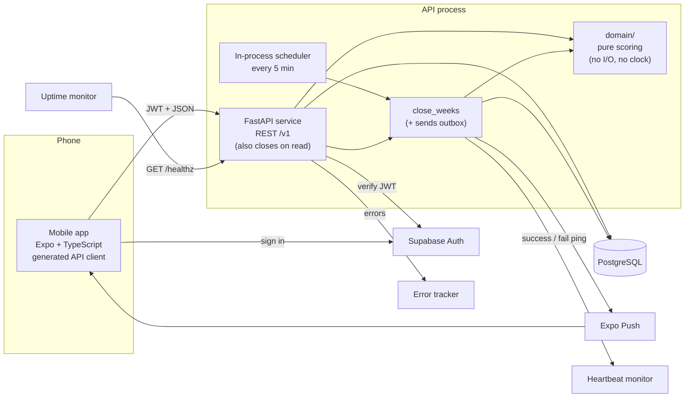

# Socius Weekly Game Engine and Engineering Foundation

*   **Author:** Shreyas Vaid
*   **Status:** Accepted
*   **Review:** EGM design review stages 5 (zoom out), 6 (comprehension) and 7 (critic) were run and their findings resolved on 2026-11-11. Stages 8 (intermediate zoom out) and 9 (implementation readiness) were not run; run stage 9 before starting Part A if the plan changes significantly.
*   **Date:** 2026-11-11

--------------------------------------------------------------------------------

## Overview

Socius is an iOS and Android app for small groups who already know each other: couples, roommates, friends, families. The group agrees on a weekly training target. Each member checks in on the days they work out. When the week ends, the member with the fewest check-ins does the punishment the group agreed on. No money is involved, and check-ins are on the honor system.

This document designs two things:

1.  **The weekly game engine:**
    *   how check-ins are recorded and dated
    *   how each group's week is scored
    *   how the loser is chosen
    *   how weeks are closed on time without manual work
    *   how skip tokens and admin excusals fit into scoring

    A **skip token** is one free point per member, per group, per week. It isn't tied to a day.
2.  **The engineering foundation that protects it:** build tooling, the API contract between app and server, and a testing approach aimed at the code most likely to produce a wrong result: scoring, dates and the weekly close.

This design is the single source of the game rules. It replaces the earlier adherence-based model in [the product requirements](../product-requirements.md) §6–7 and the group-time-zone model in [the high-level design](../high-level-design.md) §3. Once approved, those documents are changed to summarize and link here instead of restating the rules (see Part B of the plan).

--------------------------------------------------------------------------------

## The Problem

**For users:** groups already hold each other to account with group chats and informal bets. That fails in predictable ways:

*   Nobody keeps an accurate count.
*   The rules get argued over at the end of the week.
*   The bet is forgotten by Wednesday.

Socius only helps if the weekly result is something the group trusts without checking it. The rules must be simple enough to explain in one sentence. The result must be correct every week, including for members in different time zones and members who travel. It must arrive without anyone having to do anything.

**For the system:** the hard part is not the arithmetic. Scoring is "count the days you trained, up to N". The hard part is everything around it:

*   **Time.** At any instant, two or three calendar dates are in use somewhere on Earth, because time zones run from UTC−12 to UTC+14. Members' weeks start and end at different moments. For about 26 hours each weekend, a member in UTC+14 is already checking in for next week while a member in UTC−12 is still finishing this week.
*   **One check-in, many groups.** A member in several groups checks in once, and that check-in must count in each group.
*   **Closing on time.** Every group's week must close at a fixed time. If closing runs twice, or crashes halfway, it must produce the same result. A late check-in must never change a result that has already been announced.
*   **Random tie-breaks.** When several members tie for last, the server picks one at random. A retry must never pick a different person.

A mistake in any of these produces a wrong loser. In a small group of friends, one wrong loser is enough for people to stop trusting the app.

### Proposed solution (summary)

*   **Check-ins.** A check-in is a single record per member per local date. It is stored once and never copied per group.
*   **Scoring.** Each group's weekly score is computed from those records by a pure function (`score_week`), with no database or clock access. The function is given the week's saved settings: N, who is eligible, who is excused and who used a skip token.
*   **Closing.** Every week closes at Monday 12:00 UTC, the moment Sunday has ended everywhere on Earth. Two triggers run the same close: a scheduled job, and the first read of a week's results after the cutoff. Closing can safely be rerun, and it saves the result, including the tie-break pick, in one transaction.
*   **Foundation.** pnpm + uv + a root `justfile` for tooling. An OpenAPI-generated TypeScript client for the app. Tests built on written invariants checked by property-based tests, plus tests of the close against a real Postgres database with a fake clock.

--------------------------------------------------------------------------------

## Goals

*   **G1. Correct results with no manual work.**
    *   For each group, every week ends in exactly one stored result, whether or not there is a loser.
    *   The scheduled job writes the result by 12:15 UTC on Monday. If the job didn't run, the first read of that week after the cutoff writes it.
    *   Over a four-week trial with the test group (the first group of 4–5 people to use the app), no result is changed or computed by hand. A non-zero late-write mismatch count (see "Close protection") during the trial counts as a failure of this goal.
    *   The trial also needs groups and invites, which spec 0001 (groups and invites) covers, not this design.
*   **G2. Rerunning gives the same answer.** Running the close any number of times, including two copies at once, produces the same stored result and the same loser. Tests check this against a real Postgres database.
*   **G3. The rules are written down and tested.** Every scoring rule is stated as an invariant in this document. Each invariant has a property-based test, for example "points are always between 0 and N" or "an excused member never loses".
*   **G4. One check-in counts everywhere.** A member in several groups checks in once per day. That check-in adds a point in every group they belong to, with no duplicate records.
*   **G5. One command for each task.** `just dev`, `just test`, `just lint` and `just gen-client` work from a fresh clone after following the README. CI runs the same commands.
*   **G6. CI detects drift between the app and the API.** The TypeScript client is generated from the API's OpenAPI schema. CI fails if the committed client is out of date, or if sampled API responses don't match the schema.
*   **G7. A missed close is noticed.** If any group's week has no result by Monday 13:00 UTC, an alert fires. Every close run leaves a record of what it did.

--------------------------------------------------------------------------------

## Non-Goals

*   **Fixed-days mode.** Groups can't require specific weekdays in v0.1; only a weekly count N exists. See Future Improvements.
*   **Detecting cheating.** The server does not check that a check-in happened on the day it's dated. It doesn't detect a changed phone clock or time zone, or a false check-in. Any day of the open week can be logged, and all of this falls under the honor system. The one exception: a check-in dated later than "today" anywhere on Earth is rejected, because no honest phone can send such a date.
*   **Rest-day votes.** Cut from v0.1.
*   **Members leaving on their own, or opting out.** Only an admin can remove a member or excuse one.
*   **The suspense animation, and draws members can verify.** Deferred. The server saves the tie-break candidates and the pick, so retries and history are consistent, but members can't check the draw themselves.
*   **Closing a group early** once its result can't change. See Future Improvements.
*   **Configurable week length.** The week is always Monday to Sunday.
*   **Money and enforcement.** The app never handles money. It does not check whether punishments were done.
*   **Bazel, Nx or Turborepo.** Not adopted at the current repo size. The tooling ADR records when to revisit this.
*   **Product areas outside the game engine.** Profiles, proof photos, notifications beyond the weekly result, calorie targets, food logging and workout plans stay in the PRD. Each gets its own spec.

--------------------------------------------------------------------------------

## Decided Rules

These are the game rules in force. Every other section refers here instead of restating them.

| Topic | Rule |
|---|---|
| **Target** | The admin sets one weekly target N, from 1 to 7. It is the same for every member. |
| **Points** | `points = min(N, distinct counted check-in dates in the week + 1 if the skip token was used)`. |
| **Check-in dates** | <ul><li>A check-in is accepted if its `local_date` is in a week that hasn't reached its cutoff, and `local_date ≤ latest_local_date(now)`, the date in UTC+14.</li><li>One check-in per member per date.</li><li>Logging an earlier day of the open week is allowed (honor system).</li></ul> |
| **Undo** | <ul><li>A member can undo any of their own check-ins while its week is open.</li><li>Undo hides the row instead of deleting it, so a delayed retry can't bring it back.</li></ul> |
| **Skip token** | <ul><li>One per member, per group, per week.</li><li>Adds 1 point, up to N.</li><li>Not tied to a day.</li><li>Can be withdrawn while the week is open.</li><li>The app warns before a token that would be wasted because the member is already at N.</li></ul> |
| **Excusal** | <ul><li>Only an admin can excuse a member for a week, including themselves.</li><li>The request must be made while the admin's phone date is on or before Sunday of that week, and before the cutoff. The phone date is honor system.</li><li>An excused member can't lose that week.</li><li>The reason is never stored.</li><li>The group sees who was excused and by whom.</li><li>An excusal can be revoked under the same deadline.</li></ul> |
| **Roles** | <ul><li>Two roles, `admin` and `member`. The PRD's earlier term "Owner" is replaced by `admin`.</li></ul> |
| **Membership** | <ul><li>Members can't leave a group on their own; only an admin can remove a member.</li><li>A member removed during week W keeps their state for W and can still lose W.</li><li>Re-adding a member in the same week restores their earlier state.</li><li>Deleting an account, which the App Store requires apps to allow, counts as a removal from every group.</li></ul> |
| **Group size** | At most 8 active members per group. Enforced when a member joins (spec 0001). |
| **Joining** | <ul><li>The phone sends its local date when a member joins (`joined_local_date`, honor system).</li><li>A member who joins during week W can't lose W.</li><li>In that group, only their check-ins dated on or after `joined_local_date` count.</li></ul> |
| **Settings changes** | <ul><li>A change to N or the punishment text takes effect from `week_start(latest_local_date(now)) + 7 days`. That is the first week that hasn't started anywhere on Earth.</li><li>A second change before then replaces the pending one.</li><li>A new group's first settings row takes effect from `week_start(latest_local_date(now))`.</li></ul> |
| **Loser** | See "Eligibility and the loser rule". |

**Still open:**

*   **Deleted accounts in past results.** A member who deletes their account mid-week is still scored. How do they appear in that week's result and in history? An "Anonymous member" label is likely. The account-deletion spec decides.
*   **The only admin deletes their account.** Who becomes admin? Spec 0001 decides.
*   **Late results in eastern time zones.** Results arrive around Monday 04:00 in California, Monday 21:00 in Tokyo and Monday 23:00 in Sydney. Accepted for v0.1. Revisit if the test group complains.

--------------------------------------------------------------------------------

## Critical User Journeys (CUJs)

### CUJ 1: One workout counts in two groups

*   **Given**:
    *   Alex is in group A (N = 4) and group B (N = 3).
    *   Alex's phone is set to America/New_York.
    *   It's Wednesday.
    *   Alex has already checked in Monday and Tuesday.
*   **When**: Alex checks in at 19:30 local time on Wednesday.
*   **Then**:
    *   One check-in record dated Wednesday is stored.
    *   Alex's score is 3 in group A and 3 in group B. Group B is now at its cap, so a check-in on Thursday raises A to 4 and leaves B at 3.
    *   A second check-in attempt on Wednesday is rejected with "You've already checked in today."

### CUJ 2: Week closes with a tie at the bottom

*   **Given**:
    *   Group C has four eligible members and N = 5.
    *   On Sunday night their scores are 5, 3, 2 and 2.
*   **When**: the scheduled close runs at Monday 12:05 UTC.
*   **Then**:
    *   Each member's points are recorded. The two members on 2 are the tied candidates.
    *   The server picks one of them at random. The candidates and the loser are saved in the same transaction as the scores.
    *   Running the close again changes nothing.
    *   Each member gets a notification. It says results are ready but doesn't name the loser.
    *   The results screen shows everyone's points, the loser, a "decided by tie-break" label and the punishment text saved for that week.

### CUJ 3: An excused member and a new joiner cannot lose

*   **Given**:
    *   Group D has members P, Q and R, and N = 3.
    *   On Saturday, the admin excused R for this week because R is sick.
    *   S joined the group on Thursday.
*   **When**: the week closes with P on 3, Q on 1, R on 0 and S on 2.
*   **Then**:
    *   Only P and Q are eligible. Q loses with 1 point.
    *   R and S are shown with their points and marked "excused" and "joined mid-week". Neither is a candidate. S's points count only check-ins from Thursday on.
    *   If Q had also been excused, only P would be eligible. Fewer than two eligible members means no loser that week.

### CUJ 4: A skip token covers a missed day

*   **Given**:
    *   Group E has N = 4.
    *   Jordan has checked in twice by Saturday and hasn't used this week's skip token.
*   **When**: Jordan uses the skip token and checks in on Sunday.
*   **Then**:
    *   Jordan's points are 2 + 1 (token) + 1 = 4, which reaches N.
    *   Jordan can't lose. If every eligible member reached 4, the week has no loser.

### CUJ 5: Results appear even when the scheduler didn't run

*   **Given**: the API process was asleep through Monday morning, so the scheduled close never ran for group F's week.
*   **When**: a member of group F opens last week's results at Monday 14:00 UTC.
*   **Then**:
    *   The API closes that group-week inline before responding. It uses the same close function as the scheduler.
    *   The member sees the final result.
    *   The overdue check reports group F's week as late. The 13:00 UTC deadline in G7 had already passed, so the monitor alerts.

--------------------------------------------------------------------------------

## Technical Plan (Architecture)

### Components



*   **Mobile app.** Sends check-ins and admin actions, and shows live and final scores. It talks only to the API and to Supabase Auth, never to the database. It doesn't compute weeks: the API returns `week_start` and `cutoff`.
*   **API.** Validates every request, checks permissions, and stores facts: check-ins, excusals, skip tokens, settings changes. It computes *live* scores on request by calling the same pure scoring function the close uses. A request for a week that should be closed but isn't triggers the close inline.
*   **`domain/` module.** Pure Python functions with no database, network or clock access: `score_week`, eligibility, week arithmetic and the loser rule. Everything that decides who loses lives here, so it can be property-tested on its own.
*   **`close_weeks`.** After each week's cutoff, it computes and saves the final result for every group, then sends any unsent notifications. It is safe to run any number of times. It is started by the in-process scheduler, and also called for a single group-week by the API's close on read.
*   **Monitoring.**
    *   An uptime monitor requests `GET /healthz` every 5 minutes, which keeps the process awake on free hosting tiers.
    *   A heartbeat monitor gets a success ping only when a run had no failures and no week is overdue. Otherwise it gets a failure signal.
    *   Errors go to an error tracker.

### Core idea: store facts, compute scores

The database stores only facts that users or admins created:

*   a member checked in on a date
*   a member used a skip token in a week
*   an admin excused a member for a week
*   an admin changed the settings, starting from a given week

Scores are never stored while a week is open. They are computed from the facts each time they're needed: for the live leaderboard, and once more at close. The close result is then frozen.

This removes three sources of bugs:

*   there are no per-group copies of a check-in to keep in sync
*   there is no counter that can drift
*   there is no weekly job that pre-creates "sessions"

The cost is that every leaderboard view recomputes scores. With at most 8 members × 7 days, that is at most 56 check-in rows per request.

### Time model

*   **Local date.** Every check-in carries the date on the member's phone (`local_date`), plus the phone's IANA time zone and UTC offset at that moment. The server stores what the phone sent and doesn't try to detect changed clocks or zones. Which dates are accepted is in Decided Rules.
*   **Week key.** A week is identified by the date of its Monday (`week_start`). A check-in belongs to the week `week_start = local_date − weekday(local_date)`. It doesn't use ISO week numbers, which mix years in late December.
*   **Cutoff.** Week `W` closes at `W + 7 days, 12:00 UTC`: the following Monday at noon UTC. That's the moment Sunday ends in UTC−12, the last zone to finish a given date. Every group shares this cutoff. Nothing dated in week `W` can be created, undone or changed after it.
*   **When a week begins.** Week `W` begins anywhere at `W 00:00` in UTC+14, which is Sunday 10:00 UTC. This instant decides which weeks a settings change may affect, and which weeks a removed member still belongs to.
*   **Two weeks open at once.** Weeks are keyed by their Monday, not by "the current period", so week `W` and week `W+1` can both accept check-ins during the weekend overlap. No special handling is needed.
*   **Clock injection.** All code that needs the current time takes it from a `Clock` object passed in. Business logic never calls `datetime.now()` or uses Postgres `now()` or `DEFAULT now()`. The same fake clock is injected into both the API and the close in tests.
*   **Clock skew.** Hosts use NTP. A few seconds of skew between processes is absorbed by the 5-minute close delay.

### Eligibility and the loser rule

**Member set for week W.** A membership is in week `W` if:

*   `joined_local_date ≤ Sunday(W)`, and
*   it hasn't been removed, or it was removed at or after the moment `W` began anywhere.

Re-adding a member in the same week reuses their earlier membership row, so `joined_local_date` doesn't change.

Each member in the set is in exactly one state:

| State | Condition | Can lose? |
|---|---|---|
| `joined_mid_week` | `joined_local_date ≥ W` (joined during W) | no |
| `excused` | an active excusal exists for W, and they didn't join mid-week | no |
| `eligible` | everyone else | yes |

Joining mid-week takes precedence over an excusal. Both mean "can't lose", so the order only affects the label shown.

**Points:**

*   **What's counted.** Distinct `local_date` values in W from active check-ins, plus 1 for an active skip token, up to N.
*   **Mid-week joiners.** Only dates on or after their `joined_local_date` count.

**Loser rule** (pure function, applied to eligible members only):

1.  If fewer than 2 members are eligible, there is no loser.
2.  If every eligible member has `points = N`, there is no loser.
3.  Otherwise the candidates are the eligible members with the lowest points. With one candidate, that member loses. With several, the server picks one at random with `secrets.choice` over the candidates, sorted by user ID.

**Storage and retries.**

*   The candidates and the loser are saved in the same transaction as the scores.
*   A saved result is never recomputed, so a retry can never pick a different loser.
*   No seed is stored, because nothing replays the draw. A future draw that members can verify would need one (see Future Improvements).

### Data model (game engine only)

```text
groups              id, name, created_by, created_at
                    PK (id)
group_settings      group_id, effective_week_start (date), target_n (1..7),
                    punishment_text, created_by, recorded_at
                    PK (group_id, effective_week_start)
memberships         id, group_id, user_id, role (admin|member),
                    joined_at, joined_local_date, removed_at
                    PK (id); UNIQUE (group_id, user_id) WHERE removed_at IS NULL
check_ins           id, user_id, local_date, tz_name, utc_offset_minutes,
                    captured_at (phone time), recorded_at (server time),
                    removed_at, client_request_id (uuid)
                    PK (id); UNIQUE (client_request_id);
                    UNIQUE (user_id, local_date) WHERE removed_at IS NULL
skip_token_uses     id, group_id, user_id, week_start, recorded_at, removed_at
                    PK (id); UNIQUE (group_id, user_id, week_start)
                    WHERE removed_at IS NULL
excusals            id, group_id, user_id, week_start, excused_by,
                    recorded_at, removed_at
                    PK (id); UNIQUE (group_id, user_id, week_start)
                    WHERE removed_at IS NULL
week_results        group_id, week_start, target_n, punishment_text,
                    closed_at, has_loser, loser_user_id,
                    tiebreak_candidates (uuid[], empty if no tie),
                    scoring_version
                    PK (group_id, week_start)
week_member_results group_id, week_start, user_id, state, check_in_days,
                    skip_token_used, points, is_loser
                    PK (group_id, week_start, user_id)
push_tokens         id, user_id, token, platform, recorded_at
                    PK (id); UNIQUE (token)
notification_outbox id, user_id, kind, payload (jsonb), created_at, sent_at
job_runs            id, started_at, finished_at, weeks_closed,
                    groups_failed, overdue, mismatches, error
```

*   **Timestamps.** Every fact table uses the same two columns: `recorded_at` (server time when the API wrote the row) and `removed_at` (set by undo, withdraw or revoke).
*   **Settings.** A week's settings are the `group_settings` row with the latest `effective_week_start ≤ W`. The settings are copied into `week_results` at close, so later edits never change history.
*   **Check-ins.** They have no `group_id`. One row counts in every group whose member set for that week includes the member, subject to the joining rule.
*   **Retries.** `client_request_id` stays unique on every row, including removed ones. A retried request, even one arriving after an undo, can't create a second check-in.
*   **No open-week table.** There is no table for open weeks. A week exists implicitly, from its key plus the facts. It becomes a row only when `week_results` is written at close.
*   **`scoring_version`.** A label recording which rules produced a past result. Nothing recomputes old results from it.

### Request rules (API)

Every write that touches week `W` first checks `clock.now() < cutoff(W)`, and rejects with `week-closed` otherwise. Each error is an RFC 9457 problem response with a stable `type` code the app maps to a message.

**Every group endpoint** returns 404 `not-member` when the caller isn't an active member, so the response doesn't reveal that the group exists.

| Action | Extra rules | Error codes |
|---|---|---|
| Check in | one active check-in per `local_date` per user; `local_date ≤ latest_local_date(now)` | `already-checked-in`, `date-not-accepted`, `week-closed` |
| Undo check-in | own check-in only; sets `removed_at` | `week-closed` |
| Use skip token | one active token per member per group per week; the response says if it was wasted (already at N) | `token-already-used`, `week-closed` |
| Withdraw skip token | own token only | `week-closed` |
| Excuse member | <ul><li>admin only</li><li>target must be in W's member set</li><li>admin's phone date ≤ Sunday(W)</li></ul> | `not-admin`, `target-not-member`, `excusal-window-closed`, `week-closed` |
| Revoke excusal | admin only; same deadline as excusing | `not-admin`, `excusal-window-closed`, `week-closed` |
| Change target N or punishment text | admin only; N from 1 to 7; takes effect per Decided Rules | `not-admin`, `invalid-target` |
| Join, remove, re-add member | defined in spec 0001; joining enforces the 8-member cap | `group-full`, `not-admin` |

### The close

**One function, two triggers.** `close_group_week(session, group_id, week_start, clock)` closes one group-week:

1.  It runs only if `now ≥ cutoff(W) + 5 minutes` and no result exists.
2.  It takes `pg_try_advisory_xact_lock` on a key derived from `(group_id, week_start)`. If the lock isn't granted, another close is already running for this group-week, so it skips. A transaction lock is released automatically at commit or rollback, so a crash can't leave it held.
3.  It loads the members, settings and facts for the week, and calls `score_week`. If several members are tied, it picks the loser with `secrets.choice`.
4.  It inserts `week_results` and `week_member_results`, plus one `notification_outbox` row per member, then commits. If the result already exists, the insert fails on the primary key and the close skips. The primary key, not the lock, is what guarantees exactly one result.

The two triggers:

*   **Scheduled (D2).**
    *   APScheduler inside the FastAPI process runs `close_weeks` every 5 minutes.
    *   `close_weeks` calls `close_group_week` for every due group-week from the last 8 weeks. A due week older than 8 weeks is reported as an error, not closed.
    *   Then it sends up to 100 unsent outbox rows through Expo Push and marks them sent.
*   **On read (D2 addition).** `GET` for a week that is due but has no result calls `close_group_week` for that one group-week before responding. Results are then correct whenever someone looks; only notification timing depends on the scheduler.

**Each scheduled run also:**

1.  Records a `job_runs` row.
2.  Catches an error in any one group, records it in `job_runs.groups_failed` and the error tracker, and continues with the other groups.
3.  **Checks for late writes** by rescoring recent weeks (see "Close protection" below).
4.  Counts overdue group-weeks (`now ≥ cutoff + 60 minutes` and no result) into `job_runs.overdue`.
5.  **Heartbeat.** Sends the success ping only if `groups_failed = 0` and `overdue = 0`. Otherwise it sends the monitor's failure signal. This is what makes G7 hold.

**Delivery.** Notifications are delivered **at least once**. A crash after Expo accepts a push but before `sent_at` is written can resend it.

**Keeping the API awake.** Free hosting tiers put idle processes to sleep, and a sleeping process runs no scheduled jobs. The uptime monitor keeps it awake, and close on read covers the gaps.

**Before choosing a host,** check two things:

*   that it allows keep-alive pings
*   that one always-on service fits in its free monthly hours

If not, the fallback is a paid plan that never sleeps, which needs the author's approval because it costs money.

**Close protection (D1, decided: time check plus delay, with bounded transactions and rescore detection):**

*   **Rejecting late writes.** Every write for week `W` is rejected once `clock.now() ≥ cutoff(W)`.
*   **Bounding the race.** The API's database connections set `statement_timeout = 30s` and `idle_in_transaction_session_timeout = 30s`. Any write transaction that started before the cutoff therefore commits or aborts within about 30 seconds, well inside the 5-minute close delay.
*   **What the close reads.** Facts with `recorded_at < cutoff(W)` that are active (`removed_at` is null) at the time of the close.
*   **Detecting what slips through.** Each scheduled run rescores every group-week closed in the previous 24 hours from the current facts, using the same filter, and compares the result with the saved `week_member_results`.
    *   A difference means a write or undo committed after the close.
    *   It is recorded in `job_runs.mismatches` and reported to the error tracker. This also catches late undos, withdrawn tokens and revoked excusals.
    *   The saved result is not changed automatically.

### Tooling and contract

*   **Repo.** A pnpm workspace with `apps/mobile` and `packages/api-client`, and a uv project at `services/api`. A root `justfile` has `dev`, `test`, `lint`, `fmt`, `typecheck`, `gen-client`, `db-up` and `migrate`. CI installs `just` and calls those same recipes.
*   **Contract (D3, decided).**
    *   `just gen-client` exports the OpenAPI schema from FastAPI without starting a server. It then runs `openapi-typescript` to write `packages/api-client/src/schema.d.ts`.
    *   The package exports a typed `openapi-fetch` client that attaches the Supabase JWT to every request and turns problem-detail errors into one typed error.
    *   TanStack Query hooks are written by hand in `apps/mobile/src/api/`. Wrong cache keys and missed invalidations are the main drift risk for hand-written hooks, so one key-factory module keeps them in one place.
    *   CI regenerates the client and fails if anything differs from what's committed.
    *   Separately, Schemathesis generates requests from the schema against a test instance of the API. It fails if responses or status codes don't match the schema.

### Testing approach

| Layer | What it proves | How |
|---|---|---|
| `domain/` scoring, eligibility, week math | The rules in this document hold for all inputs | Hypothesis property tests against the invariants below, plus example tests for each CUJ |
| API | Request rules, permissions, error codes, retries that are safe to repeat, close on read | pytest + httpx against real Postgres (Docker locally, a CI service container), fake clock |
| Close | Same result on every rerun, including concurrent runs; late writes detected | Real Postgres, fake clock, two separate database connections for the concurrency tests |
| Contract | The app client matches the API, and the API matches its schema | Client diff check + Schemathesis |
| Mobile | Screens render scores, errors map to messages | Jest + React Native Testing Library |

The goal is not a coverage percentage. Every invariant below has a property test, and every CUJ has an example test.

**Invariants:**

1.  `0 ≤ points ≤ N` for every member.
2.  Adding a check-in or a skip token never lowers that member's points, and never makes them a candidate if they weren't one before.
3.  There is no loser if and only if fewer than 2 members are eligible or every eligible member has N points.
4.  The loser is always eligible, and always has the lowest points among eligible members.
5.  Adding, removing or changing the check-ins of `joined_mid_week` or `excused` members never changes who the candidates are.
6.  The same inputs give the same candidates, regardless of input order.
7.  A second active check-in for the same `(user_id, local_date)` is rejected and changes no score.
8.  `week_start(d)` is a Monday, `week_start(d) ≤ d`, and `d − week_start(d) < 7 days`.
9.  For every UTC offset from −12:00 to +14:00, Sunday 23:59:59 local time is before `cutoff(W)`.
10. Running the close any number of times, through either trigger and including concurrently, leaves exactly one result per group-week, with the same loser.
11. A settings write never changes the settings of a week that has begun anywhere.
12. Check-ins dated before a member's `joined_local_date` never change that member's points in that group.
13. Removing a member during week W doesn't change their state or points for W.

### Decisions in this section

*   **D1. Close vs late check-ins.** Decided: Option A, time check plus delay. Revised after review to add the 30-second transaction bound and rescore detection.
*   **D2. How closing is triggered.** Decided: Option B, a scheduler inside the API process kept awake by an uptime ping. Revised after review to add close on read, so results don't depend on the scheduler.
*   **D3. TypeScript client generator.** Decided: Option A, openapi-typescript plus openapi-fetch. Query hooks are written by hand in `apps/mobile`.

#### D1 options (decided: A)

*   **Option A: time check plus a delay.**
    *   *How it works:* every write checks `now < cutoff` before it touches the database. The close starts 5 minutes after the cutoff and reads only facts recorded before the cutoff. No extra locks.
    *   *Trade-offs:* simple, with no lock ordering to reason about. Check-in requests never wait on the close.
    *   *When it fails:* a write that passes the time check just before the cutoff, but commits after the close read the facts, isn't counted. The 30-second transaction timeout makes this practically impossible with a 5-minute delay, and rescore detection reports it if it happens anyway.
*   **Option B: a lock per week (a "seal").**
    *   *How it works:* every write for week `W` takes a shared transaction lock keyed on `W`, then checks the cutoff and that `W` isn't sealed. The close takes the same lock exclusively once, then records a seal. The cutoff is the same for every group, so one lock per week is enough.
    *   *Trade-offs:* no write can slip past the close, and the 5-minute delay and the detection go away.
    *   *When it fails:* writes for `W` wait while the seal is taken. A bug in lock handling blocks all writes for a week. It needs a concurrency test with two connections.
*   **Option C: the database refuses late rows.**
    *   *How it works:* a trigger on each fact table rejects any insert or update whose week already has a `week_results` row.
    *   *Trade-offs:* a bug in API code can't break it.
    *   *When it fails:* `check_ins` has no group, so the trigger must look up every group the user belongs to on every check-in. Business rules split between Python and SQL. A race between the trigger's lookup and the close's insert still needs a lock to close fully.

#### D2 options (decided: B, plus close on read)

*   **Option A: the hosting platform's scheduled job.**
    *   *How it works:* the host (for example Render Cron Jobs or a Fly.io scheduled machine) starts `python -m socius_api.jobs.close_weeks` as its own process every 5 minutes.
    *   *Trade-offs:* separate from web traffic. The trigger configuration depends on the host.
    *   *When it fails:* if the host's scheduler has an outage, nothing runs. Some hosts charge for scheduled jobs.
*   **Option B: a scheduler inside the API process.**
    *   *How it works:* APScheduler runs `close_weeks` every 5 minutes inside the FastAPI process.
    *   *Trade-offs:* no extra service and nothing extra to configure.
    *   *When it fails:* free-tier hosts put the API to sleep when there's no traffic, and a sleeping process runs no jobs. The uptime ping and close on read cover this.
*   **Option C: an outside scheduler calls a protected endpoint.**
    *   *How it works:* an external service sends `POST /internal/jobs/close-weeks` with a secret token every 5 minutes.
    *   *Trade-offs:* free, and it doesn't depend on the host.
    *   *When it fails:* GitHub documents that scheduled workflow runs can be delayed or dropped under high load, and it disables schedules after 60 days without repository activity. A long close runs inside a web request and can hit the host's request timeout.

#### D3 options (decided: A)

*   **Option A: openapi-typescript + openapi-fetch.**
    *   *How it works:* the generator writes TypeScript types only, in one generated file. A small typed `fetch` wrapper uses those types, and TanStack Query hooks are written by hand on top of it.
    *   *Trade-offs:* one generated file and few dependencies. Every request and query hook is visible in plain code.
    *   *When it fails:* every endpoint needs a hand-written hook, and those hooks can drift from the API's behavior: wrong cache keys, missed invalidation after writes.
*   **Option B: @hey-api/openapi-ts.**
    *   *How it works:* generates types plus one SDK function per endpoint. An optional plugin also generates TanStack Query options and hooks.
    *   *Trade-offs:* fewer hand-written files than A.
    *   *When it fails:* its configuration format has changed between major versions, so upgrades can mean regenerating and fixing call sites. The version must be pinned exactly.
*   **Option C: orval.**
    *   *How it works:* generates types and ready-to-use TanStack Query hooks for every endpoint. It can also generate mock servers.
    *   *Trade-offs:* the fewest hand-written files. The mocks help mobile tests.
    *   *When it fails:* it generates one hook file per endpoint, which makes for large review diffs. Customizing auth headers or error handling goes through orval's configuration instead of plain code.

--------------------------------------------------------------------------------

## Alternatives Considered

### Game rules

#### Alternative A: Adherence scoring with a separate goal per member

*   **How it works:** Each member sets their own weekly goal. Score = completed ÷ scheduled, with skip tokens and mid-week joins removed from the denominator.
*   **Pros:** Fair across different goals. A member who trains three days a week can compete with one who trains five.
*   **Cons:** Harder to explain ("why did 3/4 lose to 4/5?"). Needs a per-member schedule, ratio arithmetic and zero-denominator edge cases.
*   **Reason for Rejection:** Rejected by author: a shared target N keeps the group training toward the same thing, and makes raw points fair without a ratio. The cost is that members with different personal goals must agree on one N.

#### Alternative B: Ties at the bottom share the loss

*   **How it works:** Everyone tied for the lowest score takes the punishment.
*   **Pros:** No randomness to explain. Easy to test.
*   **Cons:** Two or three people doing one punishment ("buy dinner") is awkward, and a shared loss feels lighter.
*   **Reason for Rejection:** Rejected by author: one person carrying the punishment keeps the stakes real. The cost is that a tied member can lose by chance, and the app has to store and show the tie-break.

#### Alternative C: No loser, or a shared punishment, when everyone scores 0

*   **How it works:** If every member scores 0, nobody loses, or the whole group does the punishment together.
*   **Pros:** Avoids one person taking the punishment for a shared failure.
*   **Cons:** The whole group can skip a week together with no consequence.
*   **Reason for Rejection:** Rejected by author: a group-wide skip should still cost someone, or the stakes disappear exactly when they matter. The cost is that one member is punished for a failure everyone shared.

#### Alternative D: One time zone per group

*   **How it works:** All dates and deadlines use one IANA zone set by the group admin.
*   **Pros:** One clear day boundary per group, and simpler week math.
*   **Cons:** Members in other zones, or travelling, have "days" that don't match their own calendar. A check-in would have to be dated in several zones for a member in several groups.
*   **Reason for Rejection:** Rejected by author: the phone's own date matches what the member experiences, and lets one check-in count in every group. The cost is the 26-hour weekend overlap and a global cutoff that delivers results late in eastern zones.

#### Alternative E: Close each week when every member's own Sunday has ended

*   **How it works:** The close time per group is the latest end-of-Sunday across its members' zones.
*   **Pros:** Results arrive sooner for groups whose members are all in eastern zones.
*   **Cons:** The close time moves when members travel or change zones, and has to be computed per group.
*   **Reason for Rejection:** Rejected by author in favor of a single constant cutoff that needs no per-group computation. The cost is that results arrive late in eastern zones (Sydney about 23:00 Monday).

#### Alternative F: A separate grace period until noon the next day

*   **How it works:** A check-in for a date is accepted until 12:00 the following day.
*   **Pros:** Covers late-night workouts and forgetting to tap.
*   **Cons:** A second time window to define, on top of the week cutoff.
*   **Reason for Rejection:** Rejected by author: any day of the open week can be logged under the honor system, so a second window adds nothing. The cost is that a member can log missed days late, up to the cutoff, after seeing the live leaderboard.

#### Alternative G: Group-voted rest days

*   **How it works:** Any member proposes a rest day, and it passes with a strict majority of all members.
*   **Pros:** The group can agree to cancel a day together.
*   **Cons:** A feature, two background jobs and a notification type. It made sense only when everyone trained on the same fixed days.
*   **Reason for Rejection:** Rejected by author for v0.1: members choose their own days, and skip tokens and excusals cover individual absences. The cost is that the group can't lower the target for one week, for example a holiday week, without changing settings.

#### Alternative H: Member-declared travel opt-out

*   **How it works:** A member opts out of a week before it starts, at most about once a month, and the group sees it.
*   **Pros:** Members don't need to ask anyone.
*   **Cons:** It needs a deadline, a frequency limit and a setting for that limit. It is a way to escape losing that members can trigger themselves.
*   **Reason for Rejection:** Rejected by author: the admin excuses members instead, for any reason. The cost is that the admin becomes a gatekeeper, and an admin can still excuse themselves until Sunday ends (see Risks).

#### Alternative I: Fixed-days mode in v0.1

*   **How it works:** The admin picks specific weekdays, and only check-ins on those days count.
*   **Pros:** Supports groups who train together on set days.
*   **Cons:** It doubles the setup screens, the scoring paths and the test space. Weekdays become ambiguous once dates follow each phone's zone.
*   **Reason for Rejection:** Rejected by author for v0.1. The cost is that groups who train on set days can't enforce them yet. See Future Improvements.

#### Alternative J: Detecting changed clocks and backdated dates

*   **How it works:** The server compares the date the phone sends with the time it received the request, and rejects dates that aren't plausible.
*   **Pros:** Harder to cheat.
*   **Cons:** Rejects honest offline check-ins, and adds rules that conflict with trusting the group.
*   **Reason for Rejection:** Rejected by author: the groups are people who know each other, and the honor system is part of the product. The cost is that clock changes and backdating within the open week go undetected. Only dates later than "today" anywhere on Earth are rejected.

#### Alternative K: Configurable week length

*   **How it works:** Groups choose a period length, for example 7 or 14 days.
*   **Pros:** Flexible.
*   **Cons:** Every date calculation gets a variable, and the global cutoff stops being a single rule.
*   **Reason for Rejection:** Rejected by author: one Monday-to-Sunday week keeps the cutoff a single constant. The cost is that groups who want fortnightly stakes can't have them.

#### Alternative L: Members can leave a group on their own

*   **How it works:** Any member can leave at any time.
*   **Pros:** Members control their own membership.
*   **Cons:** Leaving and rejoining mid-week turns a member into a mid-week joiner who can't lose.
*   **Reason for Rejection:** Rejected by author: only admins remove members, and a re-add in the same week restores the earlier state. The cost is that a member who wants out has to ask the admin, or delete their account.

#### Alternative M: Self-excusal needs another member's confirmation

*   **How it works:** An admin's excusal of themselves stays pending until another member confirms it.
*   **Pros:** Closes the last way for an admin to dodge a loss.
*   **Cons:** It needs a pending state, a confirmation flow and an expiry, for a small group that already sees every excusal.
*   **Reason for Rejection:** Rejected by author: the Sunday deadline removes the Monday-morning window, which was the main abuse. The cost is that an admin can still excuse themselves on Sunday evening (see Risks).

### Architecture

#### Alternative N: Store running scores per group

*   **How it works:** Each check-in increments a counter for each group the member belongs to. The close reads the counters.
*   **Pros:** Leaderboard reads are a single row lookup.
*   **Cons:** Every check-in, undo, skip token, excusal and membership change must update every affected counter correctly. A bug leaves counters wrong with no way to recompute them.
*   **Reason for Rejection:** Rejected: one pure function used by both the live leaderboard and the close gives a single definition of scoring. The cost is recomputing at most 56 check-in rows per request.

#### Alternative O: A row per open week, created ahead of time, with session rows

*   **How it works:** A job creates a `periods` row and one `sessions` row per training day at the start of each week. That was the original HLD design.
*   **Pros:** The current week is explicit in the database.
*   **Cons:** It assumes one current week per group, so it can't represent two weeks open at once. It adds a creation job that must itself run on time.
*   **Reason for Rejection:** Rejected: weeks keyed by their Monday handle the overlap with no extra job. The cost is that "which weeks exist" is derived, not listed.

#### Alternative P: A replayable SHA-256 tie-break with a stored seed

*   **How it works:** Store a random seed, and pick `sha256(seed ‖ group_id ‖ week_start) mod k` over sorted candidates, so the draw can be replayed later.
*   **Pros:** The draw can be audited after the fact. With a seed derived from a server secret, it could also support a draw members can verify.
*   **Cons:** Saved results are never recomputed, so nothing replays the draw. It needs a byte-level encoding spec, fixed test vectors and a version column.
*   **Reason for Rejection:** Rejected by author: `secrets.choice` plus the stored candidates and loser covers retries and history. The cost is that a verifiable draw later needs a seed column and a migration.

#### Alternative Q: Other ways to protect the close (D1 options B and C)

*   **How it works:** a per-week lock ("seal") or database triggers. See "D1 options".
*   **Reason for Rejection:** Rejected by author in favor of a time check plus delay, bounded by 30-second transaction timeouts and checked by rescoring. The cost is that a slip-through is detected, not prevented.

#### Alternative R: Other ways to trigger the close (D2 options A and C)

*   **How it works:** the host's scheduled job, or an external scheduler calling an endpoint. See "D2 options".
*   **Reason for Rejection:** Rejected by author in favor of an in-process scheduler plus close on read, which keeps everything in one deployable service. The cost is that the process must stay awake for notifications to be on time.

#### Alternative S: Scheduler only, with no close on read

*   **How it works:** Only the scheduled job closes weeks.
*   **Pros:** Read requests never write to the database.
*   **Cons:** If the process sleeps or the scheduler fails, results don't exist until it recovers.
*   **Reason for Rejection:** Rejected by author: results should be correct whenever someone looks. The cost is a GET request that can write, which needs the same tests as the job.

#### Alternative T: Other client generators (D3 options B and C)

*   **How it works:** @hey-api/openapi-ts or orval. See "D3 options".
*   **Reason for Rejection:** Rejected by author in favor of openapi-typescript plus openapi-fetch. The cost is hand-written query hooks, kept consistent by one key-factory module.

### Tooling

#### Alternative U: Bazel (or Nx / Turborepo) as the build system

*   **How it works:**
    *   **Bazel:** a single build system for every language, with hermetic builds and a cache that can be shared across machines.
    *   **Nx and Turborepo:** task runners and caches for JavaScript-heavy monorepos.
*   **Pros:** Builds that repeat exactly, and faster CI for very large repos.
*   **Cons:** Expo's build tools (Metro, EAS) don't run through Bazel, so there would be two build systems. Every package needs BUILD files, and Bazel's Python and JavaScript rules are complex. The benefits only appear with many engineers and build targets; this repo has three packages.
*   **Reason for Rejection:** Rejected by author: pnpm + uv + a root `justfile` matches the repo's size. The cost is no shared build cache, which matters only at a size this repo isn't near. The tooling ADR states when to revisit: CI time, number of packages, or more contributors.

#### Alternative V: A branch-coverage percentage as the testing target

*   **How it works:** CI fails below a set percentage of covered branches.
*   **Pros:** Easy to measure and enforce in CI.
*   **Cons:** Coverage shows which lines ran, not whether results were checked. A near-100% target rewards tests that don't check anything.
*   **Reason for Rejection:** Rejected: the target is that every written invariant has a property test and every CUJ has an example test. Coverage is still reported. The cost is that the gate is a checklist reviewed by a person, not a number checked by CI.

--------------------------------------------------------------------------------

## Non-Functional Requirements

*   **Privacy.**
    *   A check-in's `tz_name` and `utc_offset_minutes` are never returned to anyone, because they reveal location and travel. Group members see only that a member checked in on a date.
    *   The reason for an excusal is never stored.
    *   Every group endpoint checks that the caller is an active member. Admin endpoints also check `role = admin`. Both rules have tests.
*   **Performance.**
    *   Live leaderboard reads recompute scores from at most 56 check-in rows. No caching layer is added.
    *   At roughly 50 ms per group-week, one scheduled run closes about 1,200 group-weeks a minute, far above v0.1 needs. Revisit at 1,000 groups.
*   **Rollout.**
    *   Nothing is deployed yet, so there is no data to migrate. The first Alembic migration creates the schema in this document.
    *   A change to the scoring rules increments `scoring_version`. Results already saved are never recomputed.
*   **Cost.**
    *   Everything runs on free tiers: one API service, managed Postgres, Supabase Auth, Expo Push, an error tracker, an uptime monitor and a heartbeat monitor.
    *   Moving to a paid plan needs the author's approval.

--------------------------------------------------------------------------------

## Risks & Mitigations

| Risk | Impact | Mitigation | Detection |
|---|---|---|---|
| The host refuses keep-alive pings, or one always-on service exceeds its free hours | Notifications late; results still correct (close on read) | Verify before choosing a host; fallback to a paid always-on plan with the author's approval | Heartbeat failure signal; overdue count |
| One process carries web traffic and the close | A slow close delays requests, or a crash stops both | The close is short (one transaction per group-week); close on read covers scheduler gaps | Error tracker; heartbeat |
| Free-tier Postgres pauses, expires or loses data | Closed results can't be rebuilt without facts | Choose a plan with backups; export before any free-tier expiry | Host notifications; failed health of close runs |
| Supabase Auth outage | Nobody can sign in or call the API | None in v0.1; accepted | Error tracker (401 spike) |
| Expo Push outage | Results notifications late or lost | Outbox keeps unsent rows; delivery is at least once | `notification_outbox` rows with no `sent_at` |
| Clock skew between processes | A write accepted or rejected a few seconds early or late | NTP on hosts; 5-minute close delay | None needed at this tolerance |
| Abuse of write endpoints | Spam check-ins or settings churn | Small invite-only groups; rate limiting deferred | Error tracker; database growth |
| A late write or undo commits after the close | One member's count differs from the saved result | 30-second transaction timeouts; 5-minute delay | Rescore mismatch count (G1 failure if non-zero) |
| The close misses 12:15 UTC | Results late | Scheduler every 5 minutes; close on read | Overdue count; heartbeat failure after 13:00 |
| Zone data reveals location | Members learn where someone travelled | Zone and offset never returned in any response | Privacy tests |
| An admin excuses themselves on Sunday evening | An admin dodges a loss | Sunday deadline (phone date); excusals visible to the group with who excused whom | Visible on the result screen (accepted risk) |
| Backdating within the open week after seeing the leaderboard | A member fills in missed days late | Honor system; check-ins visible to the group | Visible check-in dates (accepted risk) |
| Deleted accounts in history | Results show a missing member | Still open; account-deletion spec decides | — |

--------------------------------------------------------------------------------

## Future Improvements

These ideas were deferred, not rejected:

*   **Fixed-days mode.** The admin picks specific weekdays, and only check-ins on those days count. It can be added later as a weekday filter on `score_week`, without changing the other scoring rules.
*   **Closing a group early.** A group's week could close as soon as its result can no longer change, for example when every eligible member has reached N. That would make results arrive sooner in eastern time zones. Monday 12:00 UTC stays the latest close. The cost is a third way for a week to close, which needs its own tests.
*   **A tie-break members can verify.** Publish a hash of a seed when the week opens and reveal the seed at close, so any member can recompute the draw. This needs a seed column and the encoding described in Alternative P. It pairs with the deferred suspense animation.

--------------------------------------------------------------------------------

## Detailed Implementation Plan

The plan has two parts.

*   **Part A (the engine):** everything needed to build and test the game engine without a phone. It also includes the scaffold, CI and the generated client that the contract check needs.
*   **Part B (follow-ups):** the documentation rewrites and the mobile app. Part B's screens need spec 0001 (groups and invites) to be useful.

Each stage is one or more small PRs with green CI, and each stage depends on the ones before it. Items marked **[default]** were proposed defaults, approved by the author with this plan. Database access is synchronous (Decision D4, at the end of this section).

### Part A, Stage 1: Repository scaffold and CI

#### 1. `package.json` (Create)

*   **Type / Scope:** Root JavaScript workspace manifest.
*   **Proposed Changes:**
    *   `private: true`.
    *   `packageManager` pinned to an exact pnpm version, through Corepack.
    *   `engines.node` set to the current Node LTS.
    *   No scripts. `just` is the entry point.

#### 2. `pnpm-workspace.yaml` (Create)

*   **Type / Scope:** Workspace definition.
*   **Proposed Changes:** Packages `apps/*` and `packages/*`.

#### 3. `.npmrc` (Create)

*   **Type / Scope:** pnpm configuration.
*   **Proposed Changes:**
    *   **Linker:** set `node-linker=hoisted` only if the pinned Expo SDK's monorepo guide still requires it. Check this while scaffolding, and record the result in ADR-0005.
    *   **Peer dependencies:** set `strict-peer-dependencies=false` only if Expo's peer dependencies require it.

#### 4. `justfile` (Create)

*   **Type / Scope:** Single command entry point.
*   **Proposed Changes:**

| Recipe | Runs |
|---|---|
| `setup` | `pnpm install` and `uv sync` |
| `db-up` / `db-down` | Docker Compose |
| `migrate` | `alembic upgrade head` |
| `dev` | API with reload, plus the Expo dev server once `apps/mobile` exists |
| `test` | `test-api`, plus `test-mobile` once `apps/mobile` exists |
| `test-api` | pytest |
| `test-mobile` | Jest |
| `lint` | ruff check, ruff format --check, ESLint, Prettier --check |
| `fmt` | ruff format, Prettier --write |
| `typecheck` | pyright, `tsc --noEmit` per package |
| `gen-client` | export OpenAPI, run openapi-typescript |
| `check-client` | `gen-client`, then `git diff --exit-code packages/api-client` |
| `ci` | every check CI runs |

#### 5. `.gitignore` (Modify)

*   **Type / Scope:** Ignore rules.
*   **Proposed Changes:** Add `.venv/`, `node_modules/`, `.expo/`, `.pytest_cache/`, `.hypothesis/`, `*.env` (but not `.env.example`) and `services/api/openapi.json`.

#### 6. `.env.example` (Create)

*   **Type / Scope:** Documented environment variables.
*   **Proposed Changes:**
    *   **Database:** `DATABASE_URL`, `DB_POOL_SIZE`.
    *   **Auth:** `SUPABASE_URL`, `SUPABASE_JWT_AUDIENCE`, `SUPABASE_JWKS_URL`.
    *   **Monitoring:** `SENTRY_DSN`, `CRON_HEARTBEAT_URL`, plus the monitor's failure URL, `CRON_HEARTBEAT_FAIL_URL`.
    *   **Push:** `EXPO_ACCESS_TOKEN`.
    *   **Jobs:** `SCHEDULER_ENABLED`, which defaults to `true` and is set to `false` in tests.
    *   **Environment:**
        *   `APP_ENV` (`local`, `test`, `staging` or `production`).
        *   `FAKE_NOW`, an ISO timestamp used only in staging. Startup fails if it is set while `APP_ENV=production`.
    *   **Mobile app:** `EXPO_PUBLIC_API_URL`, `EXPO_PUBLIC_SUPABASE_URL`, `EXPO_PUBLIC_SUPABASE_ANON_KEY`.

#### 7. `docker-compose.yml` (Create)

*   **Type / Scope:** Local Postgres.
*   **Proposed Changes:**
    *   **Main database:** a `postgres:16` service with a named volume, a health check and port 5432.
    *   **Test database:** `socius_test`, created by an init script for the test suite.

#### 8. `docker/postgres-init/01-create-test-db.sql` (Create)

*   **Type / Scope:** Postgres init script.
*   **Proposed Changes:** Creates `socius_test`.

#### 9. `.github/workflows/ci.yml` (Create)

*   **Type / Scope:** CI.
*   **Proposed Changes:**
    *   **Triggers:** pull requests and pushes to `main`.
    *   **Services and tools:**
        *   A `postgres:16` service container.
        *   `actions/setup-node`, pnpm through Corepack, `astral-sh/setup-uv` and `extractions/setup-just` (or the equivalent).
        *   uv and pnpm caches.
    *   **Steps:** `just setup`, `just lint`, `just typecheck`, `just migrate` against the test database, `just test` and `just check-client`.

#### 10. Branch protection on `main` (GitHub setting, not a file)

*   **Type / Scope:** Repository setting.
*   **Proposed Changes:** Require a PR and a green `ci` check. The author applies it in the GitHub UI or with `gh`, after confirming. From this point on, changes reach `main` through PRs.

### Part A, Stage 2: Domain module (pure, no I/O)

#### 11. `services/api/pyproject.toml` (Create)

*   **Type / Scope:** Python project managed by uv.
*   **Proposed Changes:**
    *   **Python:** 3.12 or later, pinned by a `.python-version` file.
    *   **Runtime dependencies:**
        *   fastapi, uvicorn[standard], pydantic v2, pydantic-settings
        *   sqlalchemy 2.x, alembic, psycopg[binary] 3.x
        *   pyjwt[crypto] for verifying Supabase JWTs
        *   apscheduler 3.x (the stable line, not the 4.0 pre-releases)
        *   sentry-sdk, httpx
    *   **Dev dependencies:** pytest, hypothesis, schemathesis, ruff, pyright.
    *   **Tool settings:**
        *   ruff rules
        *   pyright in `strict` mode on `src/`
        *   pytest markers `db` and `concurrency`
        *   a Hypothesis profile `ci` with more examples

#### 12. `services/api/src/socius_api/domain/weeks.py` (Create)

*   **Type / Scope:** Pure week arithmetic.
*   **Proposed Changes:**
    *   **Functions:**
        *   `week_start(local_date: date) -> date`
        *   `sunday(week_start: date) -> date`
        *   `cutoff(week_start: date) -> datetime`: aware UTC, `week_start + 7 days, 12:00 UTC`.
        *   `close_due_at(week_start) -> datetime`: `cutoff + 5 min`.
        *   `overdue_at(week_start) -> datetime`: `cutoff + 60 min`.
        *   `begins_anywhere_at(week_start) -> datetime`: `week_start 00:00` at UTC+14.
        *   `is_open(week_start, now: datetime) -> bool`
        *   `latest_local_date(now) -> date`: the date at UTC+14.
        *   `next_effective_week(now) -> date`: `week_start(latest_local_date(now)) + 7 days`.
    *   **Validation:** each function raises `ValueError` if `week_start` isn't a Monday.

#### 13. `services/api/src/socius_api/domain/scoring.py` (Create)

*   **Type / Scope:** Pure eligibility, scoring and the loser rule.
*   **Proposed Changes:**
    *   **Types** (frozen dataclasses):
        *   `MemberState`, an enum: `ELIGIBLE`, `JOINED_MID_WEEK`, `EXCUSED`.
        *   `MemberWeekInput`:
            *   `user_id: UUID`
            *   `joined_local_date: date`
            *   `excused: bool`
            *   `check_in_dates: frozenset[date]`, active check-ins only
            *   `skip_token_used: bool`
        *   `MemberScore`: `user_id`, `state`, `check_in_days`, `skip_token_used`, `points`.
        *   `WeekOutcome`:
            *   `scores: tuple[MemberScore, ...]`, sorted by user ID
            *   `candidates: tuple[UUID, ...]`, sorted by user ID
            *   `kind`: one of `NO_LOSER_TOO_FEW_ELIGIBLE`, `NO_LOSER_ALL_REACHED_TARGET`, `SINGLE_LOSER`, `TIEBREAK_NEEDED`
    *   **Functions:**
        *   `member_state(joined_local_date, excused, week_start) -> MemberState`. Joining mid-week takes precedence over an excusal.
        *   `points(member, target_n, week_start) -> int`. It counts dates inside the week, from `joined_local_date` onwards, plus the token, up to `target_n`.
        *   `score_week(target_n: int, week_start: date, members: Sequence[MemberWeekInput]) -> WeekOutcome`
        *   `pick_loser(candidates: Sequence[UUID], choose: Callable[[Sequence[UUID]], UUID] = secrets.choice) -> UUID`. It sorts the candidates by UUID, then calls `choose`. Tests pass a fixed `choose`.
    *   **Version:** `SCORING_VERSION = 1`.

#### 14. `services/api/src/socius_api/domain/__init__.py` (Create)

*   **Type / Scope:** Package marker.
*   **Proposed Changes:** Re-exports the public functions.

#### 15. `services/api/tests/domain/strategies.py` (Create)

*   **Type / Scope:** Hypothesis strategies.
*   **Proposed Changes:**
    *   **Dates:** Monday dates between 2020 and 2040, and sets of dates within and around a week.
    *   **Members:** members with random join dates, excusals, check-ins and token use; groups of 1–8 members.
    *   **Targets:** `target_n` from 1 to 7.
    *   **Offsets:** UTC offsets from −720 to +840 minutes.

#### 16. `services/api/tests/domain/test_weeks.py` (Create)

*   **Type / Scope:** Property and example tests.
*   **Proposed Changes:**
    *   **Properties:** invariants 8, 9 and 11. For 11: `next_effective_week(now)` is always later than every week that has begun anywhere at `now`.
    *   **Examples:**
        *   the year boundary (2026-12-31 and 2027-01-01)
        *   leap day
        *   the cutoff instant itself, which counts as closed
        *   one microsecond before the cutoff, which counts as open
        *   `next_effective_week` on Saturday 23:00 UTC versus Sunday 10:00 UTC

#### 17. `services/api/tests/domain/test_scoring_properties.py` (Create)

*   **Type / Scope:** Property tests.
*   **Proposed Changes:**
    *   **Invariants:** 1–7, 12 and 13, one test function each, named after the invariant.
    *   **Tie-break:** `pick_loser` always returns a member of the candidates. Over 1,000 calls with `secrets.choice`, every candidate in a set of 2–8 is picked at least once.

#### 18. `services/api/tests/domain/test_scoring_examples.py` (Create)

*   **Type / Scope:** Example tests.
*   **Proposed Changes:**
    *   **CUJs:** one test each for CUJs 1–4, with their exact numbers.
    *   **Small groups:** a solo group; a couple where one member is excused.
    *   **Ties:** everyone at 0, which needs a tie-break among everyone.
    *   **Joiners and removals:** a joiner whose earlier check-ins are ignored; a member removed on Wednesday who still loses.
    *   **Other cases:** N = 1 with a skip token; a check-in outside the week, which is ignored.

#### 19. `services/api/tests/domain/test_purity.py` (Create)

*   **Type / Scope:** Architecture guard.
*   **Proposed Changes:** Parses every `domain/*.py` file with `ast`. It fails on imports of `sqlalchemy`, `fastapi` or `httpx`, and on calls to `datetime.now`, `date.today` or `time.time`. `secrets` is allowed only in `scoring.py`, as the default argument of `pick_loser`.

### Part A, Stage 3: Database layer

#### 20. `services/api/alembic.ini`, `services/api/migrations/env.py`, `services/api/migrations/script.py.mako` (Create)

*   **Type / Scope:** Alembic setup.
*   **Proposed Changes:**
    *   **Connection:** migrations read `DATABASE_URL` from the settings.
    *   **Comparison:** migrations are compared against `db/models.py` metadata.
    *   **Naming:** a naming convention for constraints keeps migrations stable.

#### 21. `services/api/migrations/versions/0001_game_engine.py` (Create)

*   **Type / Scope:** First migration.
*   **Proposed Changes:**
    *   **Tables:**
        *   `users`: id, auth_provider_id, display_name, created_at, deleted_at
        *   every table in the data model
    *   **Checks:**
        *   `target_n BETWEEN 1 AND 7`
        *   every `week_start` and `effective_week_start` is a Monday (`EXTRACT(ISODOW FROM …) = 1`)
        *   `utc_offset_minutes BETWEEN -720 AND 840`
    *   **Partial unique indexes:** exactly as listed in the data model.
    *   **No database clock:** no `server_default=now()` on any column used by business logic.
    *   **Indexes:**
        *   `memberships (user_id)`
        *   `check_ins (user_id, local_date)`
        *   `notification_outbox (id) WHERE sent_at IS NULL`

#### 22. `services/api/src/socius_api/db/models.py` (Create)

*   **Type / Scope:** SQLAlchemy 2.x typed models (`Mapped[...]`).
*   **Proposed Changes:** One class per table in the migration.

#### 23. `services/api/src/socius_api/db/session.py` (Create)

*   **Type / Scope:** Engine and session factory.
*   **Proposed Changes:**
    *   **Engine:** synchronous (D4). One `Engine` from `create_engine(DATABASE_URL)` with psycopg 3, and a `sessionmaker`.
    *   **Timeouts:** connect arguments set `options="-c statement_timeout=30000 -c idle_in_transaction_session_timeout=30000"`. That is the 30-second bound in "Close protection".
    *   **Pool:** size `DB_POOL_SIZE` (default 5), with an overflow of 5, to fit free-tier connection limits.
    *   **Sessions:** a session-per-request dependency for FastAPI, and the same factory for the scheduler.
    *   **Route handlers:** plain `def` functions, which FastAPI runs in its thread pool.

#### 24. `services/api/src/socius_api/db/repositories.py` (Create)

*   **Type / Scope:** Query functions, the only place SQL lives. They are plain functions, not repository classes: there is only one implementation, so an abstraction layer adds nothing.
*   **Proposed Changes:**
    *   **Week inputs:**
        *   `member_set(session, group_id, week_start)` returns the memberships in the week, using the rule in "Eligibility and the loser rule".
        *   `load_week_inputs(session, group_id, week_start, recorded_before: datetime | None) -> (settings, list[MemberWeekInput])`. It loads active facts only. `recorded_before` is `None` for live reads and the cutoff for closing and rescoring.
        *   `settings_for_week(session, group_id, week_start)`.
    *   **Close:**
        *   `due_group_weeks(session, now, lookback_weeks=8) -> list[(group_id, week_start)]`. It covers groups whose member set for the week isn't empty.
        *   `try_lock_group_week(session, group_id, week_start) -> bool`. It calls `pg_try_advisory_xact_lock(hashtextextended(group_id::text || week_start::text, 0))`.
        *   `insert_week_result(...)`. It raises `AlreadyClosed` on a primary-key conflict.
        *   `recently_closed(session, now, hours=24)`.
        *   `saved_member_results(session, group_id, week_start)`.
        *   `count_overdue(session, now, lookback_weeks=8)`.
    *   **Outbox:** `unsent_outbox(session, limit=100)` uses `FOR UPDATE SKIP LOCKED`; `mark_sent(...)`.
    *   **Check-ins:** `user_groups_for_week(session, user_id, week_start)`, used by the check-in response.

#### 25. `services/api/src/socius_api/clock.py` (Create)

*   **Type / Scope:** Time source.
*   **Proposed Changes:**
    *   **Clocks:**
        *   A `Clock` protocol with `now() -> datetime`, aware UTC.
        *   `SystemClock`.
        *   `FixedOffsetClock`, used when `FAKE_NOW` is set in staging. It starts at `FAKE_NOW` and advances with real time.
    *   **Production guard:** startup refuses `FAKE_NOW` when `APP_ENV=production`.
    *   **Wiring:** a FastAPI dependency `get_clock`, overridden in tests. The scheduler passes the same clock to `close_weeks`.
    *   **Tests:** `FakeClock` lives in `tests/support/clock.py`.

### Part A, Stage 4: API

#### 26. `services/api/src/socius_api/config.py` (Create)

*   **Type / Scope:** Settings.
*   **Proposed Changes:** A pydantic-settings `Settings` class with the variables from `.env.example`, loaded once.

#### 27. `services/api/src/socius_api/auth.py` (Create)

*   **Type / Scope:** Authentication dependency.
*   **Proposed Changes:**
    *   **Verification:**
        *   Verifies the Supabase JWT signature, audience and expiry.
        *   Maps the token's `sub` to a `users` row, creating it on first sight.
        *   Returns `CurrentUser`.
    *   **Errors:** a missing or invalid token gives 401 `unauthenticated`.
    *   **To check during implementation:** the exact Supabase signing method (JWKS with asymmetric keys, or a shared secret), against current Supabase docs. Recorded in ADR-0004.

#### 28. `services/api/src/socius_api/errors.py` (Create)

*   **Type / Scope:** RFC 9457 problem details.
*   **Proposed Changes:**
    *   **Error type:** `ProblemError(code, status, detail)`.
    *   **Handler:** an exception handler that returns `application/problem+json` with `type: "https://socius.app/problems/<code>"`.
    *   **Codes:** a string enum, so they appear in the OpenAPI schema and the generated TypeScript types:
        *   `already-checked-in`
        *   `week-closed`
        *   `date-not-accepted`
        *   `token-already-used`
        *   `not-admin`
        *   `not-member` (404)
        *   `target-not-member`
        *   `excusal-window-closed`
        *   `invalid-target`
        *   `group-full`
        *   `unauthenticated`

#### 29. `services/api/src/socius_api/api/schemas.py` (Create)

*   **Type / Scope:** Pydantic request and response models.
*   **Proposed Changes:**
    *   **Check-ins:**
        *   `CheckInCreate`: `local_date`, `tz_name` (validated against `zoneinfo.available_timezones()`), `utc_offset_minutes`, `captured_at`, `client_request_id`.
        *   `CheckInOut`: `local_date`, `week_start`, `cutoff`, `counted_in_group_ids`.
    *   **Weeks:**
        *   `MemberScoreOut`: `user_id`, `display_name`, `state`, `points`, `check_in_days`, `skip_token_used`, `is_loser`.
        *   `WeekOut`:
            *   `group_id`, `week_start`, `cutoff`
            *   `status`: `open` or `closed`
            *   `target_n`, `punishment_text`, `members`
            *   `has_loser`, `loser_user_id`, `was_tiebreak`
            *   `excusals`, a list of `{user_id, excused_by, recorded_at}`
    *   **Skip tokens:** `SkipTokenOut`: `wasted: bool`.
    *   **Excusals:** `ExcusalCreate`: `current_local_date`, the admin's phone date.
    *   **Settings:** `SettingsUpdate` and `SettingsOut`: `target_n`, `punishment_text`, `effective_week_start`.
    *   **Push:** `PushTokenCreate`.
    *   **Privacy:** `tz_name` and `utc_offset_minutes` appear in no response.

#### 30. `services/api/src/socius_api/api/routers/check_ins.py` (Create)

*   **Type / Scope:** Endpoints.
*   **Proposed Changes:**
    *   **`POST /v1/check-ins`:** applies the Check in rules from the request table.
        *   **Retries:** a matching `client_request_id` returns the existing row with 200, including a removed row.
        *   **Duplicates:** a different request for a date that already has an active check-in gets `already-checked-in`.
    *   **`DELETE /v1/check-ins/{local_date}`:** own active check-in only. Sets `removed_at`, and requires the week to be open.

#### 31. `services/api/src/socius_api/close.py` (Create)

*   **Type / Scope:** The shared close function, used by both triggers.
*   **Proposed Changes:**
    *   **`close_group_week(session, group_id, week_start, clock) -> CloseOutcome`:** the four steps in "The close".
        *   It returns `closed`, `already_closed`, `locked` or `not_due`.
        *   It commits its own transaction.
    *   **`rescore_matches(session, group_id, week_start) -> bool`:** recomputes the week from current active facts with `recorded_before = cutoff`, and compares the result with `saved_member_results`.

#### 32. `services/api/src/socius_api/api/routers/groups.py` (Create)

*   **Type / Scope:** Game endpoints. Creating groups, invites, removing and re-adding members are in spec 0001.
*   **Proposed Changes:**
    *   **`GET /v1/groups/{group_id}/weeks/{date}`:**
        *   `date` may be any day of the week. The response carries the computed `week_start`, so the app does no week math.
        *   **Open week:** live scores through `score_week`. Candidates aren't shown while the week is open.
        *   **Due but not closed:** calls `close_group_week` first, then reads the result. This is close on read.
        *   **Closed week:** reads `week_results`.
    *   **`PUT` / `DELETE /v1/groups/{group_id}/weeks/{date}/skip-token`:**
        *   The caller's own token.
        *   `PUT` returns `wasted` when the caller is already at N.
        *   `DELETE` sets `removed_at`.
    *   **`PUT` / `DELETE /v1/groups/{group_id}/weeks/{date}/excusals/{user_id}`:**
        *   Admin only. The body carries `current_local_date`.
        *   Applies the Excuse member and Revoke excusal rules from the request table.
        *   An admin may excuse themselves. **[default]**
    *   **`GET` / `PUT /v1/groups/{group_id}/settings`:**
        *   `PUT` is admin only.
        *   It writes a row for `next_effective_week(now)`, replacing a pending row for that week if one exists.

#### 33. `services/api/src/socius_api/api/routers/me.py` (Create)

*   **Type / Scope:** Endpoints.
*   **Proposed Changes:**
    *   `GET /v1/me`, which a signed-in phone calls to confirm the whole sign-in path works. This is the Phase 0 exit check.
    *   `POST /v1/push-tokens`, which upserts by token.

#### 34. `services/api/src/socius_api/api/routers/health.py` (Create)

*   **Type / Scope:** Health endpoint.
*   **Proposed Changes:** `GET /healthz`, with no auth. It returns 200 and does no database work, so the keep-alive ping stays cheap.

#### 35. `services/api/src/socius_api/main.py` (Create)

*   **Type / Scope:** App factory.
*   **Proposed Changes:**
    *   **`create_app(settings, clock) -> FastAPI`:**
        *   Built with `separate_input_output_schemas=False`, so Pydantic v2 doesn't create duplicate `-Input`/`-Output` type names in the schema.
        *   Mounts the routers under `/v1`, and installs the problem handler.
    *   **Sentry:** initialized if a DSN is set.
    *   **Scheduler:** when `SCHEDULER_ENABLED` is set, a lifespan hook starts it and stops it on shutdown.

#### 36. `services/api/scripts/export_openapi.py` (Create)

*   **Type / Scope:** Build script.
*   **Proposed Changes:** Builds the app with the scheduler disabled, and writes `app.openapi()` to `services/api/openapi.json` with sorted keys, so diffs stay stable.

### Part A, Stage 5: Scheduled job

#### 37. `services/api/src/socius_api/jobs/close_weeks.py` (Create)

*   **Type / Scope:** Scheduled close run.
*   **Proposed Changes:**
    *   **Entry point:** `run_close_weeks(session_factory, clock, push_sender, heartbeat) -> CloseRunReport`.
    *   **Steps:**
        1.  Insert a `job_runs` row.
        2.  **Close due weeks:** for each due group-week, call `close_group_week`.
            *   On an exception, record the group, increment `groups_failed`, report to Sentry and continue.
            *   Report a due week older than the lookback as an error.
        3.  **Check closed weeks:** for each group-week closed in the last 24 hours, call `rescore_matches`. Count mismatches, and report each one to Sentry.
        4.  **Count overdue:** set `overdue` with `count_overdue`.
        5.  **Send notifications:** up to 100 unsent outbox rows, through `push_sender`. The payload is "This week's results are in for <group>"; it never names the loser.
        6.  **Finish:** update the `job_runs` row.
            *   Call `heartbeat.success()` if `groups_failed = 0` and `overdue = 0`, otherwise `heartbeat.fail()`.
            *   A failed ping is logged and never raises.

#### 38. `services/api/src/socius_api/jobs/scheduler.py` (Create)

*   **Type / Scope:** In-process scheduler (D2).
*   **Proposed Changes:**
    *   **Job:** an APScheduler `BackgroundScheduler` with one interval job, `close_weeks`, every 5 minutes.
    *   **Settings:** `max_instances=1`, `coalesce=True`, `misfire_grace_time=300`.

#### 39. `services/api/src/socius_api/notifications/expo_push.py` and `services/api/src/socius_api/notifications/heartbeat.py` (Create)

*   **Type / Scope:** Outbound clients.
*   **Proposed Changes:**
    *   **Push:** a thin httpx wrapper behind a `PushSender` protocol.
    *   **Heartbeat:** a `Heartbeat` protocol with `success()` and `fail()`, which call `CRON_HEARTBEAT_URL` and `CRON_HEARTBEAT_FAIL_URL`.
    *   **Tests:** both have recording fakes.

### Part A, Stage 6: API and close tests

#### 40. `services/api/tests/conftest.py` and `services/api/tests/support/` (Create)

*   **Type / Scope:** Fixtures.
*   **Proposed Changes:**
    *   **Database:**
        *   One `socius_test` database per test session, migrated with Alembic.
        *   Tables are truncated between tests instead of wrapping each test in a rolled-back transaction. That fixture can't test races, because the concurrency tests need real commits on separate connections.
    *   **App and auth:**
        *   `FakeClock`.
        *   An app built with the fake clock and the scheduler off.
        *   An `auth_as(user)` helper that overrides the auth dependency.
    *   **Data:** factories for users, groups, memberships and facts.
    *   **Fakes:** `PushSender` and `Heartbeat`.

#### 41. `services/api/tests/api/test_check_ins.py`, `test_weeks.py`, `test_skip_tokens.py`, `test_excusals.py`, `test_settings.py`, `test_authz.py` (Create)

*   **Type / Scope:** API tests against real Postgres.
*   **Proposed Changes:**
    *   **Request rules:** one test for each rule and error code in the request table.
    *   **Retries:**
        *   A repeated `client_request_id` returns the same row.
        *   A retry after an undo doesn't create a new check-in.
    *   **Cutoff:** the fake clock set just before and just after the cutoff.
    *   **Excusal deadline:** `current_local_date` on Sunday is accepted; on Monday it is rejected with `excusal-window-closed`.
    *   **Settings:** a change made during the weekend overlap lands in `next_effective_week` and doesn't affect any open week.
    *   **Close on read:** CUJ 5. A GET for a due week with no result closes it, and a second GET returns the same result.
    *   **Privacy:**
        *   A non-member gets 404 `not-member` for every group endpoint.
        *   No response contains `tz_name` or `utc_offset_minutes`.
    *   **Admin rules:** admin-only actions return 403 `not-admin` for members.

#### 42. `services/api/tests/test_close.py` (Create)

*   **Type / Scope:** Close tests, real Postgres, fake clock.
*   **Proposed Changes:**
    *   **CUJs:** CUJs 2 and 3, end to end.
    *   **Timing:** nothing closes before `cutoff + 5 min`.
    *   **Reruns:** a second run changes nothing.
    *   **Late writes:**
        *   A fact with `recorded_at ≥ cutoff` is ignored.
        *   A fact inserted after close with `recorded_at < cutoff` makes `rescore_matches` return false.
        *   A late undo does the same.
    *   **Errors:** an error in one group doesn't block the others, and the heartbeat gets `fail()`.
    *   **Overdue:** a due week left unclosed past `cutoff + 60 min` sets `overdue`, and the heartbeat gets `fail()`.
    *   **Outbox:** one row per member, sent once, and marked sent.

#### 43. `services/api/tests/test_close_concurrency.py` (Create)

*   **Type / Scope:** Concurrency tests (`@pytest.mark.concurrency`).
*   **Proposed Changes:**
    *   **Two schedulers at once:** two threads, each with its own connection, run `run_close_weeks` at the same moment. The result is one `week_results` row, one set of outbox rows and one loser.
    *   **Scheduler and read at once:** one thread runs `run_close_weeks` while another sends the close-on-read GET. Same expected result.
    *   **Crash recovery:** a close that raises mid-transaction doesn't block the next run, because the transaction lock is released.
    *   **Repetition:** each scenario runs 20 times, to catch races that only happen sometimes.

#### 44. `services/api/tests/contract/test_schema_conformance.py` (Create)

*   **Type / Scope:** Schemathesis.
*   **Proposed Changes:** Runs Schemathesis checks against the in-process ASGI app, authenticated as a seeded user. It checks that responses and status codes match the schema.

### Part A, Stage 7: Generated client package

#### 45. `packages/api-client/package.json`, `tsconfig.json` (Create)

*   **Type / Scope:** Workspace package `@socius/api-client`.
*   **Proposed Changes:**
    *   **Dependencies:** `openapi-fetch`, with `openapi-typescript` as a dev dependency. Both versions are pinned exactly.
    *   **TypeScript:** strict mode.

#### 46. `packages/api-client/src/schema.d.ts` (Create, generated)

*   **Type / Scope:** Generated types.
*   **Proposed Changes:** Output of `just gen-client`.
    *   It's committed so CI can diff it.
    *   It's never edited by hand, and a header comment says so.

#### 47. `packages/api-client/src/client.ts`, `errors.ts`, `index.ts` (Create)

*   **Type / Scope:** Typed client.
*   **Proposed Changes:**
    *   **`client.ts`:** `createSociusClient({ baseUrl, getAccessToken })` returns an `openapi-fetch` client, with middleware that adds `Authorization: Bearer`.
    *   **`errors.ts`:** `SociusApiError` holds a `code` (the generated enum), `status` and `detail`. `toSociusApiError` parses problem-detail responses into it.

### Part B, Stage 8: Documentation

Rule for this stage: the PRD, HLD and CLAUDE.md **summarize and link** to this design for the game rules. They don't restate them.

#### 48. `docs/product-requirements.md` (Modify)

*   **Type / Scope:** Product requirements.
*   **Proposed Changes:**
    *   **"Overview" and "Prior art":**
        *   Replace "lowest adherence" with "fewest check-ins against a shared weekly target".
        *   Remove group-voted rest days from the differentiators. The new differentiator sentence is still to be written by the author.
    *   **"Goals (v0.1)":**
        *   G1 (form a group, set a shared schedule, check in) becomes "form a group, set a weekly target, check in".
        *   G2 (fair scoring through adherence) becomes "the same target N for everyone".
        *   G3 says "week" instead of "period".
        *   Group size is set to 1–8 members **[default]**. A group of 1 never has a loser.
    *   **"Glossary":**
        *   Remove Schedule, Session, Rest day, Period and Adherence.
        *   Add Week, Target N, Points, Eligible, Excused, Joined mid-week, Cutoff and Tie-break. Each is one line with a link to this design.
        *   Owner (the member who created the group and edits settings) becomes Admin **[default]**.
    *   **"Product requirements":**
        *   **FR-5 (create a group with a schedule, period length, punishment and time zone):** becomes "create a group with a weekly target N and punishment text".
        *   **FR-8 (members can leave; owner removes):** becomes "only an admin removes members", with a link to Decided Rules.
        *   **FR-9 (a user may belong to more than one group; was open):** becomes "yes".
        *   **FR-10 (check in once per session date):** becomes "once per local date".
        *   **FR-11 (check-in window until 12:00 the next day):** delete.
        *   **FR-13 (undo until the window closes):** becomes "undo while the week is open".
        *   **FR-15 (a check-in counts in every group with a session that date):** becomes "counts in every group".
        *   **FR-16 (reminder on session days):** becomes "reminder in the phone's current zone".
        *   **FR-17 and FR-18 (rest-day vote notifications):** delete.
        *   **FR-19 (period closed, results announced):** says "week". The notification doesn't name the loser.
        *   **New:** every rejected action shows a specific message.
    *   **"Schedule and scoring" and "Rest days and skip tokens":** replace both with a three-sentence summary of the game, and a link to this design's Decided Rules and loser rule.
    *   **"Privacy and visibility" table:**
        *   Remove the adherence and rest-vote rows.
        *   Add: check-in zone and offset (private); excusal (visible, with who excused whom; reason not stored).
    *   **"Roadmap":** v0.1 scope as in this design.
    *   **"Risks":** link to this design's Risks & Mitigations.
    *   **"Open questions":**
        *   Remove Q1 (multiple groups), Q2 (members in different zones), Q4 (tie for last) and Q8 (anonymous votes); all are decided or obsolete.
        *   Add Contributors (is a second person contributing) and Differentiator (the one-sentence pitch).
    *   **Cleanup:** remove the duplicated photo-retention paragraph and the doubled `---` separators.

#### 49. `docs/high-level-design.md` (Modify)

*   **Type / Scope:** Technical design.
*   **Proposed Changes:**
    *   **"Architecture":** replace the diagram with a link to this design's Components. Remove "vote close".
    *   **"Tech stack":** add `just`, APScheduler, openapi-typescript/openapi-fetch, Schemathesis, the error tracker and the monitors.
    *   **"Time zones":** replace with two sentences and a link to this design's Time model.
    *   **"Data model":**
        *   The game-engine tables link to this design.
        *   The user, profile, photo and push-token tables stay.
    *   **"API sketch":**
        *   The game endpoints link to this design's request rules.
        *   The rest-proposal and vote endpoints are removed.
    *   **"Background jobs":**
        *   Remove `close_votes`.
        *   `close_periods` becomes `close_weeks`, with a link to this design.
    *   **"Quality strategy":**
        *   Link to this design's Testing approach.
        *   Remove "near-100% branch coverage".
    *   **"Architecture Decision Records":** replace the table with a link to `docs/adr/`.
    *   **"Repository layout":** add `justfile`, `pnpm-workspace.yaml`, `docker-compose.yml` and `docs/designs/`. Remove "votes" from `domain/`.

#### 50. `CLAUDE.md` (Modify)

*   **Type / Scope:** Assistant instructions.
*   **Proposed Changes:**
    *   **"Key product rules":**
        *   Replace the scoring, rest-day and time-zone bullets with a link to this design's Decided Rules.
        *   Keep the rules that never change: no money, food never scored, body data private, honor system.
    *   **"What this is":** the summary paragraph says "fewest check-ins against a shared weekly target" instead of "adherence-based". The portfolio paragraph stays, pending the author's call.
    *   **"Stack":** add `just`, APScheduler and openapi-typescript.
    *   **"Current status":** the checklist follows Parts A and B of this plan.
    *   **"How we work":**
        *   Add: a design doc in `docs/designs/` covers work spanning several features; a spec covers one feature.
        *   Remove "votes" from the domain list.
    *   **"Unconfirmed defaults":** remove the items now decided:
        *   check-in grace until noon
        *   rest-day vote majority
        *   one skip token
        *   perfect week has no loser
        *   max 8 members

#### 51. `README.md` (Modify)

*   **Type / Scope:** Project overview.
*   **Proposed Changes:**
    *   **"What it is":**
        *   Remove "adherence" and "voted rest days".
        *   State the game in one line.
    *   **"Development":** a new section.
        *   **Prerequisites:** Node LTS, pnpm via Corepack, uv, just, Docker.
        *   **Commands:** `just setup`, `just db-up`, `just migrate`, `just dev`, `just test`.

#### 52. `docs/adr/0000-template.md` (Modify)

*   **Type / Scope:** ADR template.
*   **Proposed Changes:** Add `Deciders`, `Supersedes` and `Superseded by` fields.

#### 53. `docs/specs/0000-template.md` (Modify)

*   **Type / Scope:** Spec template.
*   **Proposed Changes:**
    *   Add "Alternatives considered" and "Risks" sections.
    *   Change the example references to sections of this design.

#### 54–63. `docs/adr/0001-*.md` through `docs/adr/0010-*.md` (Create)

*   **Type / Scope:** Architecture decision records, one page each, all Accepted except 0004.
*   **Proposed Changes:**
    *   **Layout:** each ADR states context, the options, the decision and its consequences.
    *   **ADRs 0007–0010:** short records that link to this design for the full rules, instead of restating them.

| ADR | File name | Status | Records |
|---|---|---|---|
| 0001 | `0001-docs-process.md` | Accepted | PRD, HLD, design docs, specs and ADRs, and when each is used. Covers the PRD/HLD split. |
| 0002 | `0002-react-native-expo.md` | Accepted | React Native and Expo over native Swift. Pinned Expo SDK version. |
| 0003 | `0003-fastapi-backend.md` | Accepted | A FastAPI backend; the app never touches the database; synchronous SQLAlchemy (D4). |
| 0004 | `0004-supabase-auth.md` | Proposed | Supabase Auth and its JWT signing method; storage options. |
| 0005 | `0005-build-tooling.md` | Accepted | pnpm + uv + just, the `.npmrc` finding, Alternative U, and when to revisit. |
| 0006 | `0006-api-contract.md` | Accepted | OpenAPI → openapi-typescript (D3), the client diff check, Schemathesis. |
| 0007 | `0007-scoring-model.md` | Accepted | Shared N, points capped at N, `secrets.choice` tie-break; links to Decided Rules and Alternatives A–C, P. |
| 0008 | `0008-time-model.md` | Accepted | Phone local date, Monday-keyed weeks, Monday 12:00 UTC cutoff; links to Time model and Alternatives D–F. |
| 0009 | `0009-close.md` | Accepted | D1 with timeouts and rescore, D2 with close on read, facts not counters; links to The close. |
| 0010 | `0010-testing-strategy.md` | Accepted | Invariant-based property tests, fake clock, real Postgres; links to Testing approach and Alternative V. |

#### 64. `docs/designs/weekly-game-engine.md` (this document; Update)

*   **Type / Scope:** This design.
*   **Proposed Changes:**
    *   This document already exists. It is updated in the same PR whenever implementation proves part of it wrong.
    *   It serves as the spec for the game engine, so no separate spec is written for the same scope.

### Part B, Stage 9: Mobile app

These screens are useful only once spec 0001 (groups and invites) is built.

#### 65. `apps/mobile/` Expo app scaffold (Create)

*   **Type / Scope:** Expo app, created with the current `create-expo-app` TypeScript template, then trimmed.
*   **Proposed Changes:**
    *   **Files:** `package.json`, `app.json`, `tsconfig.json` (strict), `eslint.config.js`, `.prettierrc`, `jest.config.js` (jest-expo preset).
    *   **Libraries:** Expo Router, TanStack Query and the Supabase JS client.
    *   **SDK:** the Expo SDK version is pinned exactly and recorded in ADR-0002.

#### 66. `apps/mobile/src/lib/localDate.ts` (Create)

*   **Type / Scope:** Phone date utilities.
*   **Proposed Changes:** `currentCheckInContext()` returns:
    *   `localDate` as `YYYY-MM-DD`, from the device's local calendar
    *   `tzName`, from `Intl.DateTimeFormat().resolvedOptions().timeZone`
    *   `utcOffsetMinutes`
    *   `capturedAt`, as ISO UTC

    No week math: the app passes `localDate` to the week endpoint and uses the `week_start` and `cutoff` the API returns.

#### 67. `apps/mobile/src/api/queryKeys.ts`, `apps/mobile/src/api/hooks.ts` (Create)

*   **Type / Scope:** TanStack Query layer (D3).
*   **Proposed Changes:**
    *   **Query keys:** a single key factory, for example `keys.week(groupId, weekStart)` and `keys.settings(groupId)`.
    *   **Read hooks:**
        *   `useWeek(groupId, date)`.
        *   `useSettings`.
    *   **Write hooks:**
        *   `useCheckIn` and `useUndoCheckIn` refresh the week for every group in `counted_in_group_ids`.
        *   `useSkipToken`, `useExcuse` (sends `current_local_date`) and `useUpdateSettings`.
    *   **Check-in retries:**
        *   Each check-in gets a `client_request_id` when it's tapped.
        *   An offline check-in is queued and retried with the same ID.

#### 68. `apps/mobile/src/api/messages.ts` (Create)

*   **Type / Scope:** Error code to message map.
*   **Proposed Changes:**
    *   **Messages:** one sentence per problem code. Examples:
        *   `already-checked-in`: "You've already checked in today."
        *   `excusal-window-closed`: "Excusals for this week closed at the end of Sunday."
    *   **Type check:** the map is typed against the generated enum, so a new code fails type-checking until it has a message.

#### 69. `apps/mobile/app/(tabs)/index.tsx`, `apps/mobile/app/group/[groupId]/index.tsx`, `apps/mobile/app/group/[groupId]/week/[date].tsx`, `apps/mobile/app/group/[groupId]/settings.tsx` (Create)

*   **Type / Scope:** Screens.
*   **Proposed Changes:**
    *   **Today:**
        *   The check-in button.
        *   Today's status for each group.
    *   **Group:**
        *   The live leaderboard for the week containing the phone's date: points out of N, plus badges for excused and joined mid-week.
        *   A link to the previous week while it's still open.
        *   The skip-token action, with a warning first when the token would be wasted.
        *   Excuse buttons for admins.
    *   **Week result:**
        *   The final scores and the loser.
        *   A "decided by tie-break" label.
        *   Excusals, with who excused whom.
        *   The punishment.
    *   **Settings:**
        *   Admin-only target N and punishment.
        *   "Applies from Monday <date>", using `effective_week_start` from the response.
    *   **Not included:** the suspense animation.

#### 70. `apps/mobile/src/**/__tests__/*.test.tsx` (Create)

*   **Type / Scope:** Jest and React Native Testing Library.
*   **Proposed Changes:**
    *   **Rendering:**
        *   The leaderboard shows states and the cap.
        *   The result screen labels a tie-break and lists excusals.
    *   **Messages:** every error code shows its message.
    *   **Retries:** a check-in retry reuses the request ID.

### Verification Plan

*   **Build:** `just setup` on a fresh clone, then `just typecheck` (pyright strict, `tsc --noEmit`).
*   **Unit and property tests:**
    *   `just test-api -m "not db"` runs the domain module alone.
    *   `just test-api` runs everything.
    *   CI uses the Hypothesis `ci` profile.
*   **Static analysis:** `just lint`.
*   **Contract:** `just check-client` passes with no diff, and Schemathesis passes.
*   **Coverage:**
    *   Reported for `domain/` and `close.py`, but not enforced.
    *   The gate is that every invariant and every CUJ has a named test. A checklist in the PR description maps each invariant number to its test.
*   **Integration:**
    *   **Local:** on Docker Postgres with the fake clock, run the five CUJs as API tests.
    *   **Staging:**
        1.  On a real iPhone dev build, check in and see the live leaderboard.
        2.  Restart the API with `FAKE_NOW` past the cutoff, with the scheduler disabled.
        3.  Open the week and see it closed on read.
*   **Operational:** in staging, check that the monitors alert:
    *   **Missing ping:** disable the heartbeat ping and confirm the monitor alerts within its window.
    *   **Failing close:** force a failing group and confirm the failure signal reaches the monitor.

### Decision D4 (decided: A, synchronous): database access style

*   **Option A: synchronous SQLAlchemy with psycopg 3.**
    *   *How it works:* FastAPI runs sync route handlers in a thread pool, and the scheduled job is a plain function.
    *   *Trade-offs:* the simplest code to read and test. The APScheduler `BackgroundScheduler` and the two-thread concurrency tests work without event-loop handling.
    *   *When it fails:* every in-flight request holds a worker thread, 40 by default. Slow database calls limit concurrency well before Postgres does. That's unlikely at this scale, but it's a ceiling.
*   **Option B: async SQLAlchemy with psycopg 3 async (or asyncpg).**
    *   *How it works:* handlers and repositories are `async`, and the job runs on the event loop through APScheduler's `AsyncIOScheduler`.
    *   *Trade-offs:* one process handles many concurrent requests waiting on I/O.
    *   *When it fails:*
        *   Async SQLAlchemy forbids lazy-loading relationships, so a missed eager load is a runtime error.
        *   Concurrency tests need several event loops or connections.
        *   A single blocking call stalls every request.
*   **Option C: sync for the job, async for the API.**
    *   *How it works:* two session factories, with repository functions written twice or wrapped.
    *   *Trade-offs:* each side uses its natural style.
    *   *When it fails:* the two copies of the data-access code drift apart, so the close and live reads could compute scores from differently written queries.

--------------------------------------------------------------------------------

*Drafted with EGM*
