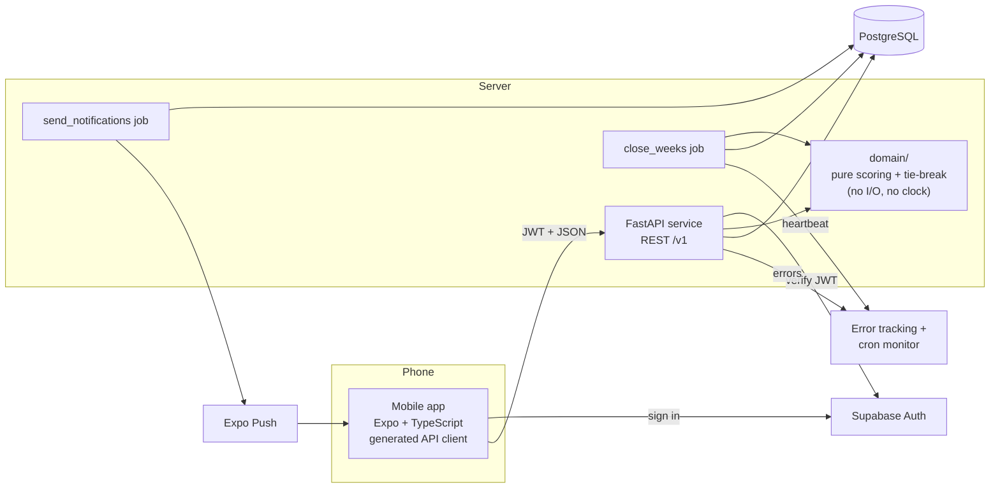

# Socius Weekly Game Engine and Engineering Foundation

*   **Author:** Shreyas Vaid
*   **Status:** Proposed
*   **Date:** 2026-11-11

--------------------------------------------------------------------------------

## Overview

Socius is an iOS and Android app for small groups who already know each other: couples, roommates, friends, families. The group agrees on a weekly training target. Each member checks in on the days they work out. When the week ends, the member with the fewest check-ins does the punishment the group agreed on. No money is involved, and check-ins are on the honor system.

This document designs two things:

1.  **The weekly game engine:**
    *   how check-ins are recorded and dated
    *   how each group's week is scored
    *   how the loser is chosen
    *   how weeks are closed on time without manual work
    *   how skip tokens and admin excusals fit into scoring
2.  **The engineering foundation that protects it:** build tooling, the API contract between app and server, and a testing approach aimed at the code most likely to produce a wrong result: scoring, dates and the weekly close.

This design replaces the earlier adherence-based model in `docs/product-requirements.md` §6–7 and the group-time-zone model in `docs/high-level-design.md` §3. Once approved, it drives the rewrite of those documents, CLAUDE.md, and the first ADRs.

## The Problem

**For users:** groups already hold each other to account with group chats and informal bets. That fails in predictable ways:

*   Nobody keeps an accurate count.
*   The rules get argued over at the end of the week.
*   The bet is forgotten by Wednesday.

Socius only helps if the weekly result is something the group trusts without checking it. The rules must be simple enough to explain in one sentence. The result must be correct every week, including for members in different time zones and members who travel. It must arrive without anyone having to do anything.

**For the system:** the hard part is not the arithmetic. Scoring is "count the days you trained, up to N". The hard part is everything around it:

*   **Time.** At any instant, two or three calendar dates are in use somewhere on Earth, because time zones run from UTC−12 to UTC+14. Members' weeks start and end at different moments. For about 26 hours each weekend, a member in UTC+14 is already checking in for next week while a member in UTC−12 is still finishing this week.
*   **One check-in, many groups.** A member in several groups checks in once, and that check-in must count in each group.
*   **Closing on time.** A background job must close every group's week at a fixed time. If it runs twice, or crashes halfway, it must produce the same result. It must never let a late check-in change a result that has already been announced.
*   **Random tie-breaks.** When several members tie for last, the server picks one at random. A retry must never pick a different person.

A mistake in any of these produces a wrong loser. In a small group of friends, one wrong loser is enough for people to stop trusting the app.

**Proposed solution in one paragraph:**

*   **Check-ins.** A check-in is a single record per member per local date. It is stored once and never copied per group.
*   **Scoring.** Each group's weekly score is computed from those records by a pure function, with no database or clock access. The function is given the week's saved settings: N, who is eligible, who is excused and who used a skip token.
*   **Closing.** Every week closes at Monday 12:00 UTC, the moment Sunday has ended everywhere on Earth. A job that can safely be rerun saves the result, including the random draw, in one transaction.
*   **Foundation.** pnpm + uv + a root `justfile` for tooling. An OpenAPI-generated TypeScript client for the app. Tests built on written invariants checked by property-based tests, plus tests of the close job against a real Postgres database with a fake clock.

## Goals

*   **G1. Correct results with no manual work.** For each group, every week ends in exactly one stored result, whether or not there is a loser. Each result is written by 12:15 UTC on Monday. Over a four-week trial with the test group, no result is changed or computed by hand.
*   **G2. Rerunning gives the same answer.** Running the close job any number of times, including two copies at once, produces the same stored result and the same loser. Tests check this against a real Postgres database.
*   **G3. The rules are written down and tested.** Every scoring rule is stated as an invariant in this document. Each invariant has a property-based test, for example "points are always between 0 and N" or "an excused member never loses".
*   **G4. One check-in counts everywhere.** A member in several groups checks in once per day. That check-in adds a point in every group they belong to, with no duplicate records.
*   **G5. One command for each task.** `just dev`, `just test`, `just lint` and `just gen-client` work from a fresh clone after following the README. CI runs the same commands.
*   **G6. The app and API cannot drift apart.** The TypeScript client is generated from the API's OpenAPI schema. CI fails if the committed client is out of date, or if the API returns responses that don't match its own schema.
*   **G7. A missed close is noticed.** If any group's week has not closed by Monday 13:00 UTC, an alert fires. Every close run leaves a record of what it did.

## Non-Goals

*   **Fixed-days mode.** Groups can't require specific weekdays in v0.1; only a weekly count N exists. It can return later as a weekday filter on the same scoring function.
*   **Detecting cheating.** The server does not try to detect a changed phone clock, a changed time zone or a false check-in. All of this falls under the honor system. The one exception is that a check-in dated later than "today" anywhere on Earth is rejected, because no honest phone can send such a date.
*   **A grace period after midnight.** A check-in belongs to the date on the member's phone when it is made.
*   **Rest-day votes.** Cut from v0.1.
*   **Member-declared opt-outs.** Replaced by the admin excusing a member.
*   **The suspense animation, and draws members can verify.** Deferred. The server saves the draw so retries are consistent, but members cannot check it themselves.
*   **Closing a group early** once its result can't change. Every group closes at the same fixed time.
*   **Configurable week length.** The week is always Monday to Sunday.
*   **Money and enforcement.** The app never handles money. It does not check whether punishments were done.
*   **Bazel, Nx or Turborepo.** Not adopted at the current repo size. The tooling ADR records when to revisit this.
*   **Product areas outside the game engine.** Profiles, proof photos, notifications beyond the weekly result, calorie targets, food logging and workout plans stay in the PRD. Each gets its own spec.

## Open Questions

Resolved during drafting. They are recorded here so they aren't asked again:

*   **Leaving mid-week, excusal timing, skip tokens, settings and Admin vs Owner** follow the defaults approved with the implementation plan.
*   **Admins** may excuse themselves.
*   **Undo** is allowed until the end of the member's own local date. The phone sends its current date with the request.
*   **Check-in dates:**
    *   Any date in an open week is accepted, so backdating within the week is allowed.
    *   A date later than "today" anywhere on Earth is rejected.
    *   That one check is the only exception to fully trusting the phone's date.

Still open:

*   **Deleted accounts in past results.** A member who deletes their account mid-week is still scored. How do they appear in that week's result and in history? An "Anonymous member" label is likely, and the account-deletion spec decides.
*   **Late results in eastern time zones.** Results arrive around Monday 04:00 in California, Monday 21:00 in Tokyo and Monday 23:00 in Sydney. This is accepted for v0.1. Revisit if the test group complains.
*   **Contributors.** Is a second person still contributing? This affects PRD §11, PRD Q10 and the review rules.
*   **Differentiator.** What one sentence describes what Socius does that other accountability apps don't, now that rest-day votes and per-person adherence are gone?

## Critical User Journeys (CUJs)

### CUJ 1: One workout counts in two groups

*   **Given**:
    *   Alex is in group A (N = 4) and group B (N = 3).
    *   Alex's phone is set to America/New_York.
    *   It's Wednesday.
    *   Alex has already checked in Monday and Tuesday.
*   **When**: Alex checks in at 19:30 local time on Wednesday.
*   **Then**:
    *   One check-in record dated Wednesday is stored.
    *   Alex's score is 3 in group A and 3 in group B. Group B is now at its cap, so a check-in on Thursday raises A to 4 and leaves B at 3.
    *   A second check-in attempt on Wednesday is rejected with "Already checked in today".

### CUJ 2: Week closes with a tie at the bottom

*   **Given**:
    *   Group C has four eligible members and N = 5.
    *   On Sunday night their scores are 5, 3, 2 and 2.
*   **When**: the close job runs at Monday 12:05 UTC.
*   **Then**:
    *   Each member's points are recorded. The two members on 2 are the tied candidates.
    *   A random seed is generated and saved. One candidate is chosen from it and saved as the loser, all in one transaction.
    *   Running the job again changes nothing.
    *   Each member gets a notification. It says results are ready but doesn't name the loser.
    *   The results screen shows everyone's points, the loser and the punishment text saved for that week.

### CUJ 3: An excused member and a new joiner cannot lose

*   **Given**:
    *   Group D has members P, Q and R, and N = 3.
    *   The admin excused R this week because R is sick.
    *   S joined the group on Thursday.
*   **When**: the week closes with P on 3, Q on 1, R on 0 and S on 2.
*   **Then**:
    *   Only P and Q are eligible. Q loses with 1 point.
    *   R and S are shown with their points and marked "excused" and "joined mid-week". Neither is a candidate.
    *   If Q had also been excused, only P would be eligible. Fewer than two eligible members means no loser that week.

### CUJ 4: A skip token covers a sick day

*   **Given**:
    *   Group E has N = 4.
    *   Jordan has checked in twice by Saturday and hasn't used this week's skip token.
*   **When**: Jordan uses the skip token on Saturday and checks in on Sunday.
*   **Then**:
    *   Jordan's points are 2 + 1 (token) + 1 = 4, which reaches N.
    *   Jordan can't lose. If every eligible member reached 4, the week has no loser.

## Technical Plan (Architecture)

### Components



*   **Mobile app.** Sends check-ins and admin actions, and shows live and final scores. It talks only to the API and to Supabase Auth, never to the database.
*   **API.** Validates every request, checks permissions, and stores facts: check-ins, excusals, skip tokens, settings changes. It computes *live* scores on request by calling the same pure scoring function the close job uses.
*   **`domain/` module.** Pure Python functions with no database, network or clock access: scoring, eligibility, week arithmetic and the tie-break. Everything that decides who loses lives here, so it can be property-tested on its own.
*   **`close_weeks` job.** After each week's cutoff, it computes and saves the final result for every group. It is safe to run any number of times.
*   **`send_notifications` job.** Sends push notifications that the close job queued. It is kept separate so a retried close never sends duplicates.
*   **Monitoring.** Errors go to an error tracker. The close job pings a cron monitor ("heartbeat") after every successful run, and the monitor alerts if the ping doesn't arrive.

### Core idea: store facts, compute scores

The database stores only facts that users or admins created:

*   a member checked in on a date
*   a member used a skip token in a week
*   an admin excused a member for a week
*   an admin changed the target, starting from a given week

Scores are never stored while a week is open. They are computed from the facts each time they're needed: for the live leaderboard, and once more at close. The close result is then frozen.

This removes three sources of bugs:

*   there are no per-group copies of a check-in to keep in sync
*   there is no counter that can drift
*   there is no weekly job that pre-creates "sessions"

The cost is that every leaderboard view recomputes scores. A group has at most a few members and seven days, so that's a few dozen rows per request.

### Time model

*   **Local date.** Every check-in carries the date on the member's phone (`local_date`), plus the phone's IANA time zone and UTC offset at that moment. The server stores what the phone sent. It does not try to detect changed clocks or zones; that's the honor system. Which dates the server accepts is an open question.
*   **Week key.** A week is identified by the date of its Monday (`week_start`). A check-in belongs to the week whose Monday is on or before its `local_date` and within the last 7 days. The function is `week_start = local_date − weekday(local_date)`. It doesn't use ISO week numbers, which mix years in late December.
*   **Cutoff.** Week `W` closes at `W + 7 days, 12:00 UTC`. That is the following Monday at noon UTC, the moment Sunday has ended in UTC−12, the latest time zone on Earth. Every group shares this cutoff. Nothing dated in week `W` can be created, undone or changed after it.
*   **Two weeks open at once.** Because weeks are keyed by their Monday and not by "the current period", week `W` and week `W+1` can both accept check-ins during the weekend overlap. No special handling is needed.
*   **Clock injection.** All code that needs the current time takes it from a `Clock` object passed in. Business logic never calls `datetime.now()` or uses Postgres `now()` / `DEFAULT now()`. Tests replace the clock with a fake one, which reaches both the API and the job.

### Eligibility and the loser rule

For group `G` and week `W`, each member is in exactly one state:

| State | Condition | Can lose? |
|---|---|---|
| `eligible` | was a member before `W` began and is not excused | yes |
| `joined_mid_week` | joined during `W` | no |
| `excused` | admin excused them for `W` | no |

"Joined during `W`" is decided by the member's local date when they joined (`joined_local_date ≥ week_start`). It uses the same rule as check-ins, so a member who joins on Sunday evening anywhere is eligible from the next Monday.

A member who leaves, is removed or deletes their account during `W` keeps their state for `W`. Leaving does not remove them from the week. This follows the proposed default and is still open.

**Points:** `points = min(N, distinct check-in dates in W + (1 if skip token used in W))`.

**Loser rule** (pure function, applied to eligible members only):

1.  If fewer than 2 members are eligible, there is no loser.
2.  If every eligible member has `points = N`, there is no loser.
3.  Otherwise the candidates are the eligible members with the lowest points. With one candidate, that member loses. With several, the tie-break picks one.

**Tie-break:**

*   **Seed.** At close the job draws a 32-byte seed from `secrets.token_bytes`.
*   **Pick.** It sorts the candidates by user ID and takes `int(sha256(seed ‖ group_id ‖ week_start)) mod k`, where `k` is the number of candidates.
*   **Storage.** The seed, the sorted candidate list, `tiebreak_algorithm = 1` and the loser are saved in the same transaction as the rest of the result.
*   **Why not Python's `random`?** Its sequences beyond `random.random()` aren't guaranteed to be the same across Python versions. A stored hash input can be replayed exactly forever.
*   **Retries.** Once a result exists, it is never recomputed.

### Data model (game engine only)

```text
groups              id, name, created_by, created_at
group_settings      group_id, effective_week_start (date), target_n (1..7),
                    punishment_text, created_by, created_at
                    PK (group_id, effective_week_start)
memberships         group_id, user_id, role (admin|member),
                    joined_at, joined_local_date, left_at
check_ins           id, user_id, local_date, tz_name, utc_offset_minutes,
                    captured_at (phone time), received_at (server time),
                    client_request_id (uuid, unique)
                    UNIQUE (user_id, local_date)
skip_token_uses     group_id, user_id, week_start, created_at
                    PK (group_id, user_id, week_start)
excusals            group_id, user_id, week_start, excused_by, created_at
                    PK (group_id, user_id, week_start)
week_results        group_id, week_start, target_n, punishment_text,
                    closed_at, has_loser, loser_user_id,
                    tiebreak_seed, tiebreak_candidates (uuid[]),
                    tiebreak_algorithm, scoring_version
                    PK (group_id, week_start)
week_member_results group_id, week_start, user_id, state, check_in_days,
                    skip_token_used, points, is_loser
                    PK (group_id, week_start, user_id)
notification_outbox id, user_id, kind, payload (jsonb), created_at, sent_at
job_runs            id, job_name, started_at, finished_at, weeks_closed,
                    late_facts, error
```

*   **Settings.** A week's settings are the `group_settings` row with the latest `effective_week_start ≤ W`. An admin change inserts a row effective next Monday, so open weeks never change. The settings are copied into `week_results` at close, so later edits never change history.
*   **Check-ins.** They have no `group_id`. One row counts in every group the member was in during that week.
*   **Retries.** `client_request_id` makes a retried check-in request harmless.
*   **Undo.** Undoing a check-in deletes the row while its week is still open. After close, `week_member_results` holds the final counts, so nothing depends on the deleted row.
*   **No open-week table.** There is no `weeks` table for open weeks. A week exists implicitly, from its key plus the facts. It becomes a row only when `week_results` is written at close.

### Request rules (API)

Every write that touches week `W` first checks `clock.now() < cutoff(W)` and rejects the request with a specific error otherwise. Each error is an RFC 9457 problem response with a stable `type` code the app maps to a message:

| Action | Extra rules | Error codes |
|---|---|---|
| Check in | one per `local_date` per user | `already-checked-in`, `week-closed`, `date-not-accepted` |
| Undo check-in | own check-in only; the phone's current date must equal the check-in's date | `undo-window-closed`, `week-closed` |
| Use skip token | one per group per week; warn (not block) if already at N | `token-already-used`, `week-closed` |
| Excuse member | admin only; target must be a member that week | `not-admin`, `week-closed` |
| Change target N | admin only; 1–7; effective next Monday | `not-admin`, `invalid-target` |

### The close job

`close_weeks` runs every 5 minutes. It is started by a scheduler inside the API process (D2, decided):

*   **Scheduler.** APScheduler runs `close_weeks` and `send_notifications` every 5 minutes inside the FastAPI process.
*   **One run at a time.** The API may run several workers or instances, and each would start its own scheduler. So each job run first takes a Postgres session-level `pg_try_advisory_lock` on the job's name. If another run holds it, this run exits at once. The job is already safe to rerun; the lock only avoids duplicate work.
*   **Keeping the API awake.** Free hosting tiers put idle processes to sleep, and a sleeping process runs no scheduled jobs. An external uptime monitor requests `GET /healthz` every 5 minutes so the process stays awake. That service is separate from the heartbeat monitor that alerts when `close_weeks` stops succeeding.
*   **Risk to verify before choosing a host.** Whether the host allows keep-alive pings, and whether one always-on service fits in its free monthly hours. If not, the fallback is a paid plan that never sleeps, which needs the author's approval because it costs money.

Each run:

1.  Records a row in `job_runs`.
2.  Finds every `(group, week_start)` whose cutoff is at least 5 minutes in the past and that has no `week_results` row. The search is bounded to recent weeks, and groups with no members are skipped.
3.  For each one, in its own transaction:
    *   Loads the members, settings, check-ins, skip tokens and excusals for that week.
    *   Calls the pure scoring function, then the tie-break if needed.
    *   Inserts `week_results` and `week_member_results`, and queues one `notification_outbox` row per member.
    *   Commits. If another run already inserted the result, the insert fails on the primary key and this run skips the group. That makes two concurrent runs safe.
4.  Finishes the `job_runs` row and pings the cron monitor.

**Close protection (D1, decided: time check plus delay).**

*   **Rejecting late writes.** Every write for week `W` is rejected once `clock.now() ≥ cutoff(W)`.
*   **Delay.** The job closes a week only when `now ≥ cutoff(W) + 5 minutes`.
*   **What the job reads.** Only check-ins, skip tokens and excusals with `received_at < cutoff(W)`. Skip tokens and excusals use `created_at` for this.
*   **No locks.** Neither writes nor the job take any lock beyond the primary-key conflict on `week_results`.
*   **Catching what slips through.** If a write passed the time check before the cutoff but committed after the result was saved, it doesn't count. To make that visible, each `close_weeks` run also counts facts for weeks it closed earlier that have `received_at < cutoff` but were committed after the result's `closed_at`. It records the count in `job_runs.late_facts` and reports any non-zero value to the error tracker. Fixing the result stays manual, and should never happen in practice.

### Tooling and contract

*   **Repo.** pnpm workspace with `apps/mobile` and `packages/api-client`; a uv project at `services/api`; a root `justfile` with `dev`, `test`, `lint`, `fmt`, `typecheck`, `gen-client`, `db-up` and `migrate`. CI installs `just` and calls those same recipes.
*   **Contract.**
    *   `just gen-client` exports the OpenAPI schema from FastAPI without starting a server, then runs `openapi-typescript` to write `packages/api-client/src/schema.d.ts` (D3, decided).
    *   The package exports a typed `openapi-fetch` client that attaches the Supabase JWT to every request and turns problem-detail errors into one typed error.
    *   TanStack Query hooks are written by hand in `apps/mobile/src/api/`. Query keys come from one key-factory module, so cache keys and invalidation after writes are defined in a single place. That is the main way hand-written hooks would otherwise drift.
    *   FastAPI's schema export runs with `separate_input_output_schemas=False` where the models allow it, so Pydantic v2 doesn't create duplicate `-Input`/`-Output` type names.
    *   CI regenerates the client and fails if anything differs from what's committed.
    *   Separately, Schemathesis generates requests from the schema against a test instance of the API and fails if responses don't match the schema.

### Testing approach

| Layer | What it proves | How |
|---|---|---|
| `domain/` scoring, eligibility, tie-break, week math | The rules in this document hold for all inputs | Hypothesis property tests against the invariants listed below, plus example tests for each CUJ |
| API | Request rules, permissions, error codes, idempotent retries | pytest + httpx against real Postgres (Docker locally, CI service container), fake clock |
| Close job | Same result on every rerun, including concurrent runs; no late writes | Real Postgres, fake clock, **two separate database connections** for concurrency tests. The usual "wrap each test in a rolled-back transaction" fixture can't test races, so these tests use a fresh database per test module. |
| Contract | App client matches API, and API matches its schema | Client diff check + Schemathesis |
| Mobile | Screens render scores, errors map to messages | Jest + React Native Testing Library |

The goal is not a coverage percentage. Every invariant below has a property test, and every CUJ has an example test.

**Invariants:**

1.  `0 ≤ points ≤ N` for every member.
2.  Adding a check-in or a skip token never lowers that member's points, and never makes them a candidate if they weren't one before.
3.  There is no loser if and only if fewer than 2 members are eligible or every eligible member has N points.
4.  The loser is always eligible, and always has the lowest points among eligible members.
5.  Adding, removing or changing the check-ins of `joined_mid_week` or `excused` members never changes who the candidates are.
6.  The same inputs and seed give the same result, regardless of input order.
7.  For every candidate set, every candidate is chosen by at least one seed.
8.  A duplicate `(user_id, local_date)` check-in is rejected and changes no score.
9.  `week_start(d)` is a Monday, `week_start(d) ≤ d`, and `d − week_start(d) < 7 days`.
10. For every UTC offset from −12:00 to +14:00, Sunday 23:59:59 local time is before `cutoff(W)`.
11. Running `close_weeks` any number of times, including concurrently, leaves exactly one result per group-week, with the same loser.

### Decisions in this section

*   **D1. Close job vs late check-ins.** Decided: Option A, time check plus delay. Options kept below for the record.
*   **D2. How the jobs are triggered.** Decided: Option B, a scheduler inside the API process, kept awake by an uptime ping. This was chosen over a paid always-on plan and over weakening G1.
*   **D3. TypeScript client generator.** Decided: Option A, openapi-typescript plus openapi-fetch. Query hooks are written by hand in `apps/mobile`.

#### D3 options (decided: A)

*   **Option A: openapi-typescript + openapi-fetch.**
    *   *How it works:* the generator writes TypeScript types only. A small typed `fetch` wrapper uses those types, and TanStack Query hooks are written by hand on top of it.
    *   *Trade-offs:* the generated code is small and easy to read, with few dependencies. You see and control every request and query hook.
    *   *When it fails:* every endpoint needs a hand-written hook. As the API grows, those hooks are boilerplate that can drift from the API's real behavior: wrong cache keys, missed cache invalidation after writes.
*   **Option B: @hey-api/openapi-ts.**
    *   *How it works:* generates types plus one SDK function per endpoint. An optional plugin also generates TanStack Query options and hooks.
    *   *Trade-offs:* less hand-written code than A, and the generated output is still mostly readable.
    *   *When it fails:* the project is young and its configuration has changed between versions. Moderate confidence on that point. Upgrades can mean regenerating and fixing call sites, so the version must be pinned exactly.
*   **Option C: orval.**
    *   *How it works:* generates types and ready-to-use TanStack Query hooks for every endpoint. It can also generate mock servers for tests.
    *   *Trade-offs:* the least hand-written code. The mocks help mobile tests.
    *   *When it fails:* the output is large and harder to read in review. It's tied to TanStack Query and orval's own way of making requests, and customizing auth headers or error handling goes through orval's configuration instead of plain code.

#### D2 options (decided: B, with a keep-alive ping)

*   **Option A: the hosting platform's scheduled job.**
    *   *How it works:* the host (for example Render Cron Jobs or a Fly.io scheduled machine) starts `python -m socius_api.jobs.close_weeks` as its own process every 5 minutes, using the same container image as the API.
    *   *Trade-offs:* the job is separate from the API, so web traffic and job crashes don't affect each other. The trigger configuration depends on the host.
    *   *When it fails:* if the host's scheduler has an outage, nothing runs. The heartbeat alert is the only signal. Some hosts charge for scheduled jobs, or don't offer them on free plans.
*   **Option B: a scheduler inside the API process.**
    *   *How it works:* a library such as APScheduler runs `close_weeks` every 5 minutes inside the FastAPI process.
    *   *Trade-offs:* no extra service and nothing extra to configure.
    *   *When it fails:* free-tier hosts put the API to sleep when there's no traffic, and a sleeping process runs no jobs, so weeks don't close until someone opens the app. With more than one API instance, every instance runs the job. That's safe because the job can be rerun, but the work is duplicated.
*   **Option C: an outside scheduler calls a protected endpoint.**
    *   *How it works:* an external service (a GitHub Actions scheduled workflow, or a cron service such as cron-job.org) sends `POST /internal/jobs/close-weeks` with a secret token every 5 minutes.
    *   *Trade-offs:* free, and it doesn't depend on the host.
    *   *When it fails:* GitHub scheduled workflows are often delayed by many minutes, are sometimes skipped under load, and are turned off after 60 days without repository activity. A long close runs inside a web request and can hit the host's request timeout. The endpoint is one more thing to secure.

#### D1 options (decided: A)

*   **Option A: time check plus a delay.**
    *   *How it works:* every write checks `now < cutoff` before it touches the database. The close job starts 5 minutes after the cutoff and reads only check-ins with `received_at < cutoff`. No extra locks.
    *   *Trade-offs:* simple, with no lock ordering to reason about. Check-in requests never wait on the job.
    *   *When it fails:* a write that passes the time check before the cutoff but takes more than 5 minutes to commit is missed. With short API transactions this is unlikely but not impossible. If it happens, the check-in is saved but doesn't count, and nothing reports it.
*   **Option B: a lock per group-week.**
    *   *How it works:* every write for week `W` and the close job both take a Postgres advisory lock on `(group, W)`. The job holds it while it reads and writes the result, and writes check the cutoff after taking the lock.
    *   *Trade-offs:* there is no window where a check-in can slip past the close.
    *   *When it fails:* a check-in counts in every group the member is in, so it has to lock several groups. The locks must always be taken in the same order, by group ID, or two requests can deadlock. Writes also wait while a close is running. This needs more code and more concurrency tests.
*   **Option C: the database refuses late rows.**
    *   *How it works:* a trigger on `check_ins`, `skip_token_uses` and `excusals` rejects any insert or delete whose week already has a `week_results` row, checked inside the same transaction.
    *   *Trade-offs:* the database itself guarantees it, so a bug in API code can't break it.
    *   *When it fails:* `check_ins` has no group, so the trigger must look up every group the user belongs to on every check-in. Business rules split between Python and SQL, and SQL triggers are harder to test with Hypothesis. A race between the trigger's lookup and the job's insert still needs a lock or serializable isolation to close fully.

## Alternatives Considered

### Game rules

#### Alternative A: Adherence scoring with a separate goal per member

*   **How it works:** Each member sets their own weekly goal. Score = completed ÷ scheduled, with skip tokens and mid-week joins removed from the denominator.
*   **Pros:**
    *   Fair across different goals.
    *   A member who trains three days a week can compete with one who trains five.
*   **Cons:**
    *   Harder to explain ("why did 3/4 lose to 4/5?").
    *   Needs a per-member schedule and ratio arithmetic.
    *   Edge cases for zero denominators.
*   **Reason for Rejection:** Rejected by author: the group agrees on one target N, and training to the same target together is what drives accountability. With a shared N, raw points are already fair and need no ratio.

#### Alternative B: Ties at the bottom share the loss

*   **How it works:** Everyone tied for the lowest score takes the punishment.
*   **Pros:**
    *   No randomness, so nothing to store or audit.
    *   Easy to test.
*   **Cons:**
    *   Two or three people doing one punishment ("buy dinner") is awkward.
    *   Shared loss feels lighter, which weakens the stakes.
*   **Reason for Rejection:** Rejected by author: a tie is broken by a random pick among the tied members.

#### Alternative C: No loser only when every member reaches N, with "everyone tied" handled separately

*   **How it works:** An earlier proposal treated "everyone at 0" as no loser, or as a shared group punishment.
*   **Pros:** Avoids one person taking the punishment for a shared failure.
*   **Cons:** The whole group can skip a week together with no consequence.
*   **Reason for Rejection:** Rejected by author: anyone below N can lose. If everyone is at 0, everyone is in the random pick.

#### Alternative D: One time zone per group

*   **How it works:** All dates and deadlines use one IANA zone set by the group admin.
*   **Pros:**
    *   One clear day boundary per group.
    *   Simpler week math.
*   **Cons:**
    *   Members in other zones, or travelling, have "days" that don't match their own calendar.
    *   A check-in has to be dated in several zones if the member is in several groups.
*   **Reason for Rejection:** Rejected by author: each check-in uses the date on the member's phone. This handles members in different zones and members who travel, and makes one check-in count in every group.

#### Alternative E: Close each week when every member's own Sunday has ended

*   **How it works:** The close time per group is the latest end-of-Sunday across its members' zones.
*   **Pros:** Results arrive sooner for groups whose members are all in eastern zones.
*   **Cons:**
    *   The close time moves when members travel or change zones.
    *   It is harder to compute, and harder to test.
*   **Reason for Rejection:** Rejected by author in favor of a fixed Monday 12:00 UTC cutoff for every group. It never moves and is trivial to test. The cost is that results arrive late in eastern zones (Sydney about 23:00 Monday).

#### Alternative F: Grace period until noon the next day

*   **How it works:** A check-in for a date is accepted until 12:00 the following day.
*   **Pros:** Covers late-night workouts and forgetting to tap.
*   **Cons:**
    *   It is a second time window to define.
    *   It pushes the close later.
    *   Every date check gets more complicated.
*   **Reason for Rejection:** Rejected by author for v0.1: check-ins must happen on the day itself.

#### Alternative G: Group-voted rest days

*   **How it works:** Any member proposes a rest day, and it passes with a strict majority of all members.
*   **Pros:** The group can agree to cancel a day together.
*   **Cons:**
    *   It adds a feature, two background jobs and a notification type.
    *   It made sense only when everyone trained on the same fixed days.
*   **Reason for Rejection:** Rejected by author for v0.1: members choose their own days, and skip tokens and excusals cover individual absences.

#### Alternative H: Member-declared travel opt-out

*   **How it works:** A member opts out of a week before it starts, at most about once a month, and the group sees it.
*   **Pros:** Members don't need to ask anyone.
*   **Cons:**
    *   It needs a deadline, a frequency limit and a setting for that limit.
    *   It is a way to escape losing that members can trigger themselves.
*   **Reason for Rejection:** Rejected by author: replaced by the admin excusing a member for any reason, such as illness or travel. That is one rule with no deadline or limit.

#### Alternative I: Fixed-days mode in v0.1

*   **How it works:** The admin picks specific weekdays, and only check-ins on those days count.
*   **Pros:** Supports groups who train together on set days.
*   **Cons:**
    *   It doubles the setup screens, the scoring paths and the test space.
    *   Weekdays become ambiguous once dates follow each phone's zone.
*   **Reason for Rejection:** Rejected by author for v0.1: count mode only. Fixed days can be added later as a weekday filter on the same scoring function.

#### Alternative J: Detecting changed clocks and backdated dates

*   **How it works:** The server compares the date the phone sends with the time it received the request, and rejects dates that aren't plausible.
*   **Pros:** Harder to cheat.
*   **Cons:**
    *   Rejects honest offline check-ins.
    *   Adds rules that conflict with "trust the group".
*   **Reason for Rejection:** Rejected by author: honor system; changing your phone's clock is on you. (A minimal "date must be today somewhere on Earth" check is still an open question.)

#### Alternative K: Configurable week length

*   **How it works:** Groups choose a period length, for example 7 or 14 days.
*   **Pros:** Flexible.
*   **Cons:** Every date calculation gets a variable, and the global cutoff stops being a single rule.
*   **Reason for Rejection:** Rejected by author: always Monday to Sunday.

### Architecture

#### Alternative L: Store running scores per group

*   **How it works:** Each check-in increments a counter for each group the member belongs to. The close reads the counters.
*   **Pros:**
    *   Leaderboard reads are a single row lookup.
    *   Scores are visible directly in the database.
*   **Cons:**
    *   Every check-in, undo, skip token, excusal and membership change must update every affected counter correctly.
    *   A bug leaves counters wrong with no way to recompute them.
    *   Scoring logic gets split between write paths and the close job.
*   **Reason for Rejection:** Rejected: storing facts and computing scores with one pure function keeps a single definition of scoring, used by both the live leaderboard and the close. Recomputing costs a few dozen rows per request at this group size.

#### Alternative M: A row per open week, created ahead of time, with session rows

*   **How it works:** A job creates a `periods` row and one `sessions` row per training day at the start of each week. That was the original HLD design.
*   **Pros:** The current week is explicit in the database.
*   **Cons:**
    *   It assumes one current week per group, so it can't represent two weeks open at once during the weekend overlap.
    *   It adds a creation job that must itself run on time.
*   **Reason for Rejection:** Rejected: weeks are identified by their Monday's date and exist implicitly. A row is written only when the result is saved.

#### Alternative N: Python's `random` with a stored seed for the tie-break

*   **How it works:** `random.Random(seed).choice(candidates)`.
*   **Pros:** One line of code.
*   **Cons:** Python only guarantees `random.random()` gives the same results across versions. `choice` and the integer methods have changed before. A stored seed might not reproduce the same loser after a Python upgrade.
*   **Reason for Rejection:** Rejected: `sha256(seed ‖ group_id ‖ week_start) mod k` over candidates sorted by ID can be replayed exactly by any language, forever.

#### Alternative O: Lock per group-week, or database triggers, to protect the close (D1 options B and C)

*   **Pros:** Lower chance of, or no, check-ins slipping past the close.
*   **Cons:**
    *   Locks: a check-in counts in several groups, so it must lock them all in a fixed order to avoid deadlocks.
    *   Triggers: business rules end up split between Python and SQL.
*   **Reason for Rejection:** Rejected by author in favor of a time check plus a 5-minute delay. The rare slip-through is counted and reported, not prevented. See D1 in the Technical Plan.

#### Alternative P: Hosting platform's scheduled job, or an external scheduler calling an endpoint (D2 options A and C)

*   **Pros:**
    *   Host scheduled job: isolated from web traffic.
    *   External scheduler: free and independent of the host.
*   **Cons:**
    *   Host scheduled job: configuration specific to the host, and possibly paid.
    *   External scheduler: GitHub scheduled workflows are often delayed, sometimes skipped, and turned off after 60 days without activity.
*   **Reason for Rejection:** Rejected by author in favor of a scheduler inside the API process, kept awake by an uptime ping. This keeps everything in one deployable service.

#### Alternative Q: @hey-api/openapi-ts or orval for the client (D3 options B and C)

*   **Pros:** They generate request functions or TanStack Query hooks, so less code is written by hand.
*   **Cons:**
    *   hey-api: young project with configuration that changes between versions.
    *   orval: large output that is hard to review, and customized through its own configuration.
*   **Reason for Rejection:** Rejected by author in favor of openapi-typescript plus openapi-fetch, with hooks written by hand around one key-factory module. It is small and readable, with full control over requests.

### Tooling and process

#### Alternative R: Bazel (or Nx / Turborepo) as the build system

*   **How it works:**
    *   Bazel: a single build system for every language, with hermetic builds and a cache that can be shared across machines.
    *   Nx and Turborepo: task runners and caches for JavaScript-heavy monorepos.
*   **Pros:**
    *   Builds that repeat exactly.
    *   Faster CI for very large repos.
    *   Used at large companies.
*   **Cons:**
    *   Expo's build tools (Metro, EAS) don't run through Bazel, so there would be two build systems.
    *   Every package needs BUILD files.
    *   Bazel's Python and JavaScript rules are complex.
    *   The benefits only appear at a scale of many engineers and targets. This repo has three packages.
*   **Reason for Rejection:** Rejected by author: pnpm + uv + a root `justfile` matches the repo's size. The tooling ADR states the signals for revisiting: CI time, number of packages, or more contributors.

#### Alternative S: One combined design document

*   **Pros:**
    *   One file to keep consistent.
*   **Cons:**
    *   Product rules and technical design change at different rates.
    *   They are reviewed by different readers.
*   **Reason for Rejection:** Rejected by author: split into `docs/product-requirements.md` and `docs/high-level-design.md`.

#### Alternative T: A branch-coverage percentage as the testing target

*   **Pros:**
    *   Easy to measure and enforce in CI.
*   **Cons:**
    *   Coverage shows which lines ran, not whether results were checked.
    *   A near-100% target rewards tests that don't check anything.
*   **Reason for Rejection:** Rejected: the target is that every written invariant has a property test and every CUJ has an example test. Coverage is still reported, but it is not a gate.

--------------------------------------------------------------------------------

## Non-Functional Requirements

*   **Privacy.**
    *   A check-in's `tz_name` and `utc_offset_minutes` are never returned to other members, because they reveal location and travel. Group members see only that a member checked in on a date.
    *   The reason for an excusal is never stored.
    *   Every group endpoint checks that the caller is a member of the group. Admin endpoints also check `role = admin`. Both rules have tests.
*   **Correctness over speed.**
    *   Live leaderboard reads recompute scores, which means at most 8 members × 7 days of check-ins per request.
    *   No caching layer is added. The close job handles one group per transaction.
*   **Rollout.**
    *   Nothing is deployed yet, so there is no data to migrate.
    *   The first Alembic migration creates the schema in this document.
    *   Any later change to scoring rules increments `scoring_version`, and any later change to the tie-break increments `tiebreak_algorithm`. Results already saved are never recomputed.
*   **Cost.**
    *   Everything runs on free tiers: one API service, managed Postgres, Supabase Auth, Expo Push, an error tracker, an uptime monitor and a cron heartbeat monitor.
    *   Moving to a paid plan needs the author's approval.

--------------------------------------------------------------------------------

### Future Improvements

Ideas from the brainstorm review that were deferred, not rejected:

*   **Fixed-days mode.** The admin picks specific weekdays, and only check-ins on those days count. It can be added later as a weekday filter on `score_week`, without changing the rest of the scoring rules.
*   **Closing a group early.** A group's week could close as soon as its result can no longer change, for example when every eligible member has reached N. That would make results arrive sooner in eastern time zones. Monday 12:00 UTC stays the latest close. The cost is a second way for a week to close, which needs its own tests.
*   **A tie-break members can verify.** Publish a hash of the seed when the week opens and reveal the seed at close. Any member could then recompute the draw themselves. This pairs with the deferred suspense animation.
*   **New joiners play without risk.** A member who joins mid-week could have their check-ins shown with points, while still not being able to lose. They wouldn't lose a week of activity just for joining on a Wednesday. Scoring is unchanged.

--------------------------------------------------------------------------------

## Detailed Implementation Plan

The work is in seven stages. Each stage is one or more small PRs with green CI, and each stage depends on the ones before it.

Items marked **[default]** were proposed defaults. The author approved them with this plan.

All decisions are made. Database access is synchronous (D4), and this document lives at `docs/designs/weekly-game-engine.md`.

### Stage 1: Documentation

#### 1. `docs/product-requirements.md` (Modify)

*   **Type / Scope:** Product requirements.
*   **Proposed Changes:** Rewrite to the rules in this design.
    *   **§1 and §1.2:** remove the adherence wording and rest-day votes. The differentiator sentence stays open.
    *   **§2.1:** G1–G3 use "week" and a shared N. G2 becomes "same target N for everyone". Fix the group size conflict (2–8 vs 1–8) to **[default]** 1–8, where groups of 1 never have a loser.
    *   **§4 glossary:**
        *   Remove Schedule, Session, Rest day, Period and Adherence.
        *   Add Week, Target N, Points, Eligible, Excused, Joined mid-week, Cutoff and Tie-break.
        *   Rename Owner to Admin **[default]**.
    *   **§5 requirements:**
        *   FR-5 covers the target N and the punishment.
        *   FR-9: yes.
        *   FR-10: local date.
        *   FR-11: delete.
        *   FR-13: undo until the end of the member's own local date. The phone sends its current date with the request.
        *   FR-15: counts in every group.
        *   FR-16: reminders in the phone's current zone.
        *   FR-17 and FR-18: delete.
        *   FR-19: "week". Results notifications don't name the loser.
        *   New: every rejected action shows a specific message.
    *   **§6:** the game rules, the eligibility table and the loser rule from this document. The honor-system statement covers clocks and dates. Settings changes apply next Monday.
    *   **§7:**
        *   Skip token: one per group per week **[default]**.
        *   Admin excusal: any reason, before the cutoff **[default]**, reason not stored.
        *   Remove rest-day votes.
    *   **§9 privacy table:**
        *   Remove the adherence and vote rows.
        *   Add a row for check-in zone and offset: private.
        *   Add a row for excusal: visible, reason not stored.
    *   **§10 roadmap:** v0.1 scope as in this design.
    *   **§11 risks:** add honor-system date slack, late results in eastern zones, and the keep-alive host dependency.
    *   **§12 open questions:** remove Q1, Q2, Q4 and Q8, and add the remaining Open Questions from this document.
    *   Remove the duplicated retention text and the doubled `---` separators.

#### 2. `docs/high-level-design.md` (Modify)

*   **Type / Scope:** Technical design.
*   **Proposed Changes:**
    *   **§2:** replace the architecture with the components diagram from this document, and remove "vote close".
    *   **§2.1:** add `just`, APScheduler, openapi-typescript/openapi-fetch, Schemathesis, the error tracker and the uptime and cron monitors.
    *   **§3:** replace with the time model.
    *   **§4:** replace with the data model in this document, plus the existing user, profile, photo and push-token tables that this design doesn't change.
    *   **§5:** replace the game endpoints with the ones in Stage 5 below.
    *   **§6:** describe `close_weeks`, `send_notifications`, the keep-alive and the heartbeat.
    *   **§7:**
        *   Replace with the testing table and invariants.
        *   Remove "near-100% branch coverage".
        *   Add the rule against database-side `now()`, the two-connection concurrency tests and Schemathesis.
    *   **§9:** replace the ADR table with a link to `docs/adr/`.
    *   **§10:** add `justfile`, `pnpm-workspace.yaml` and `docker-compose.yml`, and remove "votes" from `domain/`.

#### 3. `CLAUDE.md` (Modify)

*   **Type / Scope:** Assistant instructions.
*   **Proposed Changes:**
    *   Replace "Key product rules" with links to PRD §6–7 and HLD §3, keeping only the rules that never change: no money, food never scored, body data private, honor system.
    *   Update the summary on line 7, the stack (add `just`, APScheduler, openapi-typescript) and the Phase 0 checklist (ADRs 0001–0010, `just`).
    *   Remove items that are now decided from "Unconfirmed defaults", and remove "votes" from the domain list.
    *   The portfolio paragraph on line 9 stays, pending the author's call.

#### 4. `README.md` (Modify)

*   **Type / Scope:** Project overview.
*   **Proposed Changes:**
    *   Remove "adherence" and "voted rest days".
    *   Describe the rules in one line.
    *   Add a "Development" section: prerequisites (Node LTS, pnpm via Corepack, uv, just, Docker), then `just setup`, `just db-up`, `just migrate`, `just dev`, `just test`.

#### 5. `docs/adr/0000-template.md` (Modify)

*   **Type / Scope:** ADR template.
*   **Proposed Changes:** Add `Deciders`, `Supersedes` and `Superseded by` fields.

#### 6. `docs/specs/0000-template.md` (Modify)

*   **Type / Scope:** Spec template.
*   **Proposed Changes:** Add "Alternatives considered" and "Risks" sections, and update the example references.

#### 7–16. `docs/adr/0001-*.md` through `docs/adr/0010-*.md` (Create)

*   **Type / Scope:** Architecture decision records, one page each, all Accepted except 0004.
*   **Proposed Changes:**

| ADR | File name | Status | Records |
|---|---|---|---|
| 0001 | `0001-docs-process.md` | Accepted | PRD / HLD / design docs / specs / ADRs, and when each is used. |
| 0002 | `0002-react-native-expo.md` | Accepted | React Native and Expo over native Swift. |
| 0003 | `0003-fastapi-backend.md` | Accepted | A FastAPI backend; the app never touches the database; synchronous SQLAlchemy (D4). |
| 0004 | `0004-supabase-auth.md` | Proposed | Supabase Auth, plus storage options. |
| 0005 | `0005-build-tooling.md` | Accepted | pnpm + uv + just, Alternative R, and the signals for revisiting. |
| 0006 | `0006-api-contract.md` | Accepted | OpenAPI → openapi-typescript (D3), the client diff check, Schemathesis. |
| 0007 | `0007-scoring-model.md` | Accepted | Shared N, points capped at N, eligibility, the loser rule, Alternatives A–C. |
| 0008 | `0008-time-model.md` | Accepted | Phone local date, Monday-keyed weeks, the Monday 12:00 UTC cutoff, Alternatives D–F. |
| 0009 | `0009-close-job.md` | Accepted | Time check plus delay (D1), in-process scheduler with keep-alive (D2), facts-not-counters (Alternative L), late-fact reporting. |
| 0010 | `0010-tiebreak-and-testing.md` | Accepted | The SHA-256 tie-break (Alternative N), invariant-based testing (Alternative T), the fake clock. |

#### 17. `docs/designs/weekly-game-engine.md` (Create)

*   **Type / Scope:** This design, finalized.
*   **Proposed Changes:**
    *   It is the first document in `docs/designs/`, the folder for designs that span several features. It serves as the spec for the weekly game engine, so no separate spec is written for the same scope.
    *   CLAUDE.md ("How we work") and ADR-0001 describe when to write a design doc and when to write a spec. A design doc is for work spanning several features or components. A spec is for one feature.

#### 18. `concepts_brief.md`, `design_draft.md` (Delete)

*   **Type / Scope:** Working files at the repo root.
*   **Proposed Changes:** Delete them once the design is finalized, with the author's confirmation. Their content lives on in the final design.

### Stage 2: Repository scaffold and CI

#### 19. `package.json` (Create)

*   **Type / Scope:** Root JavaScript workspace manifest.
*   **Proposed Changes:**
    *   `private: true`.
    *   `packageManager` pinned to an exact pnpm version, through Corepack.
    *   `engines.node` set to the current Node LTS.
    *   No scripts. `just` is the entry point.

#### 20. `pnpm-workspace.yaml` (Create)

*   **Type / Scope:** Workspace definition.
*   **Proposed Changes:** Packages `apps/*` and `packages/*`.

#### 21. `.npmrc` (Create)

*   **Type / Scope:** pnpm configuration.
*   **Proposed Changes:**
    *   Set `node-linker=hoisted` only if the pinned Expo SDK's monorepo guide still requires it. Check this while scaffolding, and record the result in ADR-0005.
    *   `strict-peer-dependencies=false` is set only if Expo's peer dependencies require it.

#### 22. `justfile` (Create)

*   **Type / Scope:** Single command entry point.
*   **Proposed Changes:**

| Recipe | Runs |
|---|---|
| `setup` | `pnpm install` and `uv sync` |
| `db-up` / `db-down` | Docker Compose |
| `migrate` | `alembic upgrade head` |
| `dev` | API with reload, plus the Expo dev server |
| `test` | `test-api`, `test-mobile` |
| `test-api` | pytest |
| `test-mobile` | Jest |
| `lint` | ruff check, ruff format --check, ESLint, Prettier --check |
| `fmt` | ruff format, Prettier --write |
| `typecheck` | pyright, `tsc --noEmit` per package |
| `gen-client` | export OpenAPI, run openapi-typescript |
| `check-client` | `gen-client`, then `git diff --exit-code packages/api-client` |
| `ci` | every check CI runs |

#### 23. `.gitignore` (Modify)

*   **Type / Scope:** Ignore rules.
*   **Proposed Changes:** Add `.venv/`, `node_modules/`, `.expo/`, `.pytest_cache/`, `.hypothesis/`, `*.env` (but not `.env.example`) and `services/api/openapi.json`.

#### 24. `.env.example` (Create)

*   **Type / Scope:** Documented environment variables.
*   **Proposed Changes:**
    *   **Database:** `DATABASE_URL`.
    *   **Auth:** `SUPABASE_URL`, `SUPABASE_JWT_AUDIENCE`, `SUPABASE_JWKS_URL`.
    *   **Monitoring:** `SENTRY_DSN`, `CRON_HEARTBEAT_URL`.
    *   **Push:** `EXPO_ACCESS_TOKEN`.
    *   **Jobs:** `SCHEDULER_ENABLED`, which defaults to `true` and is set to `false` in tests.
    *   **Database pool:** `DB_POOL_SIZE`.
    *   **Mobile app:** `EXPO_PUBLIC_API_URL`, `EXPO_PUBLIC_SUPABASE_URL`, `EXPO_PUBLIC_SUPABASE_ANON_KEY`.

#### 25. `docker-compose.yml` (Create)

*   **Type / Scope:** Local Postgres.
*   **Proposed Changes:**
    *   A `postgres:16` service with a named volume, a health check and port 5432.
    *   A second database, `socius_test`, created by an init script for the test suite.

#### 26. `docker/postgres-init/01-create-test-db.sql` (Create)

*   **Type / Scope:** Postgres init script.
*   **Proposed Changes:** Creates `socius_test`.

#### 27. `.github/workflows/ci.yml` (Create)

*   **Type / Scope:** CI.
*   **Proposed Changes:**
    *   **Triggers:** pull requests and pushes to `main`.
    *   **Setup:** a `postgres:16` service container; `actions/setup-node`, pnpm through Corepack, `astral-sh/setup-uv` and `extractions/setup-just` (or the equivalent), with uv and pnpm caches.
    *   **Steps:** `just setup`, then `just lint`, `just typecheck`, `just migrate` (test database), `just test` and `just check-client`.
    *   **Schemathesis:** runs as part of `test-api`.

#### 28. Branch protection on `main` (GitHub setting, not a file)

*   **Type / Scope:** Repository setting.
*   **Proposed Changes:** Require a PR and a green `ci` check. The author applies it in the GitHub UI or with `gh`, after confirming.

### Stage 3: Domain module (pure, no I/O)

#### 29. `services/api/pyproject.toml` (Create)

*   **Type / Scope:** Python project managed by uv.
*   **Proposed Changes:**
    *   Python ≥ 3.12.
    *   **Runtime dependencies:**
        *   fastapi, uvicorn[standard], pydantic v2, pydantic-settings
        *   sqlalchemy 2.x, alembic, psycopg[binary] 3.x
        *   pyjwt[crypto] for verifying Supabase JWTs against the JWKS
        *   apscheduler 3.x (the stable line, not the 4.0 pre-releases)
        *   sentry-sdk, httpx
    *   **Dev dependencies:** pytest, hypothesis, schemathesis, ruff, pyright.
    *   **Tool settings:** ruff rules; pyright in `strict` mode on `src/`; pytest markers `db` and `concurrency`; a Hypothesis profile `ci` with more examples.
    *   **Python version:** a `.python-version` file pins it.

#### 30. `services/api/src/socius_api/domain/weeks.py` (Create)

*   **Type / Scope:** Pure week arithmetic.
*   **Proposed Changes:**
    *   `week_start(local_date: date) -> date`
    *   `week_dates(week_start: date) -> list[date]`
    *   `cutoff(week_start: date) -> datetime`, aware UTC, equal to `week_start + 7 days, 12:00 UTC`
    *   `close_eligible_at(week_start) -> datetime`, equal to `cutoff + 5 min`
    *   `is_open(week_start, now: datetime) -> bool`
    *   `latest_local_date(now) -> date`, the date in UTC+14, used to reject future dates
    *   **Validation:** raises `ValueError` if `week_start` isn't a Monday.

#### 31. `services/api/src/socius_api/domain/scoring.py` (Create)

*   **Type / Scope:** Pure scoring and the loser rule.
*   **Proposed Changes:**
    *   **Types**, all frozen dataclasses:
        *   `MemberState` enum: `ELIGIBLE`, `JOINED_MID_WEEK`, `EXCUSED`.
        *   `MemberWeekInput`: `user_id: UUID`, `state`, `check_in_dates: frozenset[date]`, `skip_token_used: bool`.
        *   `MemberScore`: `user_id`, `state`, `check_in_days`, `skip_token_used`, `points`.
        *   `WeekOutcome`: `scores: tuple[MemberScore, ...]` sorted by user ID; `candidates: tuple[UUID, ...]` sorted; `kind` set to `NO_LOSER_TOO_FEW_ELIGIBLE`, `NO_LOSER_ALL_REACHED_TARGET`, `SINGLE_LOSER` or `TIEBREAK_NEEDED`.
    *   **Functions:**
        *   `member_state(joined_local_date, excused: bool, week_start) -> MemberState`
        *   `points(check_in_dates, skip_token_used, target_n, week_start) -> int`. It counts only dates inside the week and caps the total at `target_n`.
        *   `score_week(target_n: int, week_start: date, members: Sequence[MemberWeekInput]) -> WeekOutcome`
    *   **Version:** `SCORING_VERSION = 1`.

#### 32. `services/api/src/socius_api/domain/tiebreak.py` (Create)

*   **Type / Scope:** Pure tie-break.
*   **Proposed Changes:**
    *   **Functions:**
        *   `new_seed() -> bytes`, 32 bytes from `secrets`. It is the only function in `domain/` that isn't deterministic, and it is kept separate so tests can pass a fixed seed.
        *   `pick_loser(seed: bytes, group_id: UUID, week_start: date, candidates: Sequence[UUID]) -> UUID`
    *   **Hash input:** `seed ‖ group_id.bytes ‖ week_start.isoformat().encode()`.
    *   **Pick:** candidates are sorted by `UUID.bytes`, and the loser is `int.from_bytes(sha256(...).digest(), "big") % k`.
    *   **Version:** `TIEBREAK_ALGORITHM = 1`.

#### 33. `services/api/src/socius_api/domain/__init__.py` (Create)

*   **Type / Scope:** Package marker.
*   **Proposed Changes:** Re-exports the public functions.
*   **Rule:** a test (file 61) fails if any `domain/` module imports `sqlalchemy`, `fastapi`, `httpx`, `datetime.now` or `time.time`.

#### 34. `services/api/tests/domain/strategies.py` (Create)

*   **Type / Scope:** Hypothesis strategies.
*   **Proposed Changes:**
    *   **Dates and weeks:** Monday dates between 2020 and 2040, and sets of dates within a week.
    *   **Members:** user IDs, members with random states, check-ins and token use, and groups of 1–8 members.
    *   **Targets:** `target_n` from 1 to 7.
    *   **Time zones:** UTC offsets from −720 to +840 minutes.

#### 35. `services/api/tests/domain/test_weeks.py` (Create)

*   **Type / Scope:** Property and example tests.
*   **Proposed Changes:**
    *   **Property tests:** invariants 9 and 10.
    *   **Example tests:**
        *   the year boundary, for example 2026-12-31 and 2027-01-01
        *   leap day
        *   the cutoff instant itself, which counts as closed
        *   one microsecond before the cutoff, which counts as open

#### 36. `services/api/tests/domain/test_scoring_properties.py` (Create)

*   **Type / Scope:** Property tests.
*   **Proposed Changes:** Invariants 1–6 and 8, one test function each, named after the invariant.

#### 37. `services/api/tests/domain/test_scoring_examples.py` (Create)

*   **Type / Scope:** Example tests.
*   **Proposed Changes:**
    *   **CUJs:** one test each for CUJs 1–4, with their exact numbers.
    *   **Small groups:** a solo group; a couple where one member is excused; everyone at 0 (a tie-break among everyone).
    *   **Edge cases:** N = 1 with a skip token; a check-in outside the week (ignored).

#### 38. `services/api/tests/domain/test_tiebreak.py` (Create)

*   **Type / Scope:** Property and fixed-vector tests.
*   **Proposed Changes:**
    *   **Invariants:** invariant 6 (candidate order doesn't matter) and invariant 7 (every candidate can be chosen by some seed).
    *   **Fixed vectors:** three hard-coded seed and candidate vectors with expected losers. They catch any accidental change to the algorithm.

### Stage 4: Database layer

#### 39. `services/api/alembic.ini`, `services/api/migrations/env.py`, `services/api/migrations/script.py.mako` (Create)

*   **Type / Scope:** Alembic setup.
*   **Proposed Changes:**
    *   Migrations read `DATABASE_URL` from the settings.
    *   Migrations are compared against `db/models.py` metadata.
    *   A naming convention for constraints keeps migrations stable.

#### 40. `services/api/migrations/versions/0001_game_engine.py` (Create)

*   **Type / Scope:** First migration.
*   **Proposed Changes:**
    *   **Tables:** `users` (id, auth_provider_id, display_name, created_at, deleted_at), the game-engine tables from the data model, and `push_tokens`.
    *   **Checks:**
        *   `target_n BETWEEN 1 AND 7`
        *   `effective_week_start` and `week_start` columns must be Mondays (`EXTRACT(ISODOW …) = 1`)
        *   `utc_offset_minutes BETWEEN -720 AND 840`
    *   **No database clock:** no `server_default=now()` on any column used by business logic.
    *   **Indexes:**
        *   `check_ins (user_id, local_date)` (unique), `check_ins (client_request_id)` (unique)
        *   `memberships (user_id)`
        *   `week_results (group_id, week_start)` (primary key)
        *   `notification_outbox (sent_at) WHERE sent_at IS NULL`

#### 41. `services/api/src/socius_api/db/models.py` (Create)

*   **Type / Scope:** SQLAlchemy 2.x typed models (`Mapped[...]`).
*   **Proposed Changes:** One class per table in the migration.

#### 42. `services/api/src/socius_api/db/session.py` (Create)

*   **Type / Scope:** Engine and session factory.
*   **Proposed Changes:**
    *   **Sessions:** a session-per-request dependency for FastAPI, and a separate session factory for jobs.
    *   **Synchronous (D4, decided).** One `Engine` built with `create_engine(DATABASE_URL)` using psycopg 3, and a `sessionmaker`.
    *   **Route handlers** are plain `def` functions, which FastAPI runs in its thread pool.
    *   **Pool size** is 5, with an overflow of 5. That fits free-tier Postgres connection limits and is recorded in `.env.example` as `DB_POOL_SIZE`.

#### 43. `services/api/src/socius_api/db/repositories.py` (Create)

*   **Type / Scope:** Query functions, the only place SQL lives.
*   **Proposed Changes:**
    *   **Week inputs:**
        *   `load_week_inputs(session, group_id, week_start, received_before: datetime | None) -> (target_n, punishment_text, list[MemberWeekInput])`
        *   `received_before` is `None` for live reads and the cutoff for close.
    *   **Settings:** `settings_for_week(session, group_id, week_start)`.
    *   **Close job:**
        *   `weeks_due_for_close(session, now) -> list[(group_id, week_start)]`. It looks back at most 8 weeks and only at groups with at least one membership active in that week.
        *   `insert_week_result(...)` raises `AlreadyClosed` on a primary-key conflict.
        *   `count_late_facts(session, since_closed_at)`.
    *   **Check-ins:** `user_groups_for_week(session, user_id, week_start)`, used by the check-in response.
    *   **Pattern:** plain functions, not repository classes. There is only one implementation, so an abstraction layer adds nothing.

#### 44. `services/api/src/socius_api/clock.py` (Create)

*   **Type / Scope:** Time source.
*   **Proposed Changes:**
    *   **Clock types:** a `Clock` protocol with `now() -> datetime` (aware UTC), and `SystemClock`.
    *   **In the API:** a FastAPI dependency `get_clock`, overridden in tests.
    *   **In jobs:** jobs take a `Clock` argument.
    *   **Test clock:** `FakeClock` lives in `tests/support/clock.py`.

### Stage 5: API

#### 45. `services/api/src/socius_api/config.py` (Create)

*   **Type / Scope:** Settings.
*   **Proposed Changes:** A pydantic-settings `Settings` class with the variables from `.env.example`, loaded once.

#### 46. `services/api/src/socius_api/auth.py` (Create)

*   **Type / Scope:** Authentication dependency.
*   **Proposed Changes:**
    *   **Verification:**
        *   Verifies the Supabase JWT signature against the JWKS (cached), the audience and the expiry.
        *   Maps the token's `sub` to a `users` row, creating it on first sight.
        *   Returns `CurrentUser`.
    *   **Errors:** a missing or invalid token gives 401 `unauthenticated`.
    *   **Note:** the exact Supabase signing method (JWKS with asymmetric keys, or a shared secret) is checked against current Supabase docs during implementation and recorded in ADR-0004.

#### 47. `services/api/src/socius_api/errors.py` (Create)

*   **Type / Scope:** RFC 9457 problem details.
*   **Proposed Changes:**
    *   `ProblemError(type_code, status, detail)`, plus an exception handler that returns `application/problem+json` with `type: "https://socius.app/problems/<code>"`.
    *   **Error codes:** `already-checked-in`, `week-closed`, `date-not-accepted`, `undo-window-closed`, `token-already-used`, `not-admin`, `not-member`, `invalid-target`, `unauthenticated`.
    *   **Schema:** the codes are a string enum, so they appear in the OpenAPI schema and the generated TypeScript types.

#### 48. `services/api/src/socius_api/api/schemas.py` (Create)

*   **Type / Scope:** Pydantic request and response models.
*   **Proposed Changes:**
    *   **Check-ins:**
        *   `CheckInCreate`: `local_date`, `tz_name` (validated against `zoneinfo.available_timezones()`), `utc_offset_minutes`, `captured_at`, `client_request_id`.
        *   `CheckInOut`: `local_date`, `counted_in_group_ids`.
    *   **Weeks:**
        *   `MemberScoreOut`: `user_id`, `display_name`, `state`, `points`, `check_in_days`, `skip_token_used`, `is_loser`.
        *   `WeekOut`: `group_id`, `week_start`, `status` (`open` | `closed`), `cutoff`, `target_n`, `punishment_text`, `members`, `has_loser`, `loser_user_id`, `was_tiebreak`.
    *   **Settings:** `SettingsUpdate` and `SettingsOut` (`target_n`, `punishment_text`, `effective_week_start`).
    *   **Push:** `PushTokenCreate`.
    *   **Never sent to other members:** `tz_name` and `utc_offset_minutes` appear in no response.

#### 49. `services/api/src/socius_api/api/routers/check_ins.py` (Create)

*   **Type / Scope:** Endpoints.
*   **Proposed Changes:**
    *   **`POST /v1/check-ins`:**
        *   Rejects with `date-not-accepted` if `local_date > latest_local_date(now)`.
        *   Rejects with `week-closed` if `week_start(local_date)` is past its cutoff.
        *   Inserts the row, or returns the existing row with 200 when the `client_request_id` matches.
        *   A different request for the same date gets `already-checked-in`.
        *   Any date in an open week is accepted, so backdating within the week is allowed.
    *   **`DELETE /v1/check-ins/{local_date}`:**
        *   Own check-in only.
        *   The request carries the phone's current date as a `current_local_date` query parameter.
        *   Undo is allowed only if `current_local_date == local_date`, meaning the member's own day hasn't ended. This is checked on the honor system, like the check-in date.
        *   `current_local_date` must also not be later than `latest_local_date(now)`.
        *   Otherwise the request is rejected with `undo-window-closed`.
        *   The week must also be open.

#### 50. `services/api/src/socius_api/api/routers/groups.py` (Create)

*   **Type / Scope:** Game endpoints. Creating groups and invites is in spec 0001, out of scope here.
*   **Proposed Changes:**
    *   **`GET /v1/groups/{group_id}/weeks/{week_start}`:**
        *   Members only.
        *   An open week computes live scores through `score_week` (candidates are not shown while open).
        *   A closed week reads `week_results`.
    *   **`PUT` / `DELETE /v1/groups/{group_id}/weeks/{week_start}/skip-token`:**
        *   The caller's own token.
        *   The response includes `wasted: true` when the caller is already at N, so the app can warn first.
    *   **`PUT` / `DELETE /v1/groups/{group_id}/weeks/{week_start}/excusals/{user_id}`:** admin only. **[default]** An admin may excuse themselves; the group sees it.
    *   **`GET` / `PUT /v1/groups/{group_id}/settings`:**
        *   `PUT` is admin only.
        *   It inserts a row effective next Monday, relative to the admin's latest local date. A second change in the same week replaces that pending row.

#### 51. `services/api/src/socius_api/api/routers/me.py` (Create)

*   **Type / Scope:** Endpoints.
*   **Proposed Changes:**
    *   `GET /v1/me`, which is also the Phase 0 exit check.
    *   `POST /v1/push-tokens`, which upserts by token.

#### 52. `services/api/src/socius_api/api/routers/health.py` (Create)

*   **Type / Scope:** Health endpoint.
*   **Proposed Changes:** `GET /healthz`, with no auth. It returns 200 and does no database work, so the keep-alive ping stays cheap.

#### 53. `services/api/src/socius_api/main.py` (Create)

*   **Type / Scope:** App factory.
*   **Proposed Changes:**
    *   `create_app(settings, clock) -> FastAPI` with `separate_input_output_schemas=False`. It mounts the routers under `/v1` and installs the problem handler.
    *   It initializes Sentry if a DSN is set.
    *   When `SCHEDULER_ENABLED` is set, a lifespan hook starts the scheduler.

#### 54. `services/api/scripts/export_openapi.py` (Create)

*   **Type / Scope:** Build script.
*   **Proposed Changes:** Builds the app with the scheduler disabled and writes `app.openapi()` to `services/api/openapi.json` with sorted keys, so diffs stay stable.

### Stage 6: Jobs

#### 55. `services/api/src/socius_api/jobs/close_weeks.py` (Create)

*   **Type / Scope:** Close job.
*   **Proposed Changes:**
    *   **Entry point:** `run_close_weeks(session_factory, clock, heartbeat) -> CloseRunReport`.
    *   **Steps:**
        1.  Take a `pg_try_advisory_lock` on `hashtext('close_weeks')` and exit if it isn't granted.
        2.  Insert a `job_runs` row.
        3.  For each due group-week, in its own transaction: call `load_week_inputs(received_before=cutoff)`, then `score_week`; call `pick_loser` with a new seed if a tie-break is needed; then insert the results and the outbox rows.
        4.  Skip any group-week that raises `AlreadyClosed`.
        5.  Count late facts.
        6.  Finish the `job_runs` row and ping `CRON_HEARTBEAT_URL`. A failed ping is logged and never raises.
    *   **Errors:** an error in one group is recorded and reported to Sentry, and the remaining groups still close.

#### 56. `services/api/src/socius_api/jobs/send_notifications.py` (Create)

*   **Type / Scope:** Outbox sender.
*   **Proposed Changes:**
    *   Takes the same advisory lock pattern, using its own lock key.
    *   Selects unsent rows with `FOR UPDATE SKIP LOCKED`, at most 100 per run.
    *   Sends them through the Expo Push API in batches, then marks them sent.
    *   Payload: "This week's results are in for <group>". It never names the loser.

#### 57. `services/api/src/socius_api/jobs/scheduler.py` (Create)

*   **Type / Scope:** In-process scheduler (D2).
*   **Proposed Changes:**
    *   An APScheduler `BackgroundScheduler` with two interval jobs, each every 5 minutes.
    *   Settings: `max_instances=1`, `coalesce=True`, `misfire_grace_time=300`.
    *   Started and stopped by the app lifespan in `main.py`.

#### 58. `services/api/src/socius_api/notifications/expo_push.py` (Create)

*   **Type / Scope:** Expo Push client.
*   **Proposed Changes:** A thin httpx wrapper with a `PushSender` protocol, so tests can use a recording fake.

### Stage 5–6 tests

#### 59. `services/api/tests/conftest.py` and `services/api/tests/support/` (Create)

*   **Type / Scope:** Fixtures.
*   **Proposed Changes:**
    *   **Database:**
        *   One `socius_test` database per session, migrated with Alembic.
        *   Tables are truncated between tests. Tests don't wrap in a transaction, so concurrency tests run real commits.
    *   **App and auth:**
        *   `FakeClock`.
        *   An app built with the fake clock and the scheduler off.
        *   An `auth_as(user)` helper that overrides the auth dependency.
    *   **Data:** factories for users, groups, memberships and check-ins.
    *   **Push:** a fake `PushSender`.

#### 60. `services/api/tests/api/test_check_ins.py`, `test_weeks.py`, `test_skip_tokens.py`, `test_excusals.py`, `test_settings.py`, `test_authz.py` (Create)

*   **Type / Scope:** API tests against real Postgres.
*   **Proposed Changes:**
    *   **Check-ins:** one test for each rule and error code in the request-rules table.
    *   **Retries:** a repeated `client_request_id` returns the same row.
    *   **Cutoff:** with the fake clock just before and just after the cutoff.
    *   **Privacy:** a non-member gets 404 for group endpoints, so the response doesn't reveal that the group exists. Another member's zone never appears in any response.
    *   **Admin rules:** admin-only actions return 403 `not-admin` for members.
    *   **Settings:** a settings change doesn't affect the current week.

#### 61. `services/api/tests/domain/test_purity.py` (Create)

*   **Type / Scope:** Architecture guard.
*   **Proposed Changes:** Parses every `domain/*.py` file with `ast` and fails on forbidden imports or calls.

#### 62. `services/api/tests/jobs/test_close_weeks.py` (Create)

*   **Type / Scope:** Job tests, real Postgres, fake clock.
*   **Proposed Changes:**
    *   **CUJs:** CUJs 2 and 3 end to end.
    *   **Timing:** nothing closes before `cutoff + 5 min`.
    *   **Reruns:** a second run changes nothing.
    *   **Late facts:** a check-in with `received_at ≥ cutoff` is ignored. A fact inserted after close with `received_at < cutoff` raises `late_facts` to 1.
    *   **Errors:** an error in one group doesn't block the others.
    *   **Outbox:** one row per member.
    *   **Heartbeat:** called once per successful run.

#### 63. `services/api/tests/jobs/test_close_concurrency.py` (Create)

*   **Type / Scope:** Concurrency tests (`@pytest.mark.concurrency`).
*   **Proposed Changes:**
    *   Two threads, each with its own connection, run `run_close_weeks` at the same moment. The result is exactly one `week_results` row, one set of outbox rows and the same loser (invariant 11).
    *   A loop of 20 repetitions catches races that only happen sometimes.

#### 64. `services/api/tests/contract/test_schema_conformance.py` (Create)

*   **Type / Scope:** Schemathesis.
*   **Proposed Changes:**
    *   Loads the app's schema and runs Schemathesis checks against the in-process ASGI app, authenticated as a seeded user.
    *   Checks that responses match the schema and that status codes are documented.

### Stage 7: Client and mobile

#### 65. `packages/api-client/package.json`, `tsconfig.json` (Create)

*   **Type / Scope:** Workspace package `@socius/api-client`.
*   **Proposed Changes:**
    *   **Dependencies:** `openapi-fetch`; `openapi-typescript` as a dev dependency. Both versions pinned exactly.
    *   **TypeScript:** strict mode.

#### 66. `packages/api-client/src/schema.d.ts` (Create, generated)

*   **Type / Scope:** Generated types.
*   **Proposed Changes:** Output of `just gen-client`. It's committed so CI can diff it, and it's never edited by hand. A header comment says it's generated.

#### 67. `packages/api-client/src/client.ts`, `errors.ts`, `index.ts` (Create)

*   **Type / Scope:** Typed client.
*   **Proposed Changes:**
    *   **`client.ts`:** `createSociusClient({ baseUrl, getAccessToken })` returns an `openapi-fetch` client with middleware that adds `Authorization: Bearer`.
    *   **`errors.ts`:** `SociusApiError` holds a `code` (the generated enum), `status` and `detail`, and `toSociusApiError` parses problem-detail responses.

#### 68. `apps/mobile/` Expo app scaffold (Create)

*   **Type / Scope:** Expo app, created with the current `create-expo-app` TypeScript template, then trimmed.
*   **Proposed Changes:**
    *   **Files:** `package.json`, `app.json`, `tsconfig.json` (strict), `eslint.config.js`, `.prettierrc`, `jest.config.js` (jest-expo preset).
    *   **Libraries:** Expo Router, TanStack Query and the Supabase JS client.
    *   **SDK:** the Expo SDK version is pinned exactly and recorded in ADR-0002.

#### 69. `apps/mobile/src/lib/localDate.ts` (Create)

*   **Type / Scope:** Phone date utilities.
*   **Proposed Changes:**
    *   `currentCheckInContext()` returns:
        *   `localDate` as `YYYY-MM-DD`, from the device's local calendar
        *   `tzName`, from `Intl.DateTimeFormat().resolvedOptions().timeZone`
        *   `utcOffsetMinutes`
        *   `capturedAt` as ISO UTC
    *   `weekStart(localDate)` mirrors the Python function, and a test checks both against the same table of examples.

#### 70. `apps/mobile/src/api/queryKeys.ts`, `apps/mobile/src/api/hooks.ts` (Create)

*   **Type / Scope:** TanStack Query layer (D3).
*   **Proposed Changes:**
    *   **Query keys:** a single key factory, for example `keys.week(groupId, weekStart)` and `keys.settings(groupId)`.
    *   **Read hooks:** `useWeek` and `useSettings`.
    *   **Write hooks:**
        *   `useCheckIn` and `useUndoCheckIn` refresh the week for every group in `counted_in_group_ids`. `useUndoCheckIn` sends `current_local_date` from `currentCheckInContext()`.
        *   `useSkipToken`, `useExcuse` and `useUpdateSettings`.
    *   **Retries:** each check-in generates a `client_request_id` once and reuses it on retry.

#### 71. `apps/mobile/src/api/messages.ts` (Create)

*   **Type / Scope:** Error code to message map.
*   **Proposed Changes:**
    *   One user-facing sentence per problem code, for example `already-checked-in` → "You've already checked in today."
    *   Typed against the generated enum, so a new code fails type-checking until it has a message.

#### 72. `apps/mobile/app/(tabs)/index.tsx`, `apps/mobile/app/group/[groupId]/index.tsx`, `apps/mobile/app/group/[groupId]/week/[weekStart].tsx`, `apps/mobile/app/group/[groupId]/settings.tsx` (Create)

*   **Type / Scope:** Screens.
*   **Proposed Changes:**
    *   **Today:** the check-in button and today's status for each group.
    *   **Group:** the live leaderboard (points out of N, state badges for excused and joined mid-week) and the skip-token action, with a warning when it would be wasted.
    *   **Week result:** the final scores, the loser, a "decided by tie-break" label and the punishment.
    *   **Settings:** admin-only target N and punishment, with "applies from Monday <date>". Excuse buttons are on the group screen for admins.
    *   **Not included:** the suspense animation.

#### 73. `apps/mobile/src/**/__tests__/*.test.tsx` (Create)

*   **Type / Scope:** Jest and React Native Testing Library.
*   **Proposed Changes:**
    *   **Rendering:** the leaderboard renders states and the cap; the result screen labels a tie-break.
    *   **Messages:** every error code shows its message.
    *   **Check-in retries:** reuses the request ID.
    *   **Week start:** `weekStart` parity with Python.

### Verification Plan

*   **Build:** `just setup` on a fresh clone, then `just typecheck` for pyright strict and `tsc --noEmit`.
*   **Unit and property tests:** `just test-api -m "not db"` for the domain alone, then `just test-api` for everything. CI uses the Hypothesis `ci` profile.
*   **Static analysis:** `just lint`.
*   **Contract:** `just check-client` passes with no diff, and Schemathesis passes.
*   **Coverage:** reported for `domain/` and `jobs/` but not enforced. The gate is that every invariant and every CUJ has a named test. A checklist in the PR description maps each invariant number to its test name.
*   **Integration:**
    *   On a local Docker Postgres with the fake clock, run the four CUJs as API tests.
    *   On a real iPhone dev build, check in, see the live leaderboard, then advance a staging clock (a staging-only `FAKE_NOW` setting, never in production) past the cutoff and see the result.
*   **Operational:** in staging, disable the heartbeat ping and confirm the cron monitor alerts within its window.

### Decision D4 (decided: A, synchronous): database access style

*   **Option A: synchronous SQLAlchemy with psycopg 3.**
    *   *How it works:* FastAPI runs sync route handlers in a thread pool, and the jobs are plain functions.
    *   *Trade-offs:* the simplest code to read and test. The APScheduler `BackgroundScheduler` and the two-thread concurrency tests work without event-loop handling.
    *   *When it fails:* every in-flight request holds a worker thread, 40 by default. Long or slow database calls limit concurrency well before Postgres does. That is unlikely at this scale, but it's a ceiling.
*   **Option B: async SQLAlchemy with psycopg 3 async (or asyncpg).**
    *   *How it works:* handlers and repositories are `async`, and the jobs run on the event loop through APScheduler's `AsyncIOScheduler`.
    *   *Trade-offs:* one process handles many concurrent requests waiting on I/O. It matches FastAPI's async style.
    *   *When it fails:*
        *   Async SQLAlchemy forbids lazy-loading relationships, so a missed eager load is a runtime error.
        *   Concurrency tests need several event loops or connections, which makes the fixtures more complex.
        *   A single blocking call in async code stalls every request.
*   **Option C: sync for the jobs, async for the API.**
    *   *How it works:* two session factories, and repository functions written twice or wrapped.
    *   *Trade-offs:* each side uses its natural style.
    *   *When it fails:* two copies of the data-access code drift apart, and the close job and live reads could compute scores from differently written queries. That undermines "one definition of scoring".

--------------------------------------------------------------------------------

*Drafted with EGM*
