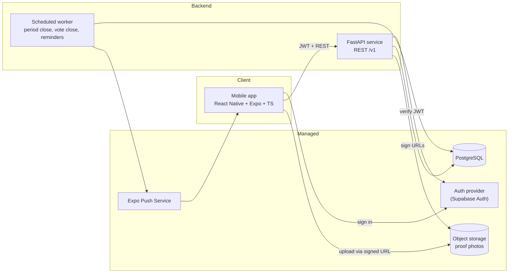

# Socius — High-Level Design

| | |
|---|---|
| **Status** | Draft v0.1 |
| **Authors** | Shreyas Vaid |
| **Last updated** | 2026-11-10 |
| **Audience** | Contributors |

> How Socius is built. What it does and why lives in the [product requirements](product-requirements.md) (PRD); requirement IDs (`FR-x`, `G-x`, `Q-x`) refer to that document. Significant decisions get an ADR in `docs/adr/`; feature-level detail goes in a spec in `docs/specs/`. When implementation proves part of this wrong, update the doc in the same PR.

---

## 1. Scope

This document covers system architecture, the tech stack, time handling, the data model, the API surface, background jobs, quality strategy, and privacy enforcement. Product behavior (scoring rules, rest days, privacy rules) is defined in the PRD and only referenced here.

---

## 2. Architecture



Key properties:

- **The mobile app only talks to the FastAPI service** (plus auth and signed-URL uploads). It never queries the database directly. All business rules live in one place.
- **Typed contract:** FastAPI emits an OpenAPI schema → `packages/api-client` generates TypeScript types and a client. CI fails if the generated client is stale.
- **Domain core is pure Python** (scoring, vote resolution, period math, calorie math), with no I/O, so it's trivially testable. API and jobs are thin layers around it.
- **Time:** all timestamps stored in UTC; all period/day boundaries computed in the group's IANA time zone.

### 2.1 Tech stack

| Layer | Choice | Main alternative | Rationale |
|---|---|---|---|
| Mobile | React Native + Expo (TypeScript), Expo Router | Swift/SwiftUI | Cross-platform is a hard requirement; one codebase |
| Client server-state | TanStack Query | Redux | Mostly server state; caching/refetch with little boilerplate |
| API | Python, FastAPI, Pydantic v2 | Node/TS | Gives the backend real weight; auto OpenAPI |
| ORM / migrations | SQLAlchemy 2.x + Alembic | raw SQL | Typed models, versioned migrations |
| Database | PostgreSQL | Firestore | Relational data: groups, members, sessions, votes |
| Auth | Supabase Auth (JWT verified in FastAPI) | Clerk / roll our own | Rolling our own is a time sink and a security risk |
| Storage | Supabase Storage or Cloudflare R2 (S3 API) | DB blobs | Cheap, standard, signed URLs |
| Jobs | Cron-triggered worker, idempotent | Celery/queue | Simplest thing that works at this scale |
| Push | Expo Push Notifications | FCM/APNs direct | One API, both platforms |
| Hosting | Fly.io / Render / Railway (API); managed Postgres | AWS | Least ops; check current free tiers |
| Python tooling | uv, ruff, pyright/mypy, pytest, Hypothesis | pip/poetry | Fast, modern, strict |
| JS tooling | pnpm workspaces, ESLint, Prettier, tsc, Jest + RNTL | npm/yarn | Workspaces for the monorepo |
| E2E | Maestro (later) | Detox | Far simpler setup |
| CI | GitHub Actions | — | Lint, types, tests, client-staleness check on every PR |
| Builds | Expo cloud builds (EAS) → TestFlight / APK | local Xcode only | Reproducible builds |

Each row with a non-obvious choice gets an ADR (§9).

---

## 3. Time zones

- Each group has one IANA time zone, set by the owner at creation (default: owner's device zone).
- Session dates, check-in windows, vote deadlines, and period boundaries are all computed in the **group** time zone.
- Members in other zones see times converted to local, with the group zone labeled.
- DST: use timezone-aware arithmetic (`zoneinfo`); property tests cover DST transitions.

---

## 4. Data model (initial)

```
users              id, auth_provider_id, display_name, created_at, deleted_at
profiles           user_id (PK/FK), dob, goal, formula_sex, height_cm, weight_kg,
                   activity_level, target_rate, body_fat_pct          -- private
groups             id, name, owner_id, timezone, period_days, skip_tokens_per_period,
                   punishment_text, created_at
group_schedules    id, group_id, training_weekdays (int[]), session_minutes,
                   effective_from_period_id
group_members      group_id, user_id, role (owner|member), joined_at, left_at
invites            id, group_id, code, created_by, expires_at, revoked_at
periods            id, group_id, starts_at, ends_at, status (open|closing|closed),
                   punishment_snapshot
sessions           id, group_id, period_id, date, status (scheduled|rest_preset|rest_voted)
check_ins          id, user_id, date, created_at, note                -- per user per date
check_in_photos    id, check_in_id, storage_key, created_at
skip_token_uses    id, user_id, group_id, period_id, date
rest_proposals     id, group_id, date, proposed_by, closes_at, status (open|passed|failed)
rest_votes         proposal_id, user_id, vote (yes|no), created_at
period_results     period_id, user_id, scheduled, completed, adherence, is_exempt, is_loser
push_tokens        id, user_id, token, platform, created_at
notification_prefs user_id, category, enabled
-- v0.2+
calorie_targets    user_id, effective_from, kcal, protein_g, carbs_g, fat_g
food_entries       id, user_id, eaten_at, name, kcal, protein_g, carbs_g, fat_g, source (manual|photo)
```

Notes:

- `check_ins` is keyed by **user + date, not group**. That's what lets one workout count in every group ([PRD FR-15](product-requirements.md#53-check-ins-v01)) without duplicate rows.
- Uniqueness: `(user_id, date)` on check-ins; `(group_id, date)` on sessions and open proposals; `(proposal_id, user_id)` on votes.
- `period_results` is written once at period close; it is the source of truth for history.

---

## 5. API sketch (`/v1`)

```
GET    /me                                  PATCH /me
GET    /me/profile                          PUT   /me/profile
DELETE /me                                  (account deletion)

POST   /groups                              GET   /groups
GET    /groups/{id}                         PATCH /groups/{id}
POST   /groups/{id}/invites                 POST  /invites/{code}/accept
DELETE /groups/{id}/members/{userId}

GET    /groups/{id}/schedule                PUT   /groups/{id}/schedule   (applies next period)
GET    /groups/{id}/periods/current         GET   /groups/{id}/periods/{pid}/results

POST   /check-ins                {date}     DELETE /check-ins/{id}
POST   /check-ins/{id}/photos    → signed upload URL
GET    /groups/{id}/feed          (check-ins + results for the group)

POST   /groups/{id}/rest-proposals {date}
POST   /rest-proposals/{id}/votes  {vote}

POST   /groups/{id}/skip-tokens    {date}

POST   /push-tokens                         PUT /me/notification-prefs
```

Errors follow RFC 9457 (problem+json). Times in ISO 8601 with offsets; dates as `YYYY-MM-DD` in group zone.

---

## 6. Background jobs

All jobs are **idempotent** and safe to run more often than needed.

| Job | Cadence | Does |
|---|---|---|
| `close_votes` | every 5 min | Resolve proposals past `closes_at`; flip sessions; notify |
| `close_periods` | every 15 min | For periods whose final grace window has ended: compute results with the domain scorer, write `period_results`, open the next period, materialize its sessions, notify |
| `send_reminders` | every 15 min | Check-in and vote reminders per user prefs and local time |
| `purge_photos` | daily | Enforce photo retention |

---

## 7. Quality strategy

### 7.1 Testing

| Layer | Tooling | Focus |
|---|---|---|
| Domain (Python) | pytest + **Hypothesis** | Scoring, ties, joins mid-period, skip tokens, vote resolution, DST and time-zone edges. Target: near-100% branch coverage |
| API (Python) | pytest + httpx + real Postgres (CI service container) | AuthZ ([PRD §9](product-requirements.md#9-privacy-and-visibility) privacy table as tests), validation, idempotency |
| Mobile | Jest + React Native Testing Library | Screens, hooks, form validation |
| Contract | CI check | Generated TS client matches current OpenAPI |
| E2E (later) | Maestro | Onboarding → create group → check in → see result |

### 7.2 CI (GitHub Actions, every PR)

- Python: `ruff check`, `ruff format --check`, type check, `pytest`.
- JS: `eslint`, `prettier --check`, `tsc --noEmit`, `jest`.
- OpenAPI client freshness check.
- `main` is protected: PR + green CI required.

### 7.3 Environments

- `local`: Docker Compose Postgres + API; Expo dev client.
- `staging`: deployed on merge to `main`; TestFlight/internal builds point here.
- `prod`: once there are real users beyond the test group.

Secrets via host secret managers; never committed. `.env.example` documents required variables.

---

---

## 8. Privacy enforcement

The visibility rules are in [PRD §9](product-requirements.md#9-privacy-and-visibility). They are enforced as follows:

Enforcement: authorization checks live in the API layer and are covered by tests. Every endpoint touching profile/food data asserts `resource.user_id == caller`. Photos are served via short-lived signed URLs scoped to the caller's group membership.

Retention: proof photos deleted after 30 days ([PRD Q9](product-requirements.md#12-open-questions)). Account deletion hard-deletes profile, food, and photos; check-ins are anonymized so historical group results stay consistent.

---

## 9. Architecture Decision Records (planned)

| ADR | Decision | Status |
|---|---|---|
| 0001 | Use lightweight spec-driven development (design doc → specs → ADRs) | Accepted |
| 0002 | React Native + Expo over native Swift | Accepted |
| 0003 | FastAPI backend instead of BaaS-only (mobile never hits DB directly) | Accepted |
| 0004 | Supabase for Auth/Postgres/Storage hosting vs alternatives | Proposed |
| 0005 | Monorepo with pnpm + uv; OpenAPI-generated TS client | Accepted |
| 0006 | Adherence-based, workout-only scoring; honor system | Accepted |

---

---

## 10. Repository layout

```
socius/
├── apps/
│   └── mobile/                 # Expo app (TypeScript)
├── services/
│   └── api/                    # FastAPI service
│       ├── src/socius_api/
│       │   ├── domain/         # pure logic: scoring, votes, periods, calories
│       │   ├── api/            # routers, schemas
│       │   ├── db/             # models, repositories, migrations
│       │   └── jobs/
│       └── tests/
├── packages/
│   └── api-client/             # generated TS client + types
├── docs/
│   ├── product-requirements.md  # what and why
│   ├── high-level-design.md     # how (this file)
│   ├── adr/
│   └── specs/
├── .github/workflows/
├── CLAUDE.md
├── README.md
└── LICENSE
```

---
