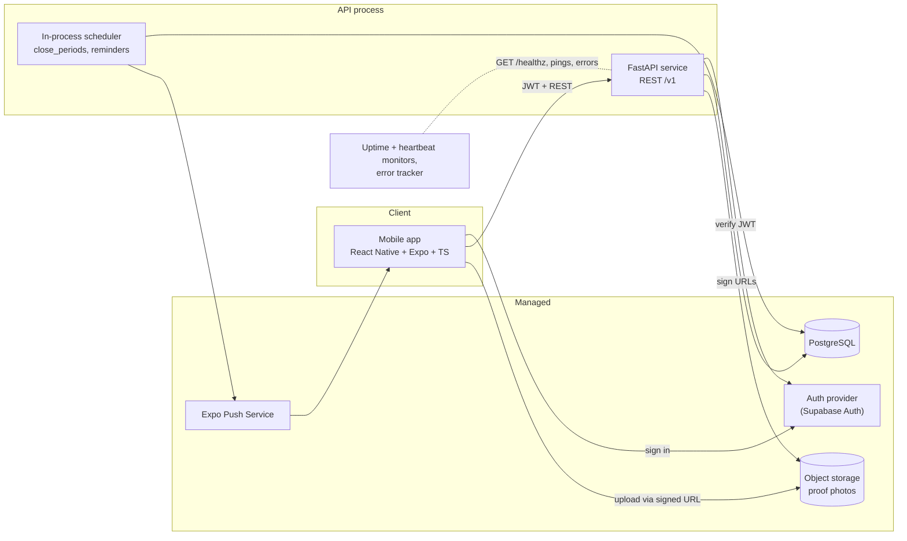

# Socius — High-Level Design

| | |
|---|---|
| **Status** | Draft v0.2 |
| **Authors** | Shreyas Vaid |
| **Last updated** | 2026-11-11 |
| **Audience** | Contributors |

> How Socius is built. What it does and why lives in the [product requirements](product-requirements.md) (PRD); requirement IDs (`FR-10`, and goals and questions such as `G1` and `Q5`) refer to that document; the engine design numbers its own goals G1–G7, so this document always says "engine design G1" for those. The game engine (scoring, periods, the close job, its data model and API) is designed in detail in [`designs/game-engine.md`](designs/game-engine.md); this document links to it instead of restating it. Significant decisions get an ADR in [`adr/`](adr/); feature-level detail goes in a spec in `specs/`. When implementation proves part of this wrong, update the doc in the same PR.

---

## 1. Scope

This document covers the system as a whole: architecture, tech stack, time handling, the data model, the API surface, background jobs, quality strategy, and privacy enforcement. For the game engine it gives a summary and a link; the engine design is the source of truth there.

---

## 2. Architecture



The game engine's own components (the close function, its two triggers, monitoring) are drawn in the [engine design's Components section](designs/game-engine.md#components).

Key properties:

- **The mobile app only talks to the FastAPI service** (plus auth and signed-URL uploads). It never queries the database directly. All business rules live in one place.
- **Typed contract:** FastAPI emits an OpenAPI schema → `packages/api-client` generates TypeScript types (openapi-typescript) and a typed fetch client (openapi-fetch). CI fails if the generated client is stale, and Schemathesis checks the API against its schema.
- **Domain core is pure Python** (scoring, period math, calorie math), with no I/O and no clock access, so it can be property-tested on its own. The API and the scheduled job are thin layers around it.
- **Time:** all timestamps stored in UTC. Each group has a time zone and admin-set periods of whole days that end at midnight in that zone; a check-in counts in the period open when the server receives it. Details: [Time model](designs/game-engine.md#time-model).

### 2.1 Tech stack

| Layer | Choice | Main alternative | Rationale |
|---|---|---|---|
| Mobile | React Native + Expo (TypeScript), Expo Router | Swift/SwiftUI | Cross-platform is a hard requirement; one codebase |
| Client server-state | TanStack Query, hooks written by hand around one key factory | Redux | Mostly server state; caching/refetch with little boilerplate |
| API client | openapi-typescript + openapi-fetch | hey-api, orval | Small generated output; requests visible in plain code ([D3](designs/game-engine.md#d3-options-decided-a)) |
| API | Python, FastAPI, Pydantic v2 | Node/TS | Gives the backend real weight; auto OpenAPI |
| ORM / migrations | SQLAlchemy 2.x (synchronous, psycopg 3) + Alembic | async SQLAlchemy, raw SQL | Typed models, versioned migrations; sync keeps the job and concurrency tests simple (D4) |
| Database | PostgreSQL 17 | Firestore | Relational data: groups, members, check-ins, results. Version 17 for `transaction_timeout` |
| Auth | Supabase Auth (JWT verified in FastAPI; proposed, ADR-0004) | Clerk / roll our own | Rolling our own is a time sink and a security risk |
| Storage | Supabase Storage or Cloudflare R2 (S3 API) | DB blobs | Cheap, standard, signed URLs |
| Jobs | APScheduler inside the API process, plus close on read; idempotent | host cron, external scheduler | One deployable service; results correct even if the scheduler sleeps ([D2](designs/game-engine.md#d2-options-decided-b-plus-close-on-read)) |
| Push | Expo Push Notifications | FCM/APNs direct | One API, both platforms |
| Monitoring | Error tracker (Sentry), uptime monitor, heartbeat monitor | none | A missed close must be noticed |
| Hosting | Render free web service (API), kept awake by an uptime ping; Postgres hosted separately (Supabase or Neon) | Fly.io (no free tier for new organizations), Railway (trial, then $1/month credit), AWS | Least ops at no cost; Render's free Postgres expires after 30 days. [Details](designs/game-engine.md#the-close) |
| Python tooling | uv, ruff, pyright (strict), pytest, Hypothesis, Schemathesis | pip/poetry, mypy | Fast, modern, strict |
| JS tooling | pnpm workspaces, ESLint, Prettier, tsc, Jest + RNTL | npm/yarn | Workspaces for the monorepo |
| Task runner | `just` (root `justfile`) | Make, Bazel, Nx, Turborepo | One command per task for humans and CI; sized to three packages |
| E2E | Maestro (later) | Detox | Far simpler setup |
| CI | GitHub Actions | — | Lint, types, tests, client-staleness check on every PR |
| Builds | Expo cloud builds (EAS) → TestFlight / APK | local Xcode only | Reproducible builds |

Each row with a non-obvious choice has an ADR in [`adr/`](adr/).

---

## 3. Time

Each group stores an IANA time zone. Its periods are a whole number of days, back to back, each ending at midnight in that zone (so daylight-saving changes are followed). A check-in is a single server timestamp and counts in every group whose period contains it. Code never reads the clock directly: a `Clock` is injected so tests (and staging, via `FAKE_NOW`) can control time.

Full model: [Time model](designs/game-engine.md#time-model).

---

## 4. Data model

The game-engine tables (`groups`, `group_settings`, `periods`, `period_member_results`, `memberships`, `check_ins`, `excusals`, `push_tokens`, `notification_outbox`, `job_runs`) are defined in the [engine design's data model](designs/game-engine.md#data-model-game-engine-only). The other tables:

```
users              id, auth_provider_id, display_name, created_at, deleted_at
profiles           user_id (PK/FK), dob, goal, formula_sex, height_cm, weight_kg,
                   activity_level, target_rate, body_fat_pct          -- private
invites            id, group_id, code, created_by, expires_at, revoked_at   -- spec 0001
check_in_photos    id, check_in_id, storage_key, created_at
notification_prefs user_id, category, enabled, reminder_local_time   -- default 19:00
-- v0.2+
calorie_targets    user_id, effective_from, kcal, protein_g, carbs_g, fat_g
food_entries       id, user_id, eaten_at, name, kcal, protein_g, carbs_g, fat_g, source (manual|photo)
```

Notes:

- `check_ins` belong to a **user, not a group**, and are matched to each group's periods by time. That's what lets one workout count in every group ([PRD FR-15](product-requirements.md#53-check-ins-v01)) without duplicate rows.
- The check-in and excusal tables use `recorded_at` (server time) and `removed_at` (undo, revoke) instead of deleting rows.
- Reminders use `notification_prefs.reminder_local_time` and the phone's current zone, stored on `push_tokens.tz_name` (private).
- A period's result is written once at close, on the `periods` row and in `period_member_results`; they are the source of truth for history.

---

## 5. API sketch (`/v1`)

The game endpoints and their rules and error codes are in the engine design's [Request rules](designs/game-engine.md#request-rules-api). Overview:

```
GET    /me                                  PATCH /me
GET    /me/profile                          PUT   /me/profile
DELETE /me                                  (account deletion)
POST   /push-tokens                         PUT   /me/notification-prefs

POST   /groups                              GET   /groups              (spec 0001)
GET    /groups/{id}                         PATCH /groups/{id}         (spec 0001)
POST   /groups/{id}/invites                 POST  /invites/{code}/accept  (spec 0001)
DELETE /groups/{id}/members/{userId}        (admin only; spec 0001)

POST   /check-ins                           DELETE /check-ins/{id}
POST   /check-ins/{id}/photos    → signed upload URL

GET    /groups/{id}/periods/current                    (live; closes on read if due)
GET    /groups/{id}/periods/{seq}                      (live or final; closes on read if due)
PUT    /groups/{id}/periods/{seq}/excusals/{userId}    DELETE (revoke)
GET    /groups/{id}/settings                PUT   /groups/{id}/settings  (applies next period)
```

Outside `/v1`: `GET /healthz` (no auth; the keep-alive target).

Errors follow RFC 9457 (problem+json) with stable codes. Timestamps in ISO 8601 UTC; the app converts them to the member's local time for display.

---

## 6. Background jobs

All jobs are **idempotent** and safe to run more often than needed. They run inside the API process via APScheduler.

| Job | Cadence | Does |
|---|---|---|
| `close_periods` | every 5 min | Open each group's current period, close due periods, rescore recently closed periods to detect late writes, count overdue periods, send queued notifications, ping the heartbeat monitor. [Details](designs/game-engine.md#the-close) |
| `send_reminders` | every 15 min | Check-in reminders per user prefs, in each phone's current time zone |
| `purge_photos` | daily | Enforce photo retention |

Periods are also closed on read: a request for a due period with no result runs the same close inline.

---

## 7. Quality strategy

### 7.1 Testing

The game engine's testing approach and its numbered invariants are in the [engine design](designs/game-engine.md#testing-approach). Across the system:

| Layer | Tooling | Focus |
|---|---|---|
| Domain (Python) | pytest + **Hypothesis** | Every written invariant has a named test of the type the engine design gives (property tests for the pure rules); every user journey has an example test. Coverage is reported, not gated |
| API (Python) | pytest + httpx + real Postgres (CI service container), fake clock | AuthZ ([PRD §9](product-requirements.md#9-privacy-and-visibility) privacy table as tests), validation, safe retries |
| Close job | Real Postgres, fake clock, two connections | Same result on every rerun, including concurrent runs |
| Mobile | Jest + React Native Testing Library | Screens, hooks, error messages |
| Contract | CI check + Schemathesis | Generated TS client matches the OpenAPI schema; API responses match it |
| E2E (later) | Maestro | Onboarding → create group → check in → see result |

Rules: business logic never calls `datetime.now()` or uses database `now()`; time comes from the injected `Clock`.

### 7.2 CI (GitHub Actions, every PR)

All steps call `just` recipes, so CI and local runs are the same commands.

- `just lint`: `ruff check`, `ruff format --check`, `eslint`, `prettier --check`.
- `just typecheck`: pyright (strict), `tsc --noEmit`.
- `just test`: pytest (including Schemathesis) and Jest.
- `just check-client`: regenerate the API client and fail on any diff.
- `main` is protected: PR + green CI required.

### 7.3 Environments

- `local`: Docker Compose Postgres + API; Expo dev client.
- `staging`: deployed on merge to `main`; TestFlight/internal builds point here. `FAKE_NOW` may be set here to test the close; startup refuses it in production. A free tier covers one always-on service, so staging is started when needed rather than always on.
- `prod`: once there are real users beyond the test group.

Secrets via host secret managers; never committed. `.env.example` documents required variables.

---

## 8. Privacy enforcement

The visibility rules are in [PRD §9](product-requirements.md#9-privacy-and-visibility). They are enforced as follows:

- Authorization checks live in the API layer and are covered by tests. Every endpoint touching profile or food data asserts `resource.user_id == caller`.
- Every group endpoint returns 404 to non-members, so it doesn't reveal that the group exists. Admin actions also check the admin role.
- The phone's time zone (`push_tokens.tz_name`, stored for reminders) is never included in any response.
- Photos are served via short-lived signed URLs, only to members of the groups the check-in counted in.

Retention: proof photos deleted after 30 days ([PRD Q9](product-requirements.md#12-open-questions)). Account deletion hard-deletes profile, food, and photos; check-ins are anonymized so historical group results stay consistent.

---

## 9. Architecture Decision Records

See [`adr/`](adr/). Each ADR is one decision with its options and consequences; superseded ADRs are kept and linked to their replacement.

---

## 10. Repository layout

```
socius/
├── apps/
│   └── mobile/                 # Expo app (TypeScript)
├── services/
│   └── api/                    # FastAPI service
│       ├── src/socius_api/
│       │   ├── domain/         # pure logic: scoring, periods, calories
│       │   ├── api/            # routers, schemas
│       │   ├── db/             # models, repositories
│       │   ├── jobs/           # scheduled job + scheduler
│       │   └── close.py        # shared close function
│       ├── migrations/         # Alembic
│       └── tests/
├── packages/
│   └── api-client/             # generated TS types + typed client
├── docs/
│   ├── product-requirements.md  # what and why
│   ├── high-level-design.md     # how (this file)
│   ├── designs/                 # designs spanning several features
│   ├── adr/
│   └── specs/
├── docker/                      # Postgres init scripts
├── .github/workflows/
├── justfile
├── pnpm-workspace.yaml
├── docker-compose.yml
├── CLAUDE.md
├── README.md
└── LICENSE
```
